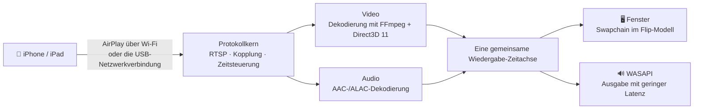

<div align="center">


# MirrorDock

**Spiegeln Sie Ihr iPhone oder iPad auf einen Windows-PC – über Wi-Fi oder das USB-Kabel.**

[](https://github.com/bestkakkoii/MirrorDock/releases/latest)
[](https://github.com/bestkakkoii/MirrorDock/releases)
[](https://github.com/bestkakkoii/MirrorDock/releases/latest)
[](README_AI.md)
[](LICENSE)
[](https://github.com/bestkakkoii/MirrorDock/stargazers)

[English](README.md) · [繁體中文](README.zh-TW.md) · [简体中文](README.zh-CN.md) · [日本語](README.ja.md) · [한국어](README.ko.md) · [Español](README.es.md) · **Deutsch** · [Français](README.fr.md) · [Tiếng Việt](README.vi.md) · [ไทย](README.th.md)

</div>

---

MirrorDock ist ein AirPlay-Empfänger für Windows. Wählen Sie ihn auf dem iPhone unter *Bildschirmsynchronisierung* aus, und schon erscheinen Bild und Ton des Smartphones auf dem PC – in einem Fenster, das sich wie ein Mediaplayer verhält. Das Programm besteht aus einer einzigen `mirror_dock.exe`: kein Installationsprogramm, kein GStreamer, kein Bonjour-Dienst, keine Laufzeitumgebung, die erst eingerichtet werden müsste.

Es baut auf dem AirPlay-Protokollkern von [UxPlay](https://github.com/FDH2/UxPlay) auf und bringt eine eigens für Windows geschriebene Medien-Engine mit (Direct3D 11, FFmpeg, WASAPI). Bis Version 1.6 wurde es unter dem Namen *UxPlay for Windows (native)* veröffentlicht.

## ✨ Highlights

| | |
|---|---|
| 📶 **Spiegelung über Wi-Fi** | Smartphone und PC im selben Netzwerk – auf keinem der beiden Geräte muss etwas installiert werden. |
| 🔌 **Spiegelung über das USB-Kabel** | Ist *Persönlicher Hotspot* aktiviert, läuft AirPlay über das Ladekabel: lokal, stabil und ohne mobile Daten zu verbrauchen. |
| 🎬 **Scharfes, flüssiges Bild** | H.265 / H.264 wird auf der GPU dekodiert, an der Ihr Monitor hängt (Intel, AMD oder NVIDIA), ohne Umkopieren angezeigt und im Takt des Bildschirms ausgegeben. Schafft die GPU das nicht, springt die Software-Dekodierung ein. |
| 🔊 **Ton synchron zum Bild** | WASAPI-Ausgabe mit geringer Latenz auf derselben Zeitachse wie das Bild – Lippenbewegung und Stimme passen zusammen. |
| 🎛️ **Drei Modi** | *Qualität*, *Ausgewogen* (Standard) und *Leistung*: Sie entscheiden zwischen dem schärfsten Bild und der geringsten Verzögerung. |
| ✂️ **Schwarze Balken abschneiden** | Schneidet die schwarzen Balken rund um einen Film automatisch ab – oder Sie rahmen mit der Maus einen beliebigen Teil des Bildes ein. |
| 🪟 **Ein richtiges Fenster** | Öffnet sich in sinnvoller Größe, behält beim Ändern der Größe das Seitenverhältnis bei, merkt sich Größe und Position, Vollbild per Tastendruck, immer im Vordergrund. |
| 🌐 **Zehn Sprachen** | Die Oberfläche richtet sich nach Ihrer Windows-Anzeigesprache. |
| 🧳 **Eine einzige Datei** | Eine einzelne ausführbare Datei von rund 10 MB, die nichts außer Windows selbst benötigt. |

## 🚀 Schnellstart

1. Laden Sie `mirror_dock_win64.zip` unter [Releases](https://github.com/bestkakkoii/MirrorDock/releases/latest) herunter und entpacken Sie die Datei an einem beliebigen Ort.
2. Starten Sie `mirror_dock.exe`. Fragt die Windows-Firewall nach, wählen Sie **Zulassen** (ein Heimnetzwerk ist ein *privates* Netzwerk).
3. Auf dem iPhone: **Kontrollzentrum → Bildschirmsynchronisierung → MirrorDock@Ihr-PC**.

Das Programm sitzt im Infobereich (neben der Uhr). Das Videofenster erscheint, sobald sich das Smartphone verbindet; wenn Sie es schließen, endet nur diese Sitzung, und mit **Beenden** im Menü beenden Sie das Programm.

> [!TIP]
> Voraussetzungen: Windows 10 oder 11 (x64) und eine GPU mit Direct3D 11. Fehlt sie, kommt der integrierte Software-Renderer zum Einsatz.

## 🔌 Spiegelung über das USB-Kabel

1. Installieren Sie einmalig den USB-Treiber von Apple: Führen Sie `install_apple_usb_support.cmd` aus dem ZIP-Archiv aus oder installieren Sie **Apple-Geräte** aus dem Microsoft Store.
2. Aktivieren Sie auf dem iPhone **Einstellungen → Persönlicher Hotspot → Zugriff für andere erlauben** und schließen Sie dann das Kabel an.
3. Wählen Sie MirrorDock unter *Bildschirmsynchronisierung* aus. Die Steuerleiste zeigt **USB** oder **Wi-Fi** an – je nachdem, welche Verbindung gerade genutzt wird.

- **USB bevorzugen / Nur Wi-Fi** schaltet die Verbindung um, ohne das USB-Gerät anzutasten; das Smartphone lädt also weiter. *Nur Wi-Fi* wird konsequent durchgesetzt: Eine Verbindung, die trotzdem über das Kabel ankommt, wird abgewiesen.
- **Ihre mobilen Daten sind sicher.** Die Spiegelung selbst läuft lokal. Sollte Windows den eigenen Internetverkehr des PCs über das Smartphone leiten, bemerkt MirrorDock das und bietet an, es mit einem Klick zu beheben (**Mobile Daten sparen**).

## 🎛️ Modi

| Modus | Was er bewirkt | Geeignet für |
|---|---|---|
| **Qualität** | Volle Auflösung, etwas mehr Pufferung, kein Einzelbild wird übersprungen. | Filme, Folien, Text |
| **Ausgewogen** *(Standard)* | Passt sich an Monitor, GPU und Netzwerk an. | Alltag |
| **Leistung** | Ein schlankerer Stream (bis 1920×1080), minimale Pufferung, immer das neueste Einzelbild. | Spiele, ältere PCs |

Den Modus wählen Sie im Menü oder mit `-mode`. Das Zeitverhalten ändert sich sofort, die Stream-Auflösung ab der nächsten Verbindung.

## ✂️ Schwarze Balken abschneiden

Ein 16:9-Film auf einem Smartphone mit breiterem Display wird mit schwarzen Balken gespiegelt, weil das Smartphone stets seinen gesamten Bildschirm überträgt.

- **Automatisch** (Taste **C**): Die Balken werden abgeschnitten, und das Fenster schmiegt sich an das Bild. Der Zuschnitt bleibt erhalten, wenn auf einen Film der nächste folgt; erscheint in einem Balken etwas anderes und bleibt dort, etwa die Bedienelemente des Players, ist das ganze Bild innerhalb von etwa einer Sekunde wieder da.
- **Von Hand** (Taste **X**): Ziehen Sie einen Rahmen um den Teil, den Sie sehen möchten. **Esc** bricht ab.

## ⌨️ Tastatur und Maus

| Aktion | Tasten |
|---|---|
| Vollbild ein / aus | **F**, **F11**, **Alt+Enter** oder Doppelklick; **Esc** verlässt das Vollbild |
| Schwarze Balken automatisch abschneiden | **C** |
| Anzuzeigenden Bereich einrahmen | **X** |
| Immer im Vordergrund | **T** |
| Stummschalten (nur am PC) | **M** |
| Steuerleiste | Maus über das Bild bewegen |
| Menü | Rechtsklick an beliebiger Stelle im Bild |

## ⚙️ Optionen

Hängen Sie die Optionen an eine Verknüpfung mit `mirror_dock.exe` an oder schreiben Sie sie zeilenweise (ohne das führende `-`) in die Datei `%USERPROFILE%\.uxplayrc`. `mirror_dock.exe -h` listet alle Optionen auf.

| Option | Wirkung |
|---|---|
| `-n name` | Name, der auf dem iPhone angezeigt wird |
| `-fs` | Im Vollbild starten |
| `-mode quality\|balanced\|performance` | Worauf optimiert wird |
| `-crop auto\|off` | Schwarze Balken abschneiden / das ganze Bild zeigen |
| `-gpu auto\|integrated\|discrete\|software` | GPU für Dekodierung und Anzeige |
| `-h264` / `-h265` | Nur H.264 anbieten / H.265 immer anbieten |
| `-ui language` | Sprache der Oberfläche (siehe unten) |
| `-vsync ms` | Ton gegenüber dem Bild verschieben |
| `-pin`, `-pw` | PIN oder Passwort verlangen |

## 🌐 Sprachen

Die Oberfläche richtet sich nach der Windows-Anzeigesprache: English, 繁體中文, 简体中文, 日本語, 한국어, Español, Deutsch, Français, Tiếng Việt und ไทย. Bei jeder anderen Sprache erscheint sie auf Englisch. Eine bestimmte Sprache erzwingen Sie mit `-ui en|zh-TW|zh-CN|ja|ko|es|de|fr|vi|th`.

Benutzerhandbücher in allen zehn Sprachen liegen dem ZIP-Archiv bei (Ordner `user_guide`).

## 🧩 So funktioniert es



Bild und Ton werden auf einer gemeinsamen Zeitachse eingeplant. Die Verzögerung passt sich dabei dem Netzwerk und der Dekodiergeschwindigkeit des PCs an: so kurz wie möglich, ohne dass es ruckelt.

## 📊 Messwerte

Ein Notebook von 2016 (Intel Core i7-6700HQ, Intel HD Graphics 530), ein H.265-Teststream mit 2872×1320 und 60 fps, Modus *Ausgewogen*, Version 1.6:

| | |
|---|---|
| Angezeigte Einzelbilder des Teststreams | 480 von 480 |
| Verzögerung zwischen Ton und Bild im Normalbetrieb | etwa 18 ms |
| Arbeitsspeicher im Leerlauf | 46 MB |
| Beenden | 0,04 s |

Die Spiegelung über Wi-Fi und über USB wurde bis Version 1.5 mit einem iPhone 16 Pro Max (iOS 26) überprüft, und Version 1.7 ist mit diesem Smartphone über Wi-Fi gelaufen: Dessen Stream mit 3200×1536 belegte etwa 310 MB Arbeitsspeicher und 200 MB GPU-Speicher. In [CHANGELOG.md](CHANGELOG.md) steht für jede Version, was mit einem Smartphone getestet und was nur kompiliert wurde.

## ❓ Häufige Fragen

**Das iPhone zeigt meinen PC nicht an.**
Beide Geräte müssen sich im selben Netzwerk befinden, und die Windows-Firewall muss `mirror_dock.exe` zulassen. Wenn Sie Wi-Fi am iPhone aus- und wieder einschalten, wird die Liste aktualisiert.

**Das Kabel ist angeschlossen, aber die Spiegelung läuft weiterhin über Wi-Fi.**
Der persönliche Hotspot muss aktiviert sein, und als Verbindung muss *USB bevorzugen* gewählt sein. Die zweite Zeile des Menüs zeigt den Zustand der USB-Verbindung.

**Es ist kein Ton zu hören.**
Prüfen Sie zuerst die Lautsprecher-Schaltfläche in der Steuerleiste, dann den Lautstärkemixer von Windows.

**Lippenbewegung und Stimme passen nicht zusammen.**
Justieren Sie mit `-vsync` und einer Zahl in Millisekunden nach (positive Werte verzögern den Ton).

**Wo finde ich das Protokoll?**
Unter `%LOCALAPPDATA%\MirrorDock\mirror_dock.log` oder über **Protokolldatei öffnen** im Menü.

## 🛠️ Aus dem Quellcode bauen

MSYS2 CLANG64 (clang 23, libc++ mit dem Modul der C++26-Standardbibliothek, CMake 4.4, Ninja) und der Shader-Compiler des Windows SDK. FFmpeg, OpenSSL und libplist werden aus gepinnten Commits als statische Bibliotheken gebaut.

```sh
bash win_native/build_scripts/fetch_deps.sh <src_root>
MSYSTEM=CLANG64 bash -lc 'bash win_native/build_scripts/build_deps.sh <src_root> <prefix> libplist openssl ffmpeg'
MSYSTEM=CLANG64 bash -lc 'bash win_native/build_scripts/build_uxplay_native.sh <this_repo> <build_dir> <prefix> Release'
```

[README_AI.md](README_AI.md) dokumentiert die Architektur, die Invarianten, die gepinnten Build-Eingaben und den Stand der Verifizierung. [CHANGELOG.md](CHANGELOG.md) führt die Versionen auf.

## 📜 Lizenz

MirrorDock wird unter der **GNU General Public License v3** ([LICENSE](LICENSE)) verbreitet, weil es auf dem GPL-3.0-Code von UxPlay aufbaut. Die Windows-Medien-Engine in [`win_native/`](win_native) ist ein eigenständiges Werk unter der **MIT-Lizenz** ([win_native/LICENSE](win_native/LICENSE)). Das ZIP-Archiv der Veröffentlichung enthält die Lizenztexte aller mitgelieferten Bibliotheken sowie den vollständigen zugehörigen Quellcode.

## 🙏 Danksagungen

- [UxPlay](https://github.com/FDH2/UxPlay) von F. Duncanh und Mitwirkenden – der AirPlay-Server, auf dem MirrorDock aufbaut.
- [RPiPlay](https://github.com/FD-/RPiPlay) von Florian Draschbacher und [shairplay](https://github.com/juhovh/shairplay) von Juho Vähä-Herttua – aus diesen Projekten stammt der Protokollkern.
- playfair, llhttp, csrp, FFmpeg, OpenSSL und libplist.

AirPlay, iPhone und iPad sind Marken von Apple Inc. MirrorDock ist ein unabhängiges Open-Source-Projekt und steht in keiner Verbindung zu Apple.
