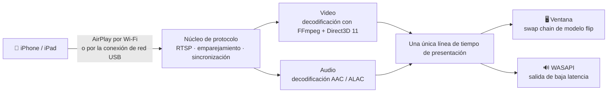

<div align="center">


# MirrorDock

**Duplique la pantalla de su iPhone o iPad en un equipo con Windows, por Wi-Fi o por el cable USB, y controle el iPhone con el mouse y el teclado.**

[](https://github.com/bestkakkoii/MirrorDock/releases/latest)
[](https://github.com/bestkakkoii/MirrorDock/releases)
[](https://github.com/bestkakkoii/MirrorDock/releases/latest)
[](README_AI.md)
[](LICENSE)
[](https://github.com/bestkakkoii/MirrorDock/stargazers)

[English](README.md) · [繁體中文](README.zh-TW.md) · [简体中文](README.zh-CN.md) · [日本語](README.ja.md) · [한국어](README.ko.md) · **Español** · [Deutsch](README.de.md) · [Français](README.fr.md) · [Tiếng Việt](README.vi.md) · [ไทย](README.th.md) · [Русский](README.ru.md)

</div>

---

MirrorDock es un receptor de AirPlay para Windows. Basta con elegirlo en *Duplicar pantalla* en el iPhone para que la imagen y el sonido del teléfono aparezcan en el equipo, en una ventana que se comporta como un reproductor multimedia. Es un único archivo, `mirror_dock.exe`: sin instalador, sin GStreamer, sin el servicio Bonjour y sin ningún entorno de ejecución que configurar.

Se basa en el núcleo del protocolo AirPlay de [UxPlay](https://github.com/FDH2/UxPlay), al que suma un motor multimedia escrito para Windows (Direct3D 11, FFmpeg, WASAPI). Hasta la versión 1.6 se publicaba como *UxPlay for Windows (native)*.

## ✨ Lo más destacado

| | |
|---|---|
| 📶 **Duplicación por Wi-Fi** | El teléfono y el equipo en la misma red, sin instalar nada en ninguno de los dos. |
| 🔌 **Duplicación por cable USB** | Con *Punto de acceso personal* activado, AirPlay funciona a través del cable de carga: en local, de forma estable y sin gastar datos móviles. |
| 🎬 **Imagen nítida y fluida** | H.265 / H.264 decodificado en la GPU que controla su monitor (Intel, AMD o NVIDIA), mostrado sin copias y al ritmo de la pantalla. Cuando la GPU no puede, la decodificación por software toma el relevo. |
| 🔊 **Sonido sincronizado** | Salida WASAPI de baja latencia en la misma línea de tiempo que la imagen, para que la voz coincida con los labios. |
| 🎛️ **Tres modos** | *Calidad*, *Equilibrado* (predeterminado) y *Rendimiento*: usted elige entre la imagen más nítida y el menor retardo. |
| ✂️ **Recorte de barras negras** | Recorta automáticamente las barras negras que rodean una película, o le permite encuadrar con el mouse cualquier parte de la imagen. |
| 🖱️ **Control del iPhone** | Haga clic, arrastre, desplácese y escriba sobre la imagen, y el teléfono hace lo mismo; mientras tanto, la imagen deja de esperar a sus marcas de tiempo y sigue a su mano antes. Viene integrado: sin programas auxiliares y sin jailbreak (iOS 27, cable USB, modo de desarrollador). |
| 🪟 **Una ventana como debe ser** | Se abre con un tamaño razonable, mantiene la relación de aspecto al redimensionarla, recuerda el tamaño y la posición, pasa a pantalla completa con una tecla y puede quedar siempre visible. |
| 📸 **Capturas de pantalla** | **F9** guarda la imagen duplicada con la resolución completa del teléfono en un archivo PNG y la copia en el portapapeles. |
| 🌐 **Once idiomas** | La interfaz sigue el idioma para mostrar de Windows. |
| 🩺 **Conoce su equipo** | La ventana «Acerca de» comprueba lo que importa para la duplicación (GPU, controladores, red, firewall, la compatibilidad USB de Apple), lo puntúa, le dice qué arreglar y arregla lo que puede con solo pulsar un botón. |
| 🔄 **Actualización con un clic** | Le avisa cuando sale una versión nueva y la instala cuando usted lo pide. Cada versión va firmada y se comprueba antes de instalarla. |
| 🧳 **Un solo archivo** | Un único ejecutable de unos 12 MB que solo necesita el propio Windows. |

## 🚀 Inicio rápido

1. Descargue `mirror_dock_win64.zip` desde [Releases](https://github.com/bestkakkoii/MirrorDock/releases/latest) y descomprímalo en cualquier carpeta.
2. Ejecute `mirror_dock.exe`. Si el Firewall de Windows pregunta, elija **Permitir** (una red doméstica es una red *privada*).
3. En el iPhone: **Centro de control → Duplicar pantalla → MirrorDock@su-equipo**.

El programa permanece en el área de notificación (junto al reloj). La ventana de video aparece cuando el teléfono se conecta; al cerrarla termina esa sesión, y **Salir**, en el menú, cierra el programa.

> [!TIP]
> Requisitos: Windows 10 u 11 (x64) y una GPU compatible con Direct3D 11. Si no la hay, se usa el renderizador por software integrado.

## 🔌 Duplicación por el cable USB

1. Instale una sola vez el controlador USB de Apple: ejecute `install_apple_usb_support.cmd`, incluido en el zip, o instale **Dispositivos Apple** desde Microsoft Store.
2. En el iPhone, active **Ajustes → Punto de acceso personal → Permitir a otros conectarse** y, después, conecte el cable.
3. Elija MirrorDock en *Duplicar pantalla*. La barra de control muestra **USB** o **Wi-Fi**, según la conexión que se esté usando.

- **Preferir USB / Solo Wi-Fi** cambia de conexión sin tocar el dispositivo USB, de modo que el teléfono sigue cargándose. *Solo Wi-Fi* se cumple de verdad: si aun así llega una conexión por el cable, se rechaza.
- **Sus datos móviles están a salvo.** La duplicación en sí es local. Si Windows empieza a enviar por el teléfono el tráfico de Internet del propio equipo, MirrorDock lo detecta y ofrece una solución con un solo clic (**Ahorrar datos móviles**).

## 🎛️ Modos

| Modo | Qué hace | Ideal para |
|---|---|---|
| **Calidad** | Resolución completa, un poco más de búfer y ningún fotograma omitido. | Películas, presentaciones, texto |
| **Equilibrado** *(predeterminado)* | Se adapta al monitor, a la GPU y a la red. | Uso diario |
| **Rendimiento** | Una transmisión más ligera (hasta 1920×1080), búfer mínimo y siempre el fotograma más reciente. | Juegos, equipos antiguos |

Se elige en el menú o con `-mode`. El retardo se ajusta al instante; la resolución de la transmisión cambia a partir de la próxima conexión.

## ✂️ Recortar las barras negras

Una película en 16:9 vista en un teléfono de pantalla más ancha se duplica con barras negras, porque el teléfono duplica su pantalla entera.

- **Automático** (tecla **C**): las barras se recortan y la ventana se ajusta a la imagen. El recorte se mantiene al pasar de una película a la siguiente; cuando en una barra aparece otra cosa y permanece, por ejemplo los controles del reproductor, la imagen completa vuelve en aproximadamente un segundo.
- **A mano** (tecla **X**): arrastre un recuadro alrededor de la parte que quiere ver. **Esc** cancela.

## 🖱️ Controlar el iPhone

Presione **F8** (o elija **Controlar el iPhone con mouse y teclado** en el menú) y la imagen pasa a ser la pantalla del teléfono: lo que usted hace sobre ella, lo hace el iPhone.

| En el equipo | En el iPhone |
|---|---|
| Botón izquierdo: hacer clic, mantener presionado, arrastrar | Un dedo: tocar, mantener presionado, deslizar |
| Rueda del mouse (con **Shift**: en horizontal) | Desplaza lo que está bajo el puntero |
| Botón central | Ir a la pantalla de inicio |
| Doble clic | Activa o desactiva la pantalla completa, como siempre; con **Alt** pulsada: dos toques seguidos en el iPhone |
| Teclado | Escribe en el teléfono como un teclado conectado a él; **Ctrl** equivale a ⌘ y **Ctrl+Espacio** cambia el idioma del teclado del teléfono |
| **Page Down** / **Page Up**, **Alt** + teclas de flecha | Pasa a la página o al video siguiente o anterior con un deslizamiento rápido |
| Botón derecho | El menú de MirrorDock, como siempre |

Qué se necesita:

1. **iOS 27 o posterior** y el **cable USB**, en un iPhone que confíe en este equipo. Por el cable solo pasa el control; la imagen puede seguir llegando por Wi-Fi.
2. El **modo de desarrollador** activado en el iPhone: *Ajustes → Privacidad y seguridad → Modo de desarrollador*. Esa opción permanece oculta hasta que una herramienta de desarrollo la solicita, que es lo que hace MirrorDock la primera vez que usted presiona F8.
3. Conexión a Internet la primera vez, y la primera vez después de cada actualización de iOS: MirrorDock instala en el teléfono la imagen de disco de desarrollador de Apple (*Developer Disk Image*). Tarda alrededor de un minuto.

> [!NOTE]
> AirPlay no puede transmitir la entrada del mouse ni del teclado, así que el control va por otro camino: los servicios para desarrolladores de iOS, los mismos que Xcode usa para manejar un dispositivo real. Para instalarlos, MirrorDock descarga la imagen de Apple desde el repositorio [DeveloperDiskImage](https://github.com/doronz88/DeveloperDiskImage) y pide al servicio de firma de Apple (`gs.apple.com`) que la firme para su teléfono, con lo que Apple recibe los números de identificación de su chip, exactamente igual que con Xcode. A partir de ahí, el control no se comunica con nadie.

Mientras el control está activado, los comandos propios de la ventana tienen prioridad: **F8**, **F9**, **F11**, **Alt+Enter**, **Alt+F4**, **Esc** en pantalla completa y el doble clic siguen reservados a la ventana. En un doble clic, el primer clic ya ha llegado al teléfono como un toque cuando llega el segundo, así que haga doble clic en una barra negra si la hay, o pulse **F11**. La barra de control no aparece, porque taparía la parte inferior de la pantalla del teléfono.

**Menos retardo mientras controla.** El iPhone marca sus imágenes y su sonido con una hora algo posterior al momento en que llegan (las imágenes, unos 85 ms por Wi-Fi), y normalmente MirrorDock espera a esa hora. Con el control activado reproduce ambos en cuanto llegan a tiempo, siempre sincronizados entre sí, de modo que el efecto de un toque se ve antes. El cambio se hace de forma gradual en unos segundos, sin saltos en el sonido.

## ⌨️ Teclado y mouse

| Acción | Teclas |
|---|---|
| Activar o desactivar la pantalla completa | **F**, **F11**, **Alt+Enter** o doble clic; **Esc** para salir |
| Recortar barras negras automáticamente | **C** |
| Encuadrar el área visible | **X** |
| Siempre visible | **T** |
| Silenciar (solo en el equipo) | **M** |
| Captura de pantalla (archivo PNG y portapapeles) | **F9** |
| Activar o desactivar el control del iPhone | **F8** |
| Barra de control | Mueva el mouse sobre la imagen |
| Menú | Haga clic con el botón derecho en cualquier punto de la imagen |

Mientras se controla el iPhone, las teclas de letras escriben en el teléfono; **F8** se las devuelve a la ventana. Las capturas se guardan en la carpeta *MirrorDock* dentro de su carpeta *Imágenes*, con la fecha y la hora por nombre, al tamaño que envía el teléfono y no al de la ventana.

## 🔄 Actualizaciones

**Buscar actualizaciones…** en el menú pregunta a GitHub cuál es la versión más reciente y muestra la respuesta en la ventana «Acerca de». Cuando hay una más nueva, **Actualizar ahora** la descarga, la comprueba y la coloca en lugar del programa en ejecución, que después se reinicia solo; si hay una duplicación en curso, ese reinicio espera a que termine, o a que usted elija **Reiniciar ahora**. **Descargar** sigue abriendo el zip en el navegador por si prefiere descomprimirlo usted mismo, y **Novedades** abre las notas de la versión. No se instala nada si usted no lo pide.

- **Búsqueda automática.** Una vez al día, con una notificación cuando sale una versión nueva. Un interruptor en la ventana «Acerca de» la desactiva.
- **Qué se envía.** Una sola petición a `api.github.com`. GitHub ve su dirección IP y el nombre de cliente `MirrorDock/<version>`, y nada sobre usted ni sobre su equipo.
- **Sin gastar sus datos móviles.** No se hace ninguna búsqueda automática con una conexión que Windows marque como de uso medido, ni mientras la conexión a Internet del equipo pase por el iPhone.
- **Solo versiones auténticas.** Cada versión se firma con una clave que no está en Internet, y MirrorDock lleva su mitad pública. Un paquete cuya firma no encaja no se instala, venga de donde venga.

## 🩺 «Acerca de» y Este equipo

**Acerca de…** en el menú abre una ventana propia, con tres páginas:

| Página | Qué muestra |
|---|---|
| **Acerca de** | Versión y fecha de publicación, la búsqueda de actualizaciones y enlaces al proyecto, a la guía del usuario y a los textos de las licencias |
| **Este equipo** | Lo que importa a MirrorDock en su equipo, fila por fila: Windows, pantalla, alimentación, red, firewall, procesador, memoria, GPU y su decodificación de video, sonido, controlador gráfico, la compatibilidad USB de Apple y el iPhone conectado por cable |
| **Componentes** | Todas las bibliotecas y herramientas con las que está hecho MirrorDock, con versión, fecha y licencia, y cuándo se publicó cada versión de MirrorDock |

Cada fila de *Este equipo* se califica como correcta, con aviso o con problema. Una fila que no está bien dice qué hacer al respecto, y tiene un botón cuando MirrorDock puede hacerlo por usted: permitir el programa en el Firewall de Windows, iniciar el servicio de Apple, instalar la compatibilidad USB de Apple o abrir la página de la Configuración de Windows donde se resuelve el asunto. Lo que requiere derechos de administrador lo hacen las propias herramientas de Windows, tras el aviso de consentimiento habitual. La puntuación es la parte de las filas calificadas que están en orden, ponderada según lo que cada una importa para la duplicación (la decodificación de video por hardware es la que más cuenta). Indica lo bien preparado que está el equipo; no es una prueba de rendimiento. **Copiar informe** copia la página al portapapeles como texto sin formato, para un informe de errores. Nada de esta página sale de su equipo, y no se muestra ni se guarda ningún número de serie ni nombre de dispositivo.

## ⚙️ Opciones

Agregue las opciones a un acceso directo de `mirror_dock.exe`, o escríbalas una por línea (sin el `-` inicial) en `%USERPROFILE%\.uxplayrc`. `mirror_dock.exe -h` las muestra todas.

| Opción | Efecto |
|---|---|
| `-n name` | Nombre que se muestra en el iPhone |
| `-fs` | Iniciar en pantalla completa |
| `-mode quality\|balanced\|performance` | Qué se quiere priorizar |
| `-crop auto\|off` | Recortar las barras negras / mostrar la imagen completa |
| `-gpu auto\|integrated\|discrete\|software` | GPU usada para decodificar y mostrar la imagen |
| `-h264` / `-h265` | Ofrecer solo H.264 / ofrecer siempre H.265 |
| `-ui language` | Idioma de la interfaz (véase más abajo) |
| `-vsync ms` | Desplazar el sonido respecto a la imagen |
| `-pin`, `-pw` | Exigir un PIN o una contraseña |

## 🌐 Idiomas

La interfaz sigue el idioma para mostrar de Windows: English, 繁體中文, 简体中文, 日本語, 한국어, Español, Deutsch, Français, Tiếng Việt, ไทย y Русский. Con cualquier otro idioma se muestra en inglés. Para forzar uno, use `-ui en|zh-TW|zh-CN|ja|ko|es|de|fr|vi|th|ru`.

Las guías de usuario en los once idiomas están en el zip (carpeta `user_guide`).

## 🧩 Cómo funciona



La imagen y el sonido se programan sobre una misma línea de tiempo, con un retardo que se adapta a la red y a la velocidad con que el equipo decodifica: el más corto posible sin que la reproducción se entrecorte.

El control va por un segundo camino, independiente. Por el cable USB, MirrorDock abre el túnel para desarrolladores del teléfono (con una pequeña implementación propia de IPv6 y TCP, de modo que no hacen falta ni un adaptador de red ni permisos de administrador) y envía informes táctiles y de teclado al servicio de entrada del teléfono.

## 📊 Mediciones

Un equipo portátil de 2016 (Intel Core i7-6700HQ, Intel HD Graphics 530), una transmisión de prueba H.265 de 2872×1320 a 60 fps, modo *Equilibrado*, versión 1.6:

| | |
|---|---|
| Fotogramas mostrados de la transmisión de prueba | 480 de 480 |
| Retardo entre audio y video, ya estabilizado | unos 18 ms |
| Memoria en reposo | 46 MB |
| Cierre | 0.04 s |

La duplicación por Wi-Fi y por USB se verificó con un iPhone 16 Pro Max (iOS 26) hasta la versión 1.5, y la versión 1.7 ha funcionado con ese mismo teléfono por Wi-Fi: su transmisión de 3200×1536 ocupó unos 310 MB de memoria y 200 MB de memoria de GPU. [CHANGELOG.md](CHANGELOG.md) indica, para cada versión, qué se probó con un teléfono y qué solo se compiló.

## ❓ Preguntas frecuentes

**El iPhone no muestra mi equipo en la lista.**
Ambos deben estar en la misma red, y el Firewall de Windows debe permitir `mirror_dock.exe`. La página *Este equipo* de la ventana «Acerca de» indica si lo que estorba es el firewall o una red configurada como *pública*, y su botón permite MirrorDock en el firewall. Desactivar y volver a activar el Wi-Fi del iPhone actualiza la lista.

**El cable está conectado, pero la duplicación sigue usando Wi-Fi.**
Punto de acceso personal debe estar activado, y la conexión elegida debe ser *Preferir USB*. La segunda línea del menú muestra el estado de la conexión USB.

**No hay sonido.**
Revise el botón del altavoz en la barra de control y, después, el mezclador de volumen de Windows.

**La voz no coincide con los labios.**
Ajústelo con `-vsync` seguido de un número de milisegundos (los valores positivos retrasan el sonido).

**F8 dice que no se puede controlar el iPhone.**
El mensaje indica el motivo: el cable no está conectado o el iPhone no confía en este equipo, el modo de desarrollador está desactivado, el iPhone tiene un iOS anterior al 27, o no se pudo instalar la imagen de disco de desarrollador (ese paso necesita Internet). Después de activar el modo de desarrollador, el iPhone se reinicia y pide confirmación una vez más.

**¿Es seguro dejar activado el modo de desarrollador?**
Es una opción de la propia Apple, pensada para quienes crean apps. Permite que un equipo de confianza instale y depure apps y acceda a los servicios para desarrolladores; no le hace jailbreak al teléfono, y puede volver a desactivarla en el mismo lugar.

**¿MirrorDock usa Internet?**
La duplicación es local. MirrorDock solo se conecta a Internet para dos cosas: las actualizaciones (la búsqueda en GitHub una vez al día, que se puede desactivar, y la descarga de una versión cuando usted la pide) y, la primera vez que controla un iPhone, la imagen de disco de desarrollador de Apple y la firma de Apple para ella.

**¿Dónde está el registro?**
`%LOCALAPPDATA%\MirrorDock\mirror_dock.log`, o **Abrir archivo de registro** en el menú.

## 🛠️ Compilar desde el código fuente

MSYS2 CLANG64 (clang 23, libc++ con el módulo de la biblioteca estándar de C++26, CMake 4.4, Ninja) y el compilador de sombreadores del SDK de Windows. FFmpeg, OpenSSL y libplist se compilan como bibliotecas estáticas a partir de commits fijados; esos commits están en `win_native/build_scripts/build_inputs.tsv`, la lista que muestra la ventana «Acerca de». Una compilación propia que deba actualizarse desde versiones propias necesita una clave de firma propia: consulte `win_native/build_scripts/sign_release.ps1`.

```sh
bash win_native/build_scripts/fetch_deps.sh <src_root>
MSYSTEM=CLANG64 bash -lc 'bash win_native/build_scripts/build_deps.sh <src_root> <prefix> libplist openssl ffmpeg'
MSYSTEM=CLANG64 bash -lc 'bash win_native/build_scripts/build_uxplay_native.sh <this_repo> <build_dir> <prefix> Release'
```

[README_AI.md](README_AI.md) documenta la arquitectura, los invariantes, las dependencias fijadas y lo que se ha verificado. [CHANGELOG.md](CHANGELOG.md) recoge las versiones publicadas.

## 📜 Licencia

MirrorDock se distribuye bajo la **GNU General Public License v3** ([LICENSE](LICENSE)), porque se basa en el código GPL-3.0 de UxPlay. El motor multimedia para Windows de [`win_native/`](win_native) es una obra original bajo la **licencia MIT** ([win_native/LICENSE](win_native/LICENSE)); el control remoto de [`phone_control/`](phone_control) es una obra original bajo **GPL-3.0-or-later**. El zip de cada versión contiene los textos de las licencias de todas las bibliotecas incluidas y el código fuente correspondiente completo.

## 🙏 Agradecimientos

- [UxPlay](https://github.com/FDH2/UxPlay), de F. Duncanh y colaboradores: el servidor AirPlay sobre el que se construye MirrorDock.
- [RPiPlay](https://github.com/FD-/RPiPlay), de Florian Draschbacher, y [shairplay](https://github.com/juhovh/shairplay), de Juho Vähä-Herttua: de donde procede ese núcleo de protocolo.
- [pymobiledevice3](https://github.com/doronz88/pymobiledevice3), de doronz88 y colaboradores: de donde procede el conocimiento sobre los servicios para desarrolladores de iOS en el que se basa el control remoto.
- playfair, llhttp, csrp, FFmpeg, OpenSSL y libplist.

AirPlay, iPhone y iPad son marcas comerciales de Apple Inc. MirrorDock es un proyecto independiente de código abierto y no está afiliado a Apple.
