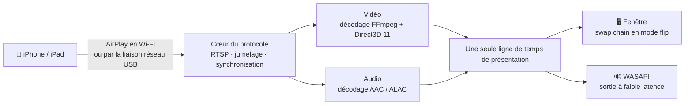

<div align="center">


# MirrorDock

**Recopiez l’écran de votre iPhone ou iPad sur un PC Windows, en Wi-Fi ou par le câble USB, et contrôlez l’iPhone à la souris et au clavier.**

[](https://github.com/bestkakkoii/MirrorDock/releases/latest)
[](https://github.com/bestkakkoii/MirrorDock/releases)
[](https://github.com/bestkakkoii/MirrorDock/releases/latest)
[](README_AI.md)
[](LICENSE)
[](https://github.com/bestkakkoii/MirrorDock/stargazers)

[English](README.md) · [繁體中文](README.zh-TW.md) · [简体中文](README.zh-CN.md) · [日本語](README.ja.md) · [한국어](README.ko.md) · [Español](README.es.md) · [Deutsch](README.de.md) · **Français** · [Tiếng Việt](README.vi.md) · [ไทย](README.th.md) · [Русский](README.ru.md)

</div>

---

MirrorDock est un récepteur AirPlay pour Windows. Choisissez-le dans *Recopie de l’écran* sur l’iPhone : l’image et le son du téléphone arrivent sur le PC, dans une fenêtre qui se comporte comme un lecteur multimédia. Le tout tient en un seul fichier, `mirror_dock.exe` : pas d’installeur, pas de GStreamer, pas de service Bonjour, aucun environnement d’exécution à mettre en place.

Il repose sur le cœur du protocole AirPlay d’[UxPlay](https://github.com/FDH2/UxPlay), associé à un moteur multimédia écrit pour Windows (Direct3D 11, FFmpeg, WASAPI). Jusqu’à la version 1.6, il était publié sous le nom *UxPlay for Windows (native)*.

## ✨ Points forts

| | |
|---|---|
| 📶 **Recopie en Wi-Fi** | Le téléphone et le PC sur le même réseau, rien à installer ni d’un côté ni de l’autre. |
| 🔌 **Recopie par câble USB** | Une fois le *Partage de connexion* activé, AirPlay passe par le câble de charge : c’est local, stable, et cela ne consomme pas de données mobiles. |
| 🎬 **Une image nette et fluide** | H.265 / H.264 décodés par le GPU qui pilote votre écran (Intel, AMD ou NVIDIA), affichés sans copie, au rythme de l’écran. Le décodage logiciel prend le relais quand le GPU n’en est pas capable. |
| 🔊 **Un son synchronisé** | Sortie WASAPI à faible latence, sur la même ligne de temps que l’image : les lèvres et la voix concordent. |
| 🎛️ **Trois modes** | *Qualité*, *Équilibré* (par défaut) et *Performances* : à vous de choisir entre l’image la plus nette et la latence la plus faible. |
| ✂️ **Rognage des bandes noires** | Supprime automatiquement les bandes noires autour d’un film, ou vous laisse cadrer à la souris n’importe quelle partie de l’image. |
| 🖱️ **Contrôle de l’iPhone** | Cliquez, faites glisser, faites défiler et tapez au clavier sur l’image : le téléphone fait de même ; pendant ce temps, l’image n’attend plus ses horodatages et suit votre main plus vite. Tout est intégré : ni programme auxiliaire ni jailbreak (iOS 27, câble USB, mode Développeur). |
| 🪟 **Une vraie fenêtre** | S’ouvre à une taille raisonnable, conserve les proportions quand vous la redimensionnez, mémorise sa taille et sa position, passe en plein écran d’une seule touche et peut rester toujours au premier plan. |
| 📸 **Captures d’écran** | **F9** enregistre l’image recopiée à la pleine résolution du téléphone dans un fichier PNG et la copie dans le presse-papiers. |
| 🌐 **Onze langues** | L’interface suit la langue d’affichage de Windows. |
| 🩺 **Connaît votre PC** | La fenêtre « À propos » vérifie ce qui compte pour la recopie de l’écran (GPU, pilotes, réseau, pare-feu, prise en charge USB d’Apple), l’évalue, vous dit quoi corriger et corrige ce qu’elle peut d’une simple pression sur un bouton. |
| 🔄 **Mise à jour en un clic** | Vous prévient quand une nouvelle version sort et l’installe quand vous le demandez. Chaque version est signée, et vérifiée avant d’être installée. |
| 🧳 **Un seul fichier** | Un exécutable unique d’environ 12 Mo, qui n’a besoin que de Windows. |

## 🚀 Démarrage rapide

1. Téléchargez `mirror_dock_win64.zip` depuis les [Releases](https://github.com/bestkakkoii/MirrorDock/releases/latest) et décompressez-le où vous voulez.
2. Lancez `mirror_dock.exe`. Si le Pare-feu Windows vous pose la question, choisissez **Autoriser** (un réseau domestique est un réseau *privé*).
3. Sur l’iPhone : **Centre de contrôle → Recopie de l’écran → MirrorDock@votre-PC**.

Le programme se loge dans la zone de notification (à côté de l’horloge). La fenêtre vidéo apparaît quand le téléphone se connecte ; la fermer met fin à cette session, et **Quitter**, dans le menu, arrête le programme.

> [!TIP]
> Configuration requise : Windows 10 ou 11 (x64) et un GPU Direct3D 11. À défaut, c’est le moteur de rendu logiciel intégré qui est utilisé.

## 🔌 Recopie par le câble USB

1. Installez une fois pour toutes le pilote USB d’Apple : lancez `install_apple_usb_support.cmd`, fourni dans le zip, ou installez **Appareils Apple** depuis le Microsoft Store.
2. Sur l’iPhone, activez **Réglages → Partage de connexion → Autoriser d’autres utilisateurs**, puis branchez le câble.
3. Choisissez MirrorDock dans *Recopie de l’écran*. La barre de contrôle indique **USB** ou **Wi-Fi**, selon la liaison utilisée.

- **USB en priorité / Wi-Fi uniquement** change de liaison sans toucher au périphérique USB : le téléphone continue donc de se charger. *Wi-Fi uniquement* est réellement appliqué : une connexion qui arriverait malgré tout par le câble est refusée.
- **Vos données mobiles ne risquent rien.** La recopie elle-même est locale. Si Windows se met à faire passer par le téléphone le trafic Internet du PC lui-même, MirrorDock s’en aperçoit et propose d’y remédier en un clic (**Économiser les données mobiles**).

## 🎛️ Modes

| Mode | Ce qu’il fait | Idéal pour |
|---|---|---|
| **Qualité** | Pleine résolution, un peu plus de mise en tampon, aucune image sautée. | Films, présentations, texte |
| **Équilibré** *(par défaut)* | S’adapte à l’écran, au GPU et au réseau. | Usage quotidien |
| **Performances** | Un flux allégé (jusqu’à 1920×1080), une mise en tampon minimale, toujours l’image la plus récente. | Jeux, PC anciens |

Choisissez le mode dans le menu ou avec `-mode`. La latence s’ajuste aussitôt ; la résolution du flux change à partir de la connexion suivante.

## ✂️ Rogner les bandes noires

Un film en 16:9 lu sur un téléphone à l’écran plus large est recopié avec des bandes noires, car le téléphone recopie la totalité de son écran.

- **Automatique** (touche **C**) : les bandes sont rognées et la fenêtre épouse l’image. Le rognage est conservé d’un film au suivant ; quand autre chose apparaît dans une bande et y reste, les commandes du lecteur par exemple, l’image entière revient en une seconde environ.
- **À la main** (touche **X**) : tracez un cadre autour de la partie que vous voulez voir. **Esc** annule.

## 🖱️ Contrôler l’iPhone

Appuyez sur **F8** (ou choisissez **Contrôler l’iPhone à la souris et au clavier** dans le menu) : l’image devient l’écran du téléphone, et ce que vous y faites, l’iPhone le fait.

| Sur le PC | Sur l’iPhone |
|---|---|
| Bouton gauche : cliquer, maintenir enfoncé, faire glisser | Un doigt : toucher, maintenir le doigt, balayer |
| Molette de la souris (avec **Shift** : horizontalement) | Fait défiler ce qui se trouve sous le pointeur |
| Bouton central | Retour à l’écran d’accueil |
| Double-clic | Active ou quitte le plein écran, comme toujours ; avec **Alt** enfoncée : toucher deux fois sur l’iPhone |
| Clavier | Écrit sur le téléphone, comme un clavier qui y serait branché ; **Ctrl** correspond à ⌘, **Ctrl+Espace** change la langue de saisie du téléphone |
| **Page Down** / **Page Up**, **Alt** + touches fléchées | Passe à la page ou à la vidéo suivante ou précédente d’un balayage rapide |
| Bouton droit | Le menu de MirrorDock, comme toujours |

Ce qu’il faut :

1. **iOS 27 ou version ultérieure** et le **câble USB**, sur un iPhone qui fait confiance à ce PC. Seul le contrôle passe par le câble ; l’image peut continuer d’arriver en Wi-Fi.
2. Le **mode Développeur** activé sur l’iPhone : *Réglages → Confidentialité et sécurité → Mode Développeur*. Cette option reste masquée tant qu’un outil de développement ne l’a pas demandée, ce que MirrorDock fait la première fois que vous appuyez sur F8.
3. Une connexion Internet la première fois, puis la première fois après chaque mise à jour d’iOS : MirrorDock installe sur le téléphone l’image disque développeur d’Apple (*Developer Disk Image*). Comptez environ une minute.

> [!NOTE]
> AirPlay ne sait pas transmettre les actions de la souris et du clavier ; le contrôle emprunte donc une autre voie : les services pour développeurs d’iOS, ceux dont Xcode se sert pour piloter un appareil réel. Pour les installer, MirrorDock télécharge l’image d’Apple depuis le dépôt [DeveloperDiskImage](https://github.com/doronz88/DeveloperDiskImage) et demande au service de signature d’Apple (`gs.apple.com`) de la signer pour votre téléphone, ce qui communique à Apple les numéros d’identification de sa puce, exactement comme le fait Xcode. Ensuite, le contrôle ne contacte plus personne.

Tant que le contrôle est actif, les commandes propres à la fenêtre passent en premier : **F8**, **F9**, **F11**, **Alt+Enter**, **Alt+F4**, **Esc** en plein écran et le double-clic restent réservés à la fenêtre. Lors d’un double-clic, le premier clic a déjà atteint le téléphone sous forme de toucher quand le second arrive : double-cliquez donc sur une bande noire s’il y en a une, ou appuyez sur **F11**. La barre de contrôle ne s’affiche pas, car elle masquerait le bas de l’écran du téléphone.

**Moins de retard pendant le contrôle.** L’iPhone horodate ses images et son audio un peu après le moment où ils arrivent (d’environ 85 ms pour les images en Wi-Fi), et MirrorDock attend normalement ces instants. Quand le contrôle est actif, il restitue les deux dès qu’ils arrivent à temps, toujours synchronisés entre eux : l’effet d’un toucher apparaît donc plus tôt. Le passage se fait en douceur, en quelques secondes, sans saut dans le son.

## ⌨️ Clavier et souris

| Action | Touches |
|---|---|
| Activer / quitter le plein écran | **F**, **F11**, **Alt+Enter** ou double-clic ; **Esc** pour quitter |
| Rogner automatiquement les bandes noires | **C** |
| Encadrer la zone à afficher | **X** |
| Toujours au premier plan | **T** |
| Couper le son (côté PC uniquement) | **M** |
| Capture d’écran (fichier PNG et presse-papiers) | **F9** |
| Activer / désactiver le contrôle de l’iPhone | **F8** |
| Barre de contrôle | Déplacez la souris sur l’image |
| Menu | Faites un clic droit n’importe où sur l’image |

Pendant le contrôle de l’iPhone, les touches de lettres écrivent sur le téléphone ; **F8** les rend à la fenêtre. Les captures sont enregistrées dans le dossier *MirrorDock* de votre dossier *Images*, avec la date et l’heure pour nom, à la taille qu’envoie le téléphone et non à celle de la fenêtre.

## 🔄 Mises à jour

**Rechercher des mises à jour…** dans le menu demande à GitHub quelle est la dernière version et affiche la réponse dans la fenêtre « À propos ». S’il en existe une plus récente, **Mettre à jour maintenant** la télécharge, la vérifie et la met à la place du programme en cours d’exécution, qui redémarre ensuite de lui-même ; si une recopie de l’écran est en cours, ce redémarrage attend qu’elle se termine, ou que vous choisissiez **Redémarrer maintenant**. **Télécharger** ouvre toujours le zip dans votre navigateur si vous préférez le décompresser vous-même, et **Nouveautés** ouvre les notes de version. Rien n’est installé sans que vous le demandiez.

- **Recherche automatique.** Une fois par jour, avec une notification quand une nouvelle version sort. Un interrupteur dans la fenêtre « À propos » la désactive.
- **Ce qui est envoyé.** Une seule requête à `api.github.com`. GitHub voit votre adresse IP et le nom de client `MirrorDock/<version>`, et rien à votre sujet ni au sujet de votre PC.
- **Pas sur vos données mobiles.** Aucune recherche automatique n’a lieu sur une connexion que Windows signale comme limitée, ni tant que l’accès à Internet du PC passe par l’iPhone.
- **Uniquement des versions authentiques.** Chaque version est signée avec une clé qui n’est pas conservée sur Internet, et MirrorDock en contient la moitié publique. Un paquet dont la signature ne correspond pas n’est pas installé, d’où qu’il vienne.

## 🩺 « À propos » et Ce PC

**À propos…** dans le menu ouvre une fenêtre à part, avec trois pages :

| Page | Ce qu’elle affiche |
|---|---|
| **À propos** | Version et date de publication, la recherche de mises à jour, et des liens vers le projet, le guide de l’utilisateur et les textes des licences |
| **Ce PC** | Ce qui compte pour MirrorDock sur votre PC, ligne par ligne : Windows, écran, alimentation, réseau, pare-feu, processeur, mémoire, GPU et son décodage vidéo, son, pilote graphique, prise en charge USB d’Apple, iPhone relié par le câble |
| **Composants** | Chaque bibliothèque et chaque outil avec lesquels MirrorDock est construit, avec version, date et licence, ainsi que la date de publication de chaque version de MirrorDock |

Chaque ligne de *Ce PC* est notée « bon », « à surveiller » ou « problème ». Une ligne qui n’est pas bonne indique quoi faire, et comporte un bouton quand MirrorDock peut le faire pour vous : autoriser le programme dans le Pare-feu Windows, démarrer le service d’Apple, installer la prise en charge USB d’Apple ou ouvrir la page des Paramètres Windows où la question se règle. Ce qui exige des droits d’administrateur est effectué par les outils de Windows eux-mêmes, après la demande de consentement habituelle. Le score est la part des lignes notées qui sont en ordre, pondérée selon l’importance de chacune pour la recopie de l’écran (le décodage vidéo matériel compte le plus). Il indique à quel point le PC est bien préparé ; ce n’est pas un test de performances. **Copier le rapport** place la page dans le presse-papiers sous forme de texte brut, pour un rapport de bogue. Rien de cette page ne quitte votre PC, et aucun numéro de série ni nom d’appareil n’est affiché ou conservé.

## ⚙️ Options

Ajoutez les options à un raccourci vers `mirror_dock.exe`, ou écrivez-les à raison d’une par ligne (sans le `-` initial) dans `%USERPROFILE%\.uxplayrc`. `mirror_dock.exe -h` en donne la liste complète.

| Option | Effet |
|---|---|
| `-n name` | Nom affiché sur l’iPhone |
| `-fs` | Démarrer en plein écran |
| `-mode quality\|balanced\|performance` | Ce qu’il faut privilégier |
| `-crop auto\|off` | Rogner les bandes noires / afficher l’image entière |
| `-gpu auto\|integrated\|discrete\|software` | GPU utilisé pour le décodage et l’affichage |
| `-h264` / `-h265` | Ne proposer que H.264 / toujours proposer H.265 |
| `-ui language` | Langue de l’interface (voir plus bas) |
| `-vsync ms` | Décaler le son par rapport à l’image |
| `-pin`, `-pw` | Exiger un code PIN ou un mot de passe |

## 🌐 Langues

L’interface suit la langue d’affichage de Windows : English, 繁體中文, 简体中文, 日本語, 한국어, Español, Deutsch, Français, Tiếng Việt, ไทย et Русский. Dans toute autre langue, l’interface s’affiche en anglais. Pour en imposer une, utilisez `-ui en|zh-TW|zh-CN|ja|ko|es|de|fr|vi|th|ru`.

Les guides d’utilisation dans les onze langues se trouvent dans le zip (dossier `user_guide`).

## 🧩 Fonctionnement



L’image et le son sont planifiés sur une même ligne de temps, avec un retard qui s’adapte au réseau et à la vitesse de décodage du PC : le plus court possible, sans saccades.

Le contrôle suit une seconde voie, distincte. Par le câble USB, MirrorDock ouvre le tunnel développeur du téléphone (avec sa propre petite implémentation d’IPv6 et de TCP, si bien qu’il ne faut ni carte réseau ni droits d’administrateur) et envoie des rapports tactiles et clavier au service d’entrée du téléphone.

## 📊 Mesures

Un portable de 2016 (Intel Core i7-6700HQ, Intel HD Graphics 530), un flux de test H.265 en 2872×1320 à 60 fps, mode *Équilibré*, version 1.6 :

| | |
|---|---|
| Images du flux de test affichées | 480 sur 480 |
| Décalage audio / vidéo, une fois stabilisé | environ 18 ms |
| Mémoire au repos | 46 Mo |
| Fermeture | 0,04 s |

La recopie en Wi-Fi et par USB a été vérifiée avec un iPhone 16 Pro Max (iOS 26) jusqu’à la version 1.5, et la version 1.7 a tourné avec ce même téléphone en Wi-Fi : son flux en 3200×1536 a occupé environ 310 Mo de mémoire et 200 Mo de mémoire GPU. [CHANGELOG.md](CHANGELOG.md) précise, pour chaque version, ce qui a été testé avec un téléphone et ce qui a seulement été compilé.

## ❓ FAQ

**L’iPhone n’affiche pas mon PC dans la liste.**
Les deux appareils doivent être sur le même réseau, et le Pare-feu Windows doit autoriser `mirror_dock.exe`. La page *Ce PC* de la fenêtre « À propos » indique si c’est le pare-feu ou un réseau défini comme *public* qui fait obstacle, et son bouton autorise MirrorDock dans le pare-feu. Désactiver puis réactiver le Wi-Fi de l’iPhone actualise la liste.

**Le câble est branché, mais la recopie passe toujours par le Wi-Fi.**
Le Partage de connexion doit être activé, et le choix de liaison doit être *USB en priorité*. La deuxième ligne du menu indique l’état de la liaison USB.

**Il n’y a pas de son.**
Vérifiez le bouton haut-parleur de la barre de contrôle, puis le mélangeur de volume de Windows.

**Les lèvres et la voix sont décalées.**
Affinez le réglage avec `-vsync` suivi d’un nombre de millisecondes (une valeur positive retarde le son).

**F8 répond qu’il est impossible de contrôler l’iPhone.**
Le message en donne la raison : le câble n’est pas branché ou l’iPhone ne fait pas confiance à ce PC, le mode Développeur est désactivé, l’iPhone tourne sous un iOS antérieur à la version 27, ou l’image disque développeur n’a pas pu être installée (cette étape nécessite Internet). Une fois le mode Développeur activé, l’iPhone redémarre et demande une dernière confirmation.

**Peut-on laisser le mode Développeur activé sans risque ?**
C’est une option officielle d’Apple, destinée à ceux qui créent des apps. Elle permet à un ordinateur de confiance d’installer et de déboguer des apps et d’accéder aux services pour développeurs ; ce n’est pas un jailbreak du téléphone, et vous pouvez la désactiver au même endroit.

**MirrorDock utilise-t-il Internet ?**
La recopie de l’écran est locale. MirrorDock ne se connecte à Internet que pour deux choses : les mises à jour (la recherche sur GitHub une fois par jour, désactivable, et le téléchargement d’une version quand vous le demandez) et, la première fois que vous contrôlez un iPhone, l’image disque développeur d’Apple et la signature d’Apple qui l’accompagne.

**Où se trouve le journal ?**
`%LOCALAPPDATA%\MirrorDock\mirror_dock.log`, ou **Ouvrir le fichier journal** dans le menu.

## 🛠️ Compiler depuis les sources

MSYS2 CLANG64 (clang 23, libc++ avec le module de la bibliothèque standard C++26, CMake 4.4, Ninja) et le compilateur de shaders du SDK Windows. FFmpeg, OpenSSL et libplist sont compilés en bibliothèques statiques à partir de commits épinglés ; ces commits figurent dans `win_native/build_scripts/build_inputs.tsv`, la liste qu’affiche la fenêtre « À propos ». Une compilation personnelle qui doit se mettre à jour à partir de vos propres versions a besoin de sa propre clé de signature : voir `win_native/build_scripts/sign_release.ps1`.

```sh
bash win_native/build_scripts/fetch_deps.sh <src_root>
MSYSTEM=CLANG64 bash -lc 'bash win_native/build_scripts/build_deps.sh <src_root> <prefix> libplist openssl ffmpeg'
MSYSTEM=CLANG64 bash -lc 'bash win_native/build_scripts/build_uxplay_native.sh <this_repo> <build_dir> <prefix> Release'
```

[README_AI.md](README_AI.md) décrit l’architecture, les invariants, les dépendances épinglées et ce qui a été vérifié. [CHANGELOG.md](CHANGELOG.md) recense les versions publiées.

## 📜 Licence

MirrorDock est distribué sous la **GNU General Public License v3** ([LICENSE](LICENSE)), car il repose sur le code GPL-3.0 d’UxPlay. Le moteur multimédia Windows de [`win_native/`](win_native) est une œuvre originale placée sous **licence MIT** ([win_native/LICENSE](win_native/LICENSE)) ; le contrôle à distance de [`phone_control/`](phone_control) est une œuvre originale placée sous **GPL-3.0-or-later**. Le zip de chaque version contient les textes de licence de toutes les bibliothèques embarquées ainsi que le code source complet correspondant.

## 🙏 Remerciements

- [UxPlay](https://github.com/FDH2/UxPlay), de F. Duncanh et de ses contributeurs : le serveur AirPlay sur lequel MirrorDock est bâti.
- [RPiPlay](https://github.com/FD-/RPiPlay), de Florian Draschbacher, et [shairplay](https://github.com/juhovh/shairplay), de Juho Vähä-Herttua : les projets dont provient ce cœur de protocole.
- [pymobiledevice3](https://github.com/doronz88/pymobiledevice3), de doronz88 et de ses contributeurs : le projet d’où vient la connaissance des services pour développeurs d’iOS sur laquelle s’appuie le contrôle à distance.
- playfair, llhttp, csrp, FFmpeg, OpenSSL et libplist.

AirPlay, iPhone et iPad sont des marques d’Apple Inc. MirrorDock est un projet open source indépendant, sans lien avec Apple.
