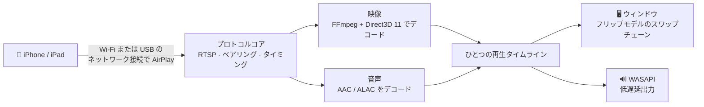

<div align="center">


# MirrorDock

**iPhone や iPad の画面を、Wi-Fi でも USB ケーブルでも Windows PC にミラーリング。**

[](https://github.com/bestkakkoii/MirrorDock/releases/latest)
[](https://github.com/bestkakkoii/MirrorDock/releases)
[](https://github.com/bestkakkoii/MirrorDock/releases/latest)
[](README_AI.md)
[](LICENSE)
[](https://github.com/bestkakkoii/MirrorDock/stargazers)

[English](README.md) · [繁體中文](README.zh-TW.md) · [简体中文](README.zh-CN.md) · **日本語** · [한국어](README.ko.md) · [Español](README.es.md) · [Deutsch](README.de.md) · [Français](README.fr.md) · [Tiếng Việt](README.vi.md) · [ไทย](README.th.md)

</div>

---

MirrorDock は Windows 用の AirPlay レシーバーです。iPhone の*画面ミラーリング*で MirrorDock を選ぶと、iPhone の映像と音声が PC に届き、メディアプレーヤーと同じ感覚で扱えるウィンドウに表示されます。本体は `mirror_dock.exe` ひとつだけで、インストーラーも、GStreamer も、Bonjour サービスも、ランタイムの準備も要りません。

[UxPlay](https://github.com/FDH2/UxPlay) の AirPlay プロトコルコアを土台に、Windows 向けに書き下ろしたメディアエンジン（Direct3D 11、FFmpeg、WASAPI）を組み合わせています。バージョン 1.6 までは *UxPlay for Windows (native)* という名前で公開していました。

## ✨ 主な特長

| | |
|---|---|
| 📶 **Wi-Fi でミラーリング** | iPhone と PC が同じネットワークにあれば使えます。どちらにも追加でインストールするものはありません。 |
| 🔌 **USB ケーブルでミラーリング** | *インターネット共有*をオンにすると、AirPlay が充電ケーブルの上を流れます。通信はローカルで完結して安定しており、モバイルデータ通信も使いません。 |
| 🎬 **鮮明でなめらかな映像** | H.265 / H.264 を、ディスプレイを駆動している GPU（Intel、AMD、NVIDIA）でデコードし、コピーをはさまずに、ディスプレイのタイミングに合わせて表示します。GPU でデコードできない場合は、ソフトウェアデコードに切り替わります。 |
| 🔊 **ずれない音声** | 低遅延の WASAPI 出力を映像と同じタイムラインで鳴らすので、口の動きと声がぴったり合います。 |
| 🎛️ **3 つのモード** | *画質優先*、*バランス*（既定）、*パフォーマンス優先*の 3 つから、映像の鮮明さを取るか、遅延の少なさを取るかを選べます。 |
| ✂️ **黒帯をトリミング** | 映画のまわりの黒帯を自動で切り落とします。マウスで囲んだ好きな部分だけを表示することもできます。 |
| 🪟 **使い勝手のよいウィンドウ** | ほどよい大きさで開き、サイズを変えても縦横比を保ち、大きさと位置を覚えます。キーひとつで全画面表示になり、常に手前に表示することもできます。 |
| 🌐 **10 言語に対応** | 画面の表示は、Windows の表示言語に合わせて切り替わります。 |
| 🧳 **ファイルはひとつ** | 約 10 MB の実行ファイルが 1 つあるだけで、Windows のほかには何も要りません。 |

## 🚀 クイックスタート

1. [Releases](https://github.com/bestkakkoii/MirrorDock/releases/latest) から `mirror_dock_win64.zip` をダウンロードし、好きな場所に展開します。
2. `mirror_dock.exe` を実行します。Windows ファイアウォールの確認が表示されたら、**許可**を選びます（家庭内のネットワークは*プライベート* ネットワークです）。
3. iPhone で **コントロールセンター → 画面ミラーリング → MirrorDock@お使いの PC** の順に選びます。

プログラムは通知領域（時計の横）に常駐します。iPhone が接続すると映像ウィンドウが現れます。このウィンドウを閉じるとそのミラーリングだけが終わり、メニューの**終了**を選ぶとプログラムが終了します。

> [!TIP]
> 動作環境: Windows 10 または 11（x64）と、Direct3D 11 対応の GPU。対応する GPU がない場合は、内蔵のソフトウェアレンダラーを使います。

## 🔌 USB ケーブルでミラーリング

1. Apple の USB ドライバーを一度だけインストールします。zip に入っている `install_apple_usb_support.cmd` を実行するか、Microsoft Store から **Appleデバイス** をインストールしてください。
2. iPhone で **設定 → インターネット共有 → ほかの人の接続を許可** をオンにしてから、ケーブルを接続します。
3. *画面ミラーリング*で MirrorDock を選びます。コントロールバーには、実際に使われている経路に応じて **USB** または **Wi-Fi** と表示されます。

- **USB 優先 / Wi-Fi のみ** は、USB デバイスには触れずに経路だけを切り替えるので、iPhone の充電はそのまま続きます。*Wi-Fi のみ* は確実に適用され、それでもケーブル経由で届いた接続は拒否されます。
- **モバイルデータ通信が減る心配はありません。** ミラーリングそのものはローカルの通信です。Windows が PC 自身のインターネット通信を iPhone 経由で流しはじめた場合は、MirrorDock がそれに気づき、ワンクリックで直せる対処（**データ通信量を節約**）を案内します。

## 🎛️ モード

| モード | 動作 | 向いている用途 |
|---|---|---|
| **画質優先** | フル解像度で、バッファリングをやや多めに取り、フレームを一切スキップしません。 | 映画、スライド、文字 |
| **バランス** *（既定）* | ディスプレイ、GPU、ネットワークに合わせて自動的に調整します。 | ふだんの利用 |
| **パフォーマンス優先** | 軽めのストリーム（最大 1920×1080）を使い、バッファリングを最小限にして、常に最新のフレームを表示します。 | ゲーム、古めの PC |

モードはメニューまたは `-mode` で選びます。タイミングに関わる動作はすぐに切り替わり、ストリームの解像度は次回の接続から変わります。

## ✂️ 黒帯のトリミング

16:9 の映画を、それより横長の画面を持つ iPhone で再生すると、黒帯が付いたままミラーリングされます。iPhone が画面全体をミラーリングするためです。

- **自動**（**C** キー）: 黒帯が切り落とされ、ウィンドウが映像にぴったり合います。次の映画に切り替わっても、トリミングはそのまま保たれます。プレーヤーのコントロールなど、別のものが黒帯の部分に現れて表示され続けた場合は、約 1 秒以内に映像全体の表示に戻ります。
- **手動**（**X** キー）: 見たい部分をドラッグして枠で囲みます。**Esc** でキャンセルできます。

## ⌨️ キーボードとマウス

| 操作 | キー |
|---|---|
| 全画面表示のオン / オフ | **F**、**F11**、**Alt+Enter**、またはダブルクリック。**Esc** で解除 |
| 黒帯を自動でトリミング | **C** |
| 表示する範囲を枠で囲む | **X** |
| 常に手前に表示 | **T** |
| ミュート（PC 側のみ） | **M** |
| コントロールバー | 映像の上でマウスを動かす |
| メニュー | 映像の上の任意の場所を右クリック |

## ⚙️ オプション

オプションは `mirror_dock.exe` のショートカットに追加するか、`%USERPROFILE%\.uxplayrc` に 1 行に 1 つずつ（先頭の `-` は付けずに）書きます。`mirror_dock.exe -h` を実行すると、すべてのオプションが表示されます。

| オプション | 効果 |
|---|---|
| `-n name` | iPhone に表示される名前 |
| `-fs` | 全画面表示で起動する |
| `-mode quality\|balanced\|performance` | 何を優先して最適化するか |
| `-crop auto\|off` | 黒帯を切り落とす / 映像全体を表示する |
| `-gpu auto\|integrated\|discrete\|software` | デコードと表示に使う GPU |
| `-h264` / `-h265` | H.264 だけを提示する / 常に H.265 を提示する |
| `-ui language` | 表示言語（下記を参照） |
| `-vsync ms` | 映像に対して音声をずらす |
| `-pin`, `-pw` | PIN またはパスワードを要求する |

## 🌐 言語

画面の表示は Windows の表示言語に合わせて切り替わります。対応しているのは English、繁體中文、简体中文、日本語、한국어、Español、Deutsch、Français、Tiếng Việt、ไทย です。それ以外の言語では英語で表示されます。特定の言語に固定するには `-ui en|zh-TW|zh-CN|ja|ko|es|de|fr|vi|th` を使います。

zip には、10 言語すべてのユーザーガイドが入っています（`user_guide` フォルダー）。

## 🧩 仕組み



映像と音声は、ひとつのタイムライン上でスケジュールされます。遅延はネットワークの状態と PC のデコード速度に合わせて変わり、カクつきが出ない範囲でできるだけ短く保たれます。

## 📊 実測値

2016 年製のノート PC 1 台（Intel Core i7-6700HQ、Intel HD Graphics 530）、2872×1320・60 fps の H.265 テストストリーム、*バランス* モード、バージョン 1.6:

| | |
|---|---|
| テストストリームのうち表示されたフレーム | 480 中 480 |
| 安定時の音声 / 映像の遅延 | 約 18 ms |
| 待機中のメモリ | 46 MB |
| 終了 | 0.04 s |

Wi-Fi と USB でのミラーリングは、バージョン 1.5 までの時点で iPhone 16 Pro Max（iOS 26）を使って確認しました。バージョン 1.7 も、同じ iPhone を使って Wi-Fi 経由で実際に動かしており、その 3200×1536 のストリームでは約 310 MB のメモリと 200 MB の GPU メモリを使いました。各リリースについて、iPhone を使ってテストしたものと、コンパイルしただけのものは、[CHANGELOG.md](CHANGELOG.md) に記載しています。

## ❓ よくある質問

**iPhone に PC が表示されません。**
iPhone と PC の両方が同じネットワークにつながっていて、Windows ファイアウォールで `mirror_dock.exe` が許可されている必要があります。iPhone の Wi-Fi をいったんオフにしてからオンに戻すと、一覧が更新されます。

**ケーブルをつないでいるのに、ミラーリングが Wi-Fi のままです。**
インターネット共有がオンで、接続方法として *USB 優先* が選ばれている必要があります。USB 接続の状態は、メニューの 2 行目で確認できます。

**音が出ません。**
まずコントロールバーのスピーカーボタンを確認し、次に Windows の音量ミキサーを確認してください。

**口の動きと声が合いません。**
`-vsync` の後ろにミリ秒数を付けて微調整します（正の値にすると音声が遅れます）。

**ログはどこにありますか。**
`%LOCALAPPDATA%\MirrorDock\mirror_dock.log` にあります。メニューの**ログファイルを開く**からも開けます。

## 🛠️ ソースからビルド

MSYS2 CLANG64（clang 23、C++26 標準ライブラリモジュールを備えた libc++、CMake 4.4、Ninja）と、Windows SDK のシェーダーコンパイラーを使います。FFmpeg、OpenSSL、libplist は、固定したコミットから静的ライブラリとしてビルドします。

```sh
bash win_native/build_scripts/fetch_deps.sh <src_root>
MSYSTEM=CLANG64 bash -lc 'bash win_native/build_scripts/build_deps.sh <src_root> <prefix> libplist openssl ffmpeg'
MSYSTEM=CLANG64 bash -lc 'bash win_native/build_scripts/build_uxplay_native.sh <this_repo> <build_dir> <prefix> Release'
```

[README_AI.md](README_AI.md) には、アーキテクチャ、不変条件、固定した入力、検証済みの内容をまとめています。リリースの一覧は [CHANGELOG.md](CHANGELOG.md) にあります。

## 📜 ライセンス

MirrorDock は UxPlay の GPL-3.0 コードを土台にしているため、**GNU General Public License v3**（[LICENSE](LICENSE)）のもとで配布しています。[`win_native/`](win_native) にある Windows 用メディアエンジンは独自に開発したもので、**MIT ライセンス**（[win_native/LICENSE](win_native/LICENSE)）で提供します。リリースの zip には、同梱しているすべてのライブラリのライセンス文と、対応する完全なソースコードが入っています。

## 🙏 謝辞

- [UxPlay](https://github.com/FDH2/UxPlay)（F. Duncanh 氏とコントリビューターの皆さん）— MirrorDock の土台となっている AirPlay サーバーです。
- [RPiPlay](https://github.com/FD-/RPiPlay)（Florian Draschbacher 氏）と [shairplay](https://github.com/juhovh/shairplay)（Juho Vähä-Herttua 氏）— そのプロトコルコアの源流です。
- playfair、llhttp、csrp、FFmpeg、OpenSSL、libplist。

AirPlay、iPhone、iPad は Apple Inc. の商標です。MirrorDock は独立したオープンソースプロジェクトであり、Apple とは関係ありません。
