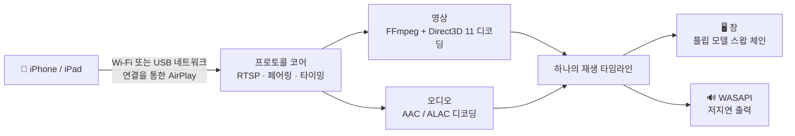

<div align="center">


# MirrorDock

**iPhone이나 iPad 화면을 Wi-Fi 또는 USB 케이블로 Windows PC에 미러링하고, 마우스와 키보드로 iPhone을 제어하세요.**

[](https://github.com/bestkakkoii/MirrorDock/releases/latest)
[](https://github.com/bestkakkoii/MirrorDock/releases)
[](https://github.com/bestkakkoii/MirrorDock/releases/latest)
[](README_AI.md)
[](LICENSE)
[](https://github.com/bestkakkoii/MirrorDock/stargazers)

[English](README.md) · [繁體中文](README.zh-TW.md) · [简体中文](README.zh-CN.md) · [日本語](README.ja.md) · **한국어** · [Español](README.es.md) · [Deutsch](README.de.md) · [Français](README.fr.md) · [Tiếng Việt](README.vi.md) · [ไทย](README.th.md) · [Русский](README.ru.md)

</div>

---

MirrorDock은 Windows용 AirPlay 수신기입니다. iPhone의 *화면 미러링*에서 MirrorDock을 선택하면 iPhone의 화면과 소리가 PC에 나타나며, 그 창은 미디어 플레이어처럼 다룰 수 있습니다. `mirror_dock.exe` 파일 하나가 전부입니다. 설치 프로그램도, GStreamer도, Bonjour 서비스도, 따로 준비할 런타임도 없습니다.

[UxPlay](https://github.com/FDH2/UxPlay)의 AirPlay 프로토콜 코어를 기반으로 하고, 미디어 엔진은 Windows에 맞춰 새로 작성했습니다(Direct3D 11, FFmpeg, WASAPI). 버전 1.6까지는 ‘*UxPlay for Windows (native)*’라는 이름으로 배포되었습니다.

## ✨ 주요 특징

| | |
|---|---|
| 📶 **Wi-Fi 미러링** | iPhone과 PC가 같은 네트워크에 있기만 하면 됩니다. 어느 쪽에도 따로 설치할 것이 없습니다. |
| 🔌 **USB 케이블 미러링** | *개인용 핫스팟*을 켜면 AirPlay가 충전 케이블을 타고 전송됩니다. 로컬 연결이라 안정적이고, 셀룰러 데이터도 쓰지 않습니다. |
| 🎬 **선명하고 부드러운 영상** | 모니터를 구동하는 GPU(Intel, AMD, NVIDIA)에서 H.265 / H.264를 디코딩하고, 복사 없이 모니터의 화면 갱신에 맞춰 표시합니다. GPU가 디코딩하지 못하면 소프트웨어 디코딩이 대신합니다. |
| 🔊 **어긋나지 않는 소리** | 지연이 짧은 WASAPI 출력을 영상과 같은 타임라인에 맞추므로 입 모양과 목소리가 일치합니다. |
| 🎛️ **세 가지 모드** | *화질 우선*, *균형*(기본값), *성능 우선* 가운데, 가장 선명한 화면과 가장 짧은 지연 사이에서 원하는 쪽을 고르면 됩니다. |
| ✂️ **검은 여백 자르기** | 영화 주위의 검은 여백을 자동으로 잘라내거나, 마우스로 원하는 부분만 골라서 볼 수 있습니다. |
| 🖱️ **iPhone 제어** | 영상 위에서 클릭하고, 드래그하고, 스크롤하고, 입력하면 iPhone이 그대로 따라 합니다. 프로그램에 내장된 기능이라 보조 프로그램도 탈옥도 필요 없습니다(iOS 27, USB 케이블, 개발자 모드 필요). |
| 🪟 **제대로 된 창** | 알맞은 크기로 열리고, 크기를 바꿔도 화면 비율이 유지되며, 크기와 위치를 기억합니다. 키 하나로 전체 화면이 되고, 항상 위에 표시할 수도 있습니다. |
| 🌐 **11개 언어** | 인터페이스는 Windows 표시 언어를 따릅니다. |
| 🩺 **PC 상태 점검** | ‘프로그램 정보’ 창이 미러링에 중요한 항목(그래픽 카드, 드라이버, 네트워크, 방화벽, Apple의 USB 지원)을 확인하고 평가해, 무엇을 고쳐야 하는지 알려 줍니다. |
| 🔄 **업데이트 확인** | 새 버전이 나오면 알려 줍니다. GitHub에는 하루에 한 번만 확인하며, 클릭 한 번으로 끌 수 있습니다. |
| 🧳 **파일 하나** | 약 12 MB짜리 실행 파일 하나면 되고, Windows 말고는 아무것도 필요 없습니다. |

## 🚀 빠른 시작

1. [Releases](https://github.com/bestkakkoii/MirrorDock/releases/latest)에서 `mirror_dock_win64.zip`을 내려받아 원하는 곳에 압축을 풉니다.
2. `mirror_dock.exe`를 실행합니다. Windows 방화벽이 물으면 **허용**을 선택합니다(가정용 네트워크는 *개인* 네트워크입니다).
3. iPhone에서 **제어 센터 → 화면 미러링 → MirrorDock@내-PC**를 선택합니다.

프로그램은 알림 영역(시계 옆)에 자리 잡습니다. iPhone이 연결되면 영상 창이 나타납니다. 이 창을 닫으면 해당 미러링만 끝나고, 메뉴에서 **종료**를 선택하면 프로그램이 종료됩니다.

> [!TIP]
> 요구 사항: Windows 10 또는 11(x64)과 Direct3D 11 GPU. 해당 GPU가 없으면 내장 소프트웨어 렌더러를 사용합니다.

## 🔌 USB 케이블로 미러링하기

1. Apple USB 드라이버를 한 번만 설치합니다. zip에 들어 있는 `install_apple_usb_support.cmd`를 실행하거나 Microsoft Store에서 **Apple 기기**를 설치하세요.
2. iPhone에서 **설정 → 개인용 핫스팟 → 다른 사람의 연결 허용**을 켠 다음 케이블을 연결합니다.
3. *화면 미러링*에서 MirrorDock을 선택합니다. 컨트롤 바에는 실제로 사용 중인 연결에 따라 **USB** 또는 **Wi-Fi**가 표시됩니다.

- **USB 우선 / Wi-Fi 전용**은 USB 기기를 건드리지 않고 연결 경로만 바꾸므로 iPhone은 계속 충전됩니다. *Wi-Fi 전용*은 확실하게 지켜집니다. 그런데도 케이블로 들어오는 연결은 거부합니다.
- **셀룰러 데이터는 안전합니다.** 미러링 자체는 로컬 전송입니다. Windows가 PC의 인터넷 트래픽을 iPhone으로 보내기 시작하면 MirrorDock이 이를 알아차리고, 클릭 한 번으로 해결하는 방법(**셀룰러 데이터 절약**)을 제안합니다.

## 🎛️ 모드

| 모드 | 동작 | 적합한 용도 |
|---|---|---|
| **화질 우선** | 전체 해상도로 받고 버퍼링을 조금 더 두며, 프레임을 하나도 건너뛰지 않습니다. | 영화, 슬라이드, 텍스트 |
| **균형** *(기본값)* | 모니터, GPU, 네트워크에 맞춰 조정합니다. | 일상적인 사용 |
| **성능 우선** | 더 가벼운 스트림(최대 1920×1080)을 받고 버퍼링을 최소화하며, 항상 최신 프레임을 표시합니다. | 게임, 오래된 PC |

메뉴나 `-mode`로 선택합니다. 타이밍은 즉시 바뀌고, 스트림 해상도는 다음 연결부터 바뀝니다.

## ✂️ 검은 여백 자르기

화면이 더 넓은 iPhone에서 16:9 영화를 재생하면 검은 여백까지 함께 미러링됩니다. iPhone이 화면 전체를 미러링하기 때문입니다.

- **자동**(**C** 키): 여백을 잘라내고 창을 영상에 딱 맞춥니다. 다음 영화로 넘어가도 자르기는 그대로 유지됩니다. 플레이어의 컨트롤처럼 다른 무언가가 여백 자리에 나타나 계속 남아 있으면, 약 1초 안에 전체 영상이 다시 표시됩니다.
- **수동**(**X** 키): 보고 싶은 부분을 드래그해 틀로 지정합니다. **Esc**를 누르면 취소됩니다.

## 🖱️ iPhone 제어하기

**F8**을 누르거나 메뉴에서 **마우스와 키보드로 iPhone 제어**를 선택하면 영상이 곧 iPhone 화면이 됩니다. 영상 위에서 하는 동작을 iPhone이 그대로 수행합니다.

| PC에서 | iPhone에서 |
|---|---|
| 왼쪽 버튼: 클릭, 누르고 있기, 드래그 | 손가락 하나: 탭, 길게 터치, 쓸어넘기기 |
| 마우스 휠(**Shift**를 누르면 좌우로) | 포인터 아래의 내용을 스크롤 |
| 가운데 버튼 | 홈 화면으로 이동 |
| 두 번 클릭 | 평소처럼 전체 화면 켜기 / 끄기. **Alt**를 누른 채 두 번 클릭하면 iPhone에서 두 번 탭 |
| 키보드 | iPhone에 키보드를 연결한 것처럼 입력. **Ctrl**은 ⌘ 역할을 하고, **Ctrl+Space**는 iPhone의 입력 언어를 전환 |
| **Page Down** / **Page Up**, **Alt** + 방향키 | 다음 또는 이전 페이지나 동영상으로 빠르게 쓸어넘기기 |
| 오른쪽 버튼 | 평소처럼 MirrorDock 메뉴 |

필요한 조건:

1. **iOS 27 이상**의 iPhone이 **USB 케이블**로 연결되어 있고, iPhone에서 이 PC를 신뢰한 상태여야 합니다. 케이블은 제어에만 쓰이며, 영상은 계속 Wi-Fi로 받아도 됩니다.
2. iPhone에서 **개발자 모드**가 켜져 있어야 합니다(*설정 → 개인정보 보호 및 보안 → 개발자 모드*). 이 스위치는 개발 도구가 요청하기 전까지 숨겨져 있으며, F8을 처음 누를 때 MirrorDock이 그 요청을 보냅니다.
3. 처음 사용할 때, 그리고 iOS를 업데이트한 뒤 처음 사용할 때마다 인터넷 연결이 필요합니다. MirrorDock이 Apple의 개발자 디스크 이미지(*Developer Disk Image*)를 iPhone에 설치하기 때문입니다. 1분 정도 걸립니다.

> [!NOTE]
> AirPlay로는 입력을 전달할 수 없어서, 제어는 다른 경로를 이용합니다. 바로 iOS의 개발자 서비스로, Xcode가 실제 기기를 다룰 때 쓰는 것과 같은 서비스입니다. 이 서비스를 설치하기 위해 MirrorDock은 [DeveloperDiskImage](https://github.com/doronz88/DeveloperDiskImage) 저장소에서 Apple의 이미지를 내려받고, Apple의 서명 서비스(`gs.apple.com`)에 사용자의 iPhone에 맞게 서명해 달라고 요청합니다. 이때 Xcode가 하는 것과 똑같이 iPhone의 칩 식별 번호가 Apple에 전달됩니다. 그 뒤로는 제어할 때 어디에도 접속하지 않습니다.

제어가 켜져 있는 동안에도 창 자체의 명령이 우선합니다. **F8**, **F11**, **Alt+Enter**, **Alt+F4**, 전체 화면에서의 **Esc**, 그리고 두 번 클릭은 여전히 창에서 동작합니다. 두 번 클릭할 때는 두 번째 클릭이 도착하는 시점에 첫 번째 클릭이 이미 탭으로 iPhone에 전달된 상태이므로, 검은 여백이 있으면 그 위에서 두 번 클릭하거나 **F11**을 누르세요. 컨트롤 바는 iPhone 화면의 아랫부분을 가리게 되므로 나타나지 않습니다.

## ⌨️ 키보드와 마우스

| 동작 | 키 |
|---|---|
| 전체 화면 켜기 / 끄기 | **F**, **F11**, **Alt+Enter** 또는 두 번 클릭, **Esc**로 해제 |
| 검은 여백 자동으로 자르기 | **C** |
| 표시할 영역을 틀로 지정 | **X** |
| 항상 위에 표시 | **T** |
| 음소거(PC 쪽만) | **M** |
| iPhone 제어 켜기 / 끄기 | **F8** |
| 컨트롤 바 | 영상 위에서 마우스를 움직이기 |
| 메뉴 | 영상 위 아무 곳이나 오른쪽 클릭 |

iPhone을 제어하는 동안에는 문자 키가 iPhone에 입력됩니다. **F8**을 누르면 이 키들을 다시 창에서 쓸 수 있습니다.

## 🔄 업데이트

메뉴에서 **업데이트 확인…** 항목을 선택하면 GitHub에서 최신 버전을 확인하고 그 결과를 ‘프로그램 정보’ 창에 표시합니다. 새 버전이 있으면 **다운로드**로 해당 zip을 브라우저에서 열고, **변경 사항**으로 릴리스 노트를 열 수 있습니다. MirrorDock이 스스로 설치하는 것은 아무것도 없습니다.

- **자동 확인.** 하루에 한 번 확인하고, 새 버전이 나와 있으면 알림으로 알려 줍니다. ‘프로그램 정보’ 창의 스위치 하나로 끌 수 있습니다.
- **전송되는 내용.** `api.github.com`으로 보내는 요청 한 건이 전부입니다. GitHub는 사용자의 IP 주소와 클라이언트 이름 `MirrorDock/<version>`을 볼 뿐, 사용자나 PC에 관한 정보는 받지 않습니다.
- **셀룰러 데이터로는 확인하지 않습니다.** Windows가 데이터 통신 연결로 표시한 연결에서는, 그리고 PC의 인터넷이 iPhone을 거치는 동안에는 자동으로 확인하지 않습니다.

## 🩺 ‘프로그램 정보’와 ‘이 PC’

메뉴에서 **프로그램 정보…** 항목을 선택하면 별도의 창이 열리며, 탭이 세 개 있습니다.

| 탭 | 표시되는 내용 |
|---|---|
| **프로그램 정보** | 버전과 출시일, 업데이트 확인, 프로젝트·사용 설명서·라이선스 전문으로 가는 링크 |
| **이 PC** | 사용자의 PC에서 MirrorDock에 중요한 것을 항목별로 보여 줍니다: Windows, 디스플레이, 전원, 네트워크, 방화벽, 프로세서, 메모리, 그래픽 카드와 그 영상 디코딩, 소리, 그래픽 드라이버, Apple의 USB 지원, 케이블로 연결한 iPhone |
| **구성 요소** | MirrorDock을 이루는 모든 라이브러리와 도구(버전, 날짜, 라이선스 포함), 그리고 MirrorDock 각 버전의 출시일 |

*이 PC*의 모든 항목은 ‘좋음’, ‘주의’, ‘문제’ 중 하나로 평가되며, 좋음이 아닌 항목에는 어떻게 하면 되는지가 함께 표시됩니다. 점수는 평가된 항목 가운데 정상인 항목의 비율을, 각 항목이 미러링에 얼마나 중요한지에 따라 가중해 계산한 값입니다(하드웨어 영상 디코딩의 비중이 가장 큽니다). 이 점수는 PC가 얼마나 잘 준비되어 있는지를 나타낼 뿐, 벤치마크가 아닙니다. **보고서 복사**를 누르면 이 탭의 내용이 일반 텍스트로 클립보드에 복사되어, 문제를 보고할 때 쓸 수 있습니다. 이 탭의 내용은 PC 밖으로 나가지 않으며, 일련 번호나 기기 이름은 표시되지도 저장되지도 않습니다.

## ⚙️ 옵션

`mirror_dock.exe`의 바로 가기에 옵션을 추가하거나, `%USERPROFILE%\.uxplayrc`에 한 줄에 하나씩(맨 앞의 `-` 없이) 적습니다. `mirror_dock.exe -h`를 실행하면 모든 옵션이 나열됩니다.

| 옵션 | 효과 |
|---|---|
| `-n name` | iPhone에 표시되는 이름 |
| `-fs` | 전체 화면으로 시작 |
| `-mode quality\|balanced\|performance` | 무엇에 맞춰 최적화할지 |
| `-crop auto\|off` | 검은 여백 자르기 / 전체 영상 표시 |
| `-gpu auto\|integrated\|discrete\|software` | 디코딩과 표시에 쓸 GPU |
| `-h264` / `-h265` | H.264만 제안 / 항상 H.265 제안 |
| `-ui language` | 인터페이스 언어(아래 참고) |
| `-vsync ms` | 영상을 기준으로 소리를 앞뒤로 옮김 |
| `-pin`, `-pw` | PIN 또는 암호 요구 |

## 🌐 언어

인터페이스는 Windows 표시 언어를 따릅니다. 지원하는 언어는 English, 繁體中文, 简体中文, 日本語, 한국어, Español, Deutsch, Français, Tiếng Việt, ไทย, Русский입니다. 그 밖의 언어에서는 영어로 표시됩니다. 특정 언어로 고정하려면 `-ui en|zh-TW|zh-CN|ja|ko|es|de|fr|vi|th|ru`를 사용하세요.

zip에는 열한 가지 언어의 사용 설명서가 모두 들어 있습니다(`user_guide` 폴더).

## 🧩 작동 방식



영상과 소리는 하나의 타임라인에 맞춰 예약됩니다. 지연은 네트워크 상태와 PC의 디코딩 속도에 따라 조정되며, 끊김이 없는 범위에서 최대한 짧게 유지됩니다.

제어는 이와 별개인 두 번째 경로로 이루어집니다. MirrorDock은 USB 케이블을 통해 iPhone의 개발자 터널을 열고(작은 IPv6 및 TCP 구현을 자체적으로 갖추고 있어 네트워크 어댑터도 관리자 권한도 필요 없습니다), 터치와 키보드 리포트를 iPhone의 입력 서비스로 보냅니다.

## 📊 측정 결과

2016년형 노트북 한 대(Intel Core i7-6700HQ, Intel HD Graphics 530), 2872×1320 60 fps H.265 테스트 스트림, *균형* 모드, 버전 1.6:

| | |
|---|---|
| 표시된 테스트 스트림 프레임 | 480개 중 480개 |
| 안정 상태의 오디오 / 영상 지연 | 약 18 ms |
| 대기 중 메모리 | 46 MB |
| 종료 | 0.04 s |

Wi-Fi 미러링과 USB 미러링은 버전 1.5까지 iPhone 16 Pro Max(iOS 26)로 확인했습니다. 버전 1.7도 같은 iPhone으로 Wi-Fi를 통해 실제로 실행했으며, 그 3200×1536 스트림에는 메모리 약 310 MB와 GPU 메모리 200 MB가 사용되었습니다. 릴리스마다 iPhone으로 테스트한 것과 컴파일만 한 것은 [CHANGELOG.md](CHANGELOG.md)에 적혀 있습니다.

## ❓ 자주 묻는 질문

**iPhone 목록에 PC가 나타나지 않습니다.**
둘 다 같은 네트워크에 연결되어 있어야 하고, Windows 방화벽에서 `mirror_dock.exe`가 허용되어 있어야 합니다. 방화벽이나 *공용*으로 설정된 네트워크가 연결을 막고 있는지는 ‘프로그램 정보’ 창의 *이 PC* 탭에서 확인할 수 있습니다. iPhone의 Wi-Fi를 껐다가 다시 켜면 목록이 새로 고쳐집니다.

**케이블을 연결했는데도 미러링이 Wi-Fi로 됩니다.**
개인용 핫스팟이 켜져 있어야 하고, 연결 방식으로 *USB 우선*이 선택되어 있어야 합니다. 메뉴의 둘째 줄에서 USB 연결 상태를 확인할 수 있습니다.

**소리가 나지 않습니다.**
컨트롤 바의 스피커 버튼을 먼저 확인한 다음 Windows 볼륨 믹서를 확인하세요.

**입 모양과 목소리가 맞지 않습니다.**
`-vsync` 뒤에 밀리초 값을 붙여 미세하게 조정하세요(양수 값은 소리를 늦춥니다).

**F8을 누르면 ‘iPhone을 제어할 수 없습니다’라고 나옵니다.**
원인은 메시지에 나와 있습니다. 케이블이 연결되어 있지 않거나 이 PC를 신뢰하지 않은 경우, 개발자 모드가 꺼져 있는 경우, iPhone의 iOS가 27보다 낮은 경우, 개발자 디스크 이미지를 설치하지 못한 경우(이 단계에는 인터넷이 필요합니다) 가운데 하나입니다. 개발자 모드를 켜면 iPhone이 재시동되고 한 번 더 확인을 요청합니다.

**개발자 모드를 계속 켜 두어도 안전한가요?**
개발자 모드는 앱을 만드는 사람들을 위해 Apple이 직접 마련한 스위치입니다. 켜 두면 신뢰하는 컴퓨터가 앱을 설치하고 디버깅하며 개발자 서비스를 이용할 수 있게 됩니다. iPhone을 탈옥시키는 것이 아니며, 같은 곳에서 다시 끌 수 있습니다.

**MirrorDock은 인터넷을 사용하나요?**
미러링은 로컬에서만 이루어집니다. MirrorDock이 인터넷에 접속하는 경우는 두 가지뿐입니다. 하나는 업데이트 확인(GitHub, 하루에 한 번, 끌 수 있음)이고, 다른 하나는 iPhone을 처음 제어할 때 Apple의 개발자 디스크 이미지와 그에 대한 Apple의 서명을 받아 오는 것입니다.

**로그는 어디에 있나요?**
`%LOCALAPPDATA%\MirrorDock\mirror_dock.log`에 있으며, 메뉴의 **로그 파일 열기**로도 열 수 있습니다.

## 🛠️ 소스에서 빌드하기

MSYS2 CLANG64(clang 23, C++26 표준 라이브러리 모듈을 포함한 libc++, CMake 4.4, Ninja)와 Windows SDK 셰이더 컴파일러를 사용합니다. FFmpeg, OpenSSL, libplist는 고정된 커밋에서 정적 라이브러리로 빌드합니다. 고정된 커밋은 `win_native/build_scripts/build_inputs.tsv`에 적혀 있으며, ‘프로그램 정보’ 창에 표시되는 목록이 바로 이 파일입니다.

```sh
bash win_native/build_scripts/fetch_deps.sh <src_root>
MSYSTEM=CLANG64 bash -lc 'bash win_native/build_scripts/build_deps.sh <src_root> <prefix> libplist openssl ffmpeg'
MSYSTEM=CLANG64 bash -lc 'bash win_native/build_scripts/build_uxplay_native.sh <this_repo> <build_dir> <prefix> Release'
```

[README_AI.md](README_AI.md)에는 아키텍처, 불변 조건, 고정된 입력, 검증된 내용이 정리되어 있습니다. 릴리스 목록은 [CHANGELOG.md](CHANGELOG.md)에서 볼 수 있습니다.

## 📜 라이선스

MirrorDock은 UxPlay의 GPL-3.0 코드를 기반으로 하므로 **GNU General Public License v3**([LICENSE](LICENSE))에 따라 배포됩니다. [`win_native/`](win_native)의 Windows 미디어 엔진은 독자적으로 작성한 것으로 **MIT 라이선스**([win_native/LICENSE](win_native/LICENSE))를 따릅니다. [`phone_control/`](phone_control)의 iPhone 제어 기능도 독자적으로 작성한 것으로 **GPL-3.0-or-later**를 따릅니다. 릴리스 zip에는 포함된 모든 라이브러리의 라이선스 전문과 그에 해당하는 소스 코드 전체가 들어 있습니다.

## 🙏 감사의 말

- [UxPlay](https://github.com/FDH2/UxPlay)(F. Duncanh와 기여자들) — MirrorDock의 기반이 되는 AirPlay 서버입니다.
- [RPiPlay](https://github.com/FD-/RPiPlay)(Florian Draschbacher)와 [shairplay](https://github.com/juhovh/shairplay)(Juho Vähä-Herttua) — 그 프로토콜 코어의 출처입니다.
- [pymobiledevice3](https://github.com/doronz88/pymobiledevice3)(doronz88과 기여자들) — iPhone 제어 기능의 바탕이 된 iOS 개발자 서비스 관련 지식의 출처입니다.
- playfair, llhttp, csrp, FFmpeg, OpenSSL, libplist.

AirPlay, iPhone, iPad는 Apple Inc.의 상표입니다. MirrorDock은 독립적인 오픈 소스 프로젝트이며 Apple과 아무런 관련이 없습니다.
