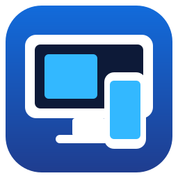
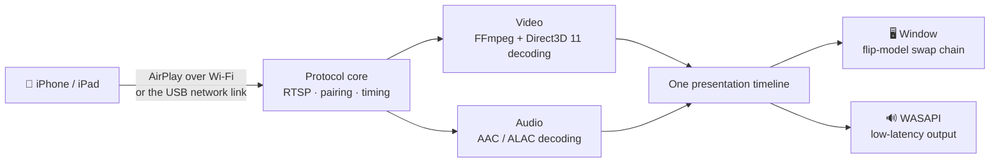

<div align="center">



# MirrorDock

**Mirror your iPhone or iPad to a Windows PC — over Wi-Fi or the USB cable.**

[](https://github.com/bestkakkoii/MirrorDock/releases/latest)
[](https://github.com/bestkakkoii/MirrorDock/releases)
[](https://github.com/bestkakkoii/MirrorDock/releases/latest)
[](README_AI.md)
[](LICENSE)
[](https://github.com/bestkakkoii/MirrorDock/stargazers)

**English** · [繁體中文](README.zh-TW.md) · [简体中文](README.zh-CN.md) · [日本語](README.ja.md) · [한국어](README.ko.md) · [Español](README.es.md) · [Deutsch](README.de.md) · [Français](README.fr.md) · [Tiếng Việt](README.vi.md) · [ไทย](README.th.md)

</div>

---

MirrorDock is an AirPlay receiver for Windows. Pick it in *Screen Mirroring* on the iPhone and the phone's picture and sound appear on the PC, in a window that behaves like a media player. It is a single `mirror_dock.exe`: no installer, no GStreamer, no Bonjour service, no runtime to set up.

It is built on the AirPlay protocol core of [UxPlay](https://github.com/FDH2/UxPlay) with a media engine written for Windows (Direct3D 11, FFmpeg, WASAPI). Up to version 1.6 it was published as *UxPlay for Windows (native)*.

## ✨ Highlights

| | |
|---|---|
| 📶 **Wi-Fi mirroring** | Phone and PC on the same network, nothing to install on either side. |
| 🔌 **USB cable mirroring** | With *Personal Hotspot* on, AirPlay runs over the charging cable: local, stable, and it does not use mobile data. |
| 🎬 **Sharp, smooth video** | H.265 / H.264 decoded on the GPU that drives your monitor (Intel, AMD or NVIDIA), shown without copying, paced to the display. Software decoding steps in when the GPU cannot. |
| 🔊 **Sound in sync** | Low-latency WASAPI output on the same timeline as the picture, so lips and voice match. |
| 🎛️ **Three modes** | *Quality*, *Balanced* (default) and *Performance*: you choose between the sharpest picture and the lowest delay. |
| ✂️ **Crop black bars** | Cuts the black bars around a film off automatically, or lets you frame any part of the picture with the mouse. |
| 🪟 **A proper window** | Opens at a sensible size, keeps the aspect ratio while you resize, remembers size and position, full screen with one key, always on top. |
| 🌐 **Ten languages** | The interface follows your Windows display language. |
| 🧳 **One file** | A single executable of about 10 MB that needs only Windows itself. |

## 🚀 Quick start

1. Download `mirror_dock_win64.zip` from [Releases](https://github.com/bestkakkoii/MirrorDock/releases/latest) and unzip it anywhere.
2. Run `mirror_dock.exe`. If Windows Firewall asks, choose **Allow** (a home network is a *private* network).
3. On the iPhone: **Control Center → Screen Mirroring → MirrorDock@your-PC**.

The program lives in the notification area (next to the clock). The video window appears when the phone connects; closing it ends that session, and **Exit** in the menu ends the program.

> [!TIP]
> Requirements: Windows 10 or 11 (x64) and a Direct3D 11 GPU. Without one the built-in software renderer is used.

## 🔌 Mirroring over the USB cable

1. Install Apple's USB driver once: run `install_apple_usb_support.cmd` from the zip, or install **Apple Devices** from the Microsoft Store.
2. On the iPhone turn on **Settings → Personal Hotspot → Allow Others to Join**, then plug in the cable.
3. Pick MirrorDock in *Screen Mirroring*. The control bar shows **USB** or **Wi-Fi**, whichever is in use.

- **Prefer USB / Wi-Fi only** switches the link without touching the USB device, so the phone keeps charging. *Wi-Fi only* is enforced: a connection that still arrives over the cable is refused.
- **Your mobile data is safe.** Mirroring itself is local. If Windows starts routing the PC's own internet traffic through the phone, MirrorDock notices and offers a one-click fix (**Save mobile data**).

## 🎛️ Modes

| Mode | What it does | Good for |
|---|---|---|
| **Quality** | Full resolution, a little more buffering, no frame is skipped. | Films, slides, text |
| **Balanced** *(default)* | Adapts to the monitor, the GPU and the network. | Everyday use |
| **Performance** | A lighter stream (up to 1920×1080), minimal buffering, always the newest frame. | Games, older PCs |

Choose it in the menu or with `-mode`. Timing changes at once; the stream resolution changes from the next connection.

## ✂️ Cropping black bars

A 16:9 film on a phone with a wider screen is mirrored with black bars, because the phone mirrors its whole screen.

- **Automatic** (key **C**): the bars are cut off and the window hugs the picture. The crop stays when one film follows another; when something else shows up in a bar and stays, the player's controls for example, the whole picture is back within about a second.
- **By hand** (key **X**): drag a frame around the part you want to see. **Esc** cancels.

## ⌨️ Keyboard and mouse

| Action | Keys |
|---|---|
| Full screen on / off | **F**, **F11**, **Alt+Enter** or double-click; **Esc** leaves |
| Crop black bars automatically | **C** |
| Frame the area to show | **X** |
| Always on top | **T** |
| Mute (the PC side only) | **M** |
| Control bar | Move the mouse over the picture |
| Menu | Right-click anywhere on the picture |

## ⚙️ Options

Add options to a shortcut of `mirror_dock.exe`, or write them one per line (without the leading `-`) into `%USERPROFILE%\.uxplayrc`. `mirror_dock.exe -h` lists them all.

| Option | Effect |
|---|---|
| `-n name` | Name shown on the iPhone |
| `-fs` | Start in full screen |
| `-mode quality\|balanced\|performance` | What to optimize for |
| `-crop auto\|off` | Cut black bars off / show the whole picture |
| `-gpu auto\|integrated\|discrete\|software` | GPU used for decoding and display |
| `-h264` / `-h265` | Offer only H.264 / always offer H.265 |
| `-ui language` | Interface language (see below) |
| `-vsync ms` | Shift the sound against the picture |
| `-pin`, `-pw` | Require a PIN or a password |

## 🌐 Languages

The interface follows the Windows display language: English, 繁體中文, 简体中文, 日本語, 한국어, Español, Deutsch, Français, Tiếng Việt and ไทย. Any other language gets English. Force one with `-ui en|zh-TW|zh-CN|ja|ko|es|de|fr|vi|th`.

User guides in all ten languages are in the zip (folder `user_guide`).

## 🧩 How it works



Picture and sound are scheduled on one timeline, with a delay that adapts to the network and to how fast the PC decodes: as short as possible without stutter.

## 📊 Measured

One 2016 laptop (Intel Core i7-6700HQ, Intel HD Graphics 530), a 2872×1320 60 fps H.265 test stream, *Balanced* mode, version 1.6:

| | |
|---|---|
| Frames of the test stream shown | 480 of 480 |
| Audio / video delay at rest | about 18 ms |
| Memory while idle | 46 MB |
| Exit | 0.04 s |

Mirroring over Wi-Fi and over USB was verified with an iPhone 16 Pro Max (iOS 26) up to version 1.5, and version 1.7 has run with that phone over Wi-Fi: its 3200×1536 stream took about 310 MB of memory and 200 MB of GPU memory. [CHANGELOG.md](CHANGELOG.md) says for each release what was tested with a phone and what was only compiled.

## ❓ FAQ

**The iPhone does not list my PC.**
Both must be on the same network, and Windows Firewall must allow `mirror_dock.exe`. Turning the iPhone's Wi-Fi off and on again refreshes the list.

**The cable is plugged in but mirroring still uses Wi-Fi.**
Personal Hotspot must be on, and the link choice must be *Prefer USB*. The second line of the menu shows the state of the USB link.

**There is no sound.**
Check the speaker button in the control bar, then the Windows volume mixer.

**Lips and voice do not match.**
Fine-tune with `-vsync` followed by a number of milliseconds (positive values delay the sound).

**Where is the log?**
`%LOCALAPPDATA%\MirrorDock\mirror_dock.log`, or **Open log file** in the menu.

## 🛠️ Build from source

MSYS2 CLANG64 (clang 23, libc++ with the C++26 standard library module, CMake 4.4, Ninja) and the Windows SDK shader compiler. FFmpeg, OpenSSL and libplist are built from pinned commits as static libraries.

```sh
bash win_native/build_scripts/fetch_deps.sh <src_root>
MSYSTEM=CLANG64 bash -lc 'bash win_native/build_scripts/build_deps.sh <src_root> <prefix> libplist openssl ffmpeg'
MSYSTEM=CLANG64 bash -lc 'bash win_native/build_scripts/build_uxplay_native.sh <this_repo> <build_dir> <prefix> Release'
```

[README_AI.md](README_AI.md) documents the architecture, the invariants, the pinned inputs and what has been verified. [CHANGELOG.md](CHANGELOG.md) lists the releases.

## 📜 Licence

MirrorDock is distributed under the **GNU General Public License v3** ([LICENSE](LICENSE)), because it is built on UxPlay's GPL-3.0 code. The Windows media engine in [`win_native/`](win_native) is original work under the **MIT licence** ([win_native/LICENSE](win_native/LICENSE)). The release zip contains the licence texts of all bundled libraries and the complete corresponding source.

## 🙏 Credits

- [UxPlay](https://github.com/FDH2/UxPlay) by F. Duncanh and contributors — the AirPlay server MirrorDock is built on.
- [RPiPlay](https://github.com/FD-/RPiPlay) by Florian Draschbacher and [shairplay](https://github.com/juhovh/shairplay) by Juho Vähä-Herttua — where that protocol core comes from.
- playfair, llhttp, csrp, FFmpeg, OpenSSL and libplist.

AirPlay, iPhone and iPad are trademarks of Apple Inc. MirrorDock is an independent open-source project and is not affiliated with Apple.
