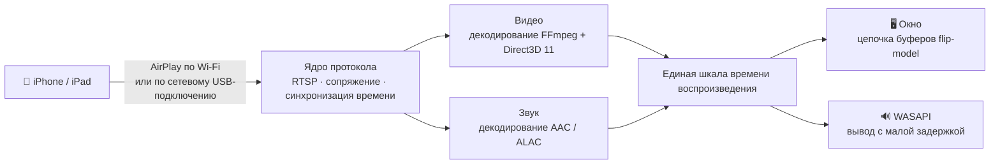

<div align="center">


# MirrorDock

**Дублируйте экран iPhone или iPad на компьютер с Windows — по Wi-Fi или USB-кабелю — и управляйте iPhone мышью и клавиатурой.**

[](https://github.com/bestkakkoii/MirrorDock/releases/latest)
[](https://github.com/bestkakkoii/MirrorDock/releases)
[](https://github.com/bestkakkoii/MirrorDock/releases/latest)
[](README_AI.md)
[](LICENSE)
[](https://github.com/bestkakkoii/MirrorDock/stargazers)

[English](README.md) · [繁體中文](README.zh-TW.md) · [简体中文](README.zh-CN.md) · [日本語](README.ja.md) · [한국어](README.ko.md) · [Español](README.es.md) · [Deutsch](README.de.md) · [Français](README.fr.md) · [Tiếng Việt](README.vi.md) · [ไทย](README.th.md) · **Русский**

</div>

---

MirrorDock — приемник AirPlay для Windows. Выберите его на iPhone в меню *Повтор экрана*, и на компьютере появятся изображение и звук телефона — в окне, которое ведет себя как медиаплеер. Вся программа — один файл `mirror_dock.exe`: ни установщика, ни GStreamer, ни службы Bonjour, ни среды выполнения, которую пришлось бы настраивать.

Программа построена на ядре протокола AirPlay из проекта [UxPlay](https://github.com/FDH2/UxPlay) и использует медиадвижок, написанный специально для Windows (Direct3D 11, FFmpeg, WASAPI). До версии 1.6 включительно она выходила под названием *UxPlay for Windows (native)*.

## ✨ Возможности

| | |
|---|---|
| 📶 **Дублирование экрана по Wi-Fi** | Телефон и компьютер находятся в одной сети — и ни на одном из них ничего не нужно устанавливать. |
| 🔌 **Дублирование экрана по USB-кабелю** | Когда включен *Режим модема*, AirPlay работает через зарядный кабель: локально, стабильно и без расхода мобильного трафика. |
| 🎬 **Четкое и плавное видео** | H.265 / H.264 декодируется на том GPU, к которому подключен монитор (Intel, AMD или NVIDIA), выводится без копирования и в такт обновлению экрана. Если GPU не справляется, подключается программное декодирование. |
| 🔊 **Синхронный звук** | Вывод через WASAPI с малой задержкой на той же шкале времени, что и изображение, поэтому движение губ совпадает с голосом. |
| 🎛️ **Три режима** | *Качество*, *Баланс* (по умолчанию) и *Производительность*: вы сами выбираете между самым четким изображением и наименьшей задержкой. |
| ✂️ **Обрезка черных полос** | Автоматически обрезает черные полосы вокруг фильма или позволяет выделить мышью любую часть изображения. |
| 🖱️ **Управление iPhone** | Щелкайте, перетаскивайте, прокручивайте и печатайте прямо на изображении — телефон выполнит то же самое; при этом изображение больше не ждет своих меток времени и быстрее следует за рукой. Функция встроена: ни вспомогательных программ, ни джейлбрейка (нужны iOS 27, USB-кабель и режим разработчика). |
| 🪟 **Полноценное окно** | Открывается в разумном размере, сохраняет пропорции при изменении размера, запоминает размер и положение, одной клавишей разворачивается во весь экран, может располагаться поверх всех окон. |
| 📸 **Снимки экрана** | **F9** сохраняет дублируемое изображение в полном разрешении телефона в файл PNG и копирует его в буфер обмена. |
| 🌐 **Одиннадцать языков** | Язык программы совпадает с языком интерфейса вашей Windows. |
| 🩺 **Знает ваш компьютер** | Окно «О программе» проверяет все, что важно для дублирования экрана (видеокарту, драйверы, сеть, брандмауэр, поддержку USB от Apple), выставляет оценки, подсказывает, что исправить, и одним нажатием кнопки исправляет то, что может исправить само. |
| 🔄 **Обновление одним щелчком** | Сообщает, когда выходит новый выпуск, и устанавливает его, когда вы об этом попросите. Каждый выпуск подписан и перед установкой проверяется. |
| 🧳 **Один файл** | Единственный исполняемый файл размером около 12 МБ, которому нужна только сама Windows. |

## 🚀 Быстрый старт

1. Скачайте `mirror_dock_win64.zip` со страницы [Releases](https://github.com/bestkakkoii/MirrorDock/releases/latest) и распакуйте его в любую папку.
2. Запустите `mirror_dock.exe`. Если брандмауэр Windows запросит разрешение, выберите **Разрешить** (домашняя сеть — это *частная* сеть).
3. На iPhone: **Пункт управления → Повтор экрана → MirrorDock@имя-компьютера**.

Программа находится в области уведомлений (рядом с часами). Окно с видео появляется, когда подключается телефон; закрыв его, вы завершите только текущий сеанс, а саму программу закрывает пункт **Выход** в меню.

> [!TIP]
> Требования: Windows 10 или 11 (x64) и GPU с поддержкой Direct3D 11. Если такого GPU нет, используется встроенный программный рендерер.

## 🔌 Дублирование экрана по USB-кабелю

1. Один раз установите USB-драйвер Apple: запустите `install_apple_usb_support.cmd` из архива или установите приложение **Устройства Apple** из Microsoft Store.
2. На iPhone включите **Настройки → Режим модема → Разрешать другим**, затем подключите кабель.
3. Выберите MirrorDock в меню *Повтор экрана*. Панель инструментов показывает **USB** или **Wi-Fi** — то подключение, которое сейчас используется.

- **Приоритет USB / Только Wi-Fi** переключает способ подключения, не затрагивая USB-устройство, поэтому телефон продолжает заряжаться. Вариант *Только Wi-Fi* соблюдается строго: подключение, которое все же приходит по кабелю, отклоняется.
- **Мобильный трафик в безопасности.** Само дублирование экрана — локальная передача. Если Windows начнет направлять через телефон собственные интернет-соединения компьютера, MirrorDock это заметит и предложит исправить ситуацию одним щелчком (**Экономить трафик**).

## 🎛️ Режимы

| Режим | Что делает | Для чего подходит |
|---|---|---|
| **Качество** | Полное разрешение, чуть больший буфер, ни один кадр не пропускается. | Фильмы, слайды, текст |
| **Баланс** *(по умолчанию)* | Подстраивается под монитор, GPU и сеть. | Повседневное использование |
| **Производительность** | Облегченный поток (до 1920×1080), минимальный буфер, всегда самый свежий кадр. | Игры, старые компьютеры |

Режим выбирается в меню или параметром `-mode`. Задержка меняется сразу, а разрешение потока — со следующего подключения.

## ✂️ Обрезка черных полос

Фильм формата 16:9 на телефоне с более широким экраном дублируется с черными полосами, потому что телефон передает свой экран целиком.

- **Автоматически** (клавиша **C**): полосы обрезаются, и окно плотно прилегает к изображению. Обрезка сохраняется, когда за одним фильмом идет другой; если же в полосе появляется и остается что-то еще, например элементы управления плеера, примерно через секунду изображение снова показывается целиком.
- **Вручную** (клавиша **X**): обведите рамкой ту часть, которую хотите видеть. **Esc** — отмена.

## 🖱️ Управление iPhone

Нажмите **F8** (или выберите в меню **Управление iPhone мышью и клавиатурой**), и изображение превратится в экран телефона: все, что вы на нем делаете, выполняет iPhone.

| На компьютере | На iPhone |
|---|---|
| Левая кнопка мыши: щелчок, удержание, перетаскивание | Палец: касание, долгое нажатие, смахивание |
| Колесико мыши (с **Shift** — по горизонтали) | Прокручивает то, что находится под указателем |
| Средняя кнопка мыши | Переход на экран «Домой» |
| Двойной щелчок | Как обычно, включает и выключает полноэкранный режим; при нажатой клавише **Alt** — двойное касание на iPhone |
| Клавиатура | Печатает на телефоне так, как будто к нему подключена клавиатура; **Ctrl** соответствует ⌘, **Ctrl+Пробел** переключает язык ввода телефона |
| **Page Down** / **Page Up**, **Alt** + клавиши со стрелками | Быстрым смахиванием перелистывает на следующую или предыдущую страницу либо видео |
| Правая кнопка мыши | Как обычно, меню MirrorDock |

Что для этого нужно:

1. **iOS 27 или новее** и **USB-кабель**, причем iPhone должен доверять этому компьютеру. По кабелю идет только управление; изображение может по-прежнему приходить по Wi-Fi.
2. **Режим разработчика** на iPhone: *Настройки → Конфиденциальность и безопасность → Режим разработчика*. Этот переключатель скрыт, пока его не запросит какой-нибудь инструмент разработчика; MirrorDock делает это при первом нажатии F8.
3. Подключение к интернету — в первый раз и в первый раз после каждого обновления iOS: MirrorDock устанавливает на телефон *Developer Disk Image* — образ диска Apple со службами разработчика. Это занимает около минуты.

> [!NOTE]
> AirPlay не умеет передавать ввод, поэтому управление идет другим путем: через службы разработчика iOS — те самые, с помощью которых Xcode управляет реальным устройством. Чтобы их установить, MirrorDock скачивает образ Apple из репозитория [DeveloperDiskImage](https://github.com/doronz88/DeveloperDiskImage) и просит службу подписи Apple (`gs.apple.com`) подписать его для вашего телефона; при этом Apple узнает номера чипов телефона — точно так же, как при работе с Xcode. После этого управление ни с кем не связывается.

Пока управление включено, собственные команды окна имеют приоритет: **F8**, **F9**, **F11**, **Alt+Enter**, **Alt+F4**, **Esc** в полноэкранном режиме и двойной щелчок по-прежнему относятся к окну. При двойном щелчке первый щелчок доходит до телефона как касание раньше, чем приходит второй, поэтому делайте двойной щелчок по черной полосе, если она есть, или нажимайте **F11**. Панель инструментов не появляется, потому что она закрывала бы нижнюю часть экрана телефона.

**Меньше задержка во время управления.** iPhone ставит на изображение и звук метки времени чуть позже момента, когда они приходят (для изображения по Wi-Fi — примерно на 85 мс), и обычно MirrorDock дожидается этого момента. Пока управление включено, он воспроизводит и то и другое так рано, как только они успевают прийти, по-прежнему синхронно друг с другом, поэтому результат касания виден раньше. Переход происходит плавно, за несколько секунд, без скачка в звуке.

## ⌨️ Клавиатура и мышь

| Действие | Клавиши |
|---|---|
| Включить / выключить полноэкранный режим | **F**, **F11**, **Alt+Enter** или двойной щелчок; **Esc** — выход |
| Автоматически обрезать черные полосы | **C** |
| Выделить область для показа | **X** |
| Поверх всех окон | **T** |
| Выключить звук (только на компьютере) | **M** |
| Снимок экрана (файл PNG и буфер обмена) | **F9** |
| Включить / выключить управление iPhone | **F8** |
| Панель инструментов | Наведите мышь на изображение |
| Меню | Щелкните правой кнопкой мыши в любом месте изображения |

Пока идет управление iPhone, буквенные клавиши печатают на телефоне; **F8** возвращает их окну. Снимки экрана сохраняются в папке *MirrorDock* внутри вашей папки *Изображения*; имя файла — дата и время, а размер — тот, что передает телефон, а не размер окна.

## 🔄 Обновления

Пункт меню **Проверить наличие обновлений…** спрашивает у GitHub, какой выпуск самый новый, и показывает ответ в окне «О программе». Если вышел более новый выпуск, кнопка **Обновить сейчас** скачивает его, проверяет и ставит на место работающей программы, после чего та сама перезапускается; если идет дублирование экрана, перезапуск ждет его окончания или нажатия кнопки **Перезапустить сейчас**. Кнопка **Скачать** по-прежнему открывает zip-архив в браузере, если вы предпочитаете распаковать его сами, а кнопка **Что нового** — примечания к выпуску. Без вашей команды ничего не устанавливается.

- **Автоматическая проверка.** Раз в день; если вышел новый выпуск, появляется уведомление. Отключается одним переключателем в окне «О программе».
- **Что передается.** Один запрос к `api.github.com`. GitHub видит ваш IP-адрес и имя клиента `MirrorDock/<version>` и не получает никаких сведений о вас или о вашем компьютере.
- **Не за счет мобильного трафика.** Автоматическая проверка не выполняется, если Windows считает подключение лимитным, а также пока компьютер выходит в интернет через iPhone.
- **Только подлинные выпуски.** Каждый выпуск подписан ключом, который не хранится в интернете, а открытая половина этого ключа встроена в MirrorDock. Пакет, подпись которого не подходит, не устанавливается, откуда бы он ни пришел.

## 🩺 «О программе» и «Этот компьютер»

Пункт меню **О программе…** открывает отдельное окно с тремя вкладками:

| Вкладка | Что на ней показано |
|---|---|
| **О программе** | Версия и дата выпуска, проверка обновлений, ссылки на проект, руководство пользователя и тексты лицензий |
| **Этот компьютер** | Все, что на вашем компьютере важно для MirrorDock, строка за строкой: Windows, дисплей, питание, сеть, брандмауэр, процессор, память, видеокарта и декодирование видео на ней, звук, драйвер видеокарты, поддержка USB от Apple, iPhone, подключенный кабелем |
| **Компоненты** | Все библиотеки и инструменты, из которых собран MirrorDock, с версией, датой и лицензией, а также даты выхода всех версий MirrorDock |

Каждой строке вкладки *Этот компьютер* выставлена оценка — «хорошо», «внимание» или «проблема». В строке с оценкой ниже «хорошо» сказано, что с этим делать, и есть кнопка, если MirrorDock может сделать это за вас: разрешить программу в брандмауэре Windows, запустить службу Apple, установить поддержку USB от Apple или открыть страницу параметров Windows, где решается этот вопрос. То, для чего нужны права администратора, выполняют собственные средства Windows после обычного запроса на согласие. Общая оценка — это доля оцененных строк, с которыми все в порядке, с учетом того, насколько каждая из них важна для дублирования экрана (больше всего весит аппаратное декодирование видео). Она показывает, насколько хорошо подготовлен компьютер; это не тест производительности. Кнопка **Копировать отчет** помещает содержимое вкладки в буфер обмена в виде обычного текста — для сообщения о проблеме. Ничто с этой вкладки не покидает ваш компьютер, а серийные номера и имена устройств не отображаются и не сохраняются.

## ⚙️ Параметры запуска

Параметры можно дописать в ярлык `mirror_dock.exe` или перечислить по одному в строке (без начального `-`) в файле `%USERPROFILE%\.uxplayrc`. Полный список выводит команда `mirror_dock.exe -h`.

| Параметр | Действие |
|---|---|
| `-n name` | Имя, которое отображается на iPhone |
| `-fs` | Запуск в полноэкранном режиме |
| `-mode quality\|balanced\|performance` | Что в приоритете |
| `-crop auto\|off` | Обрезать черные полосы / показывать изображение целиком |
| `-gpu auto\|integrated\|discrete\|software` | GPU для декодирования и вывода изображения |
| `-h264` / `-h265` | Предлагать только H.264 / всегда предлагать H.265 |
| `-ui language` | Язык интерфейса (см. ниже) |
| `-vsync ms` | Сдвиг звука относительно изображения |
| `-pin`, `-pw` | Требовать PIN-код или пароль |

## 🌐 Языки

Язык программы совпадает с языком интерфейса Windows: English, 繁體中文, 简体中文, 日本語, 한국어, Español, Deutsch, Français, Tiếng Việt, ไทย и Русский. Для любого другого языка используется английский. Задать язык принудительно можно параметром `-ui en|zh-TW|zh-CN|ja|ko|es|de|fr|vi|th|ru`.

Руководства пользователя на всех одиннадцати языках находятся в архиве (папка `user_guide`).

## 🧩 Как это работает



Изображение и звук выводятся по единой шкале времени, а задержка подстраивается под сеть и под скорость декодирования на компьютере: она настолько мала, насколько это возможно без рывков.

Управление — второй, отдельный канал. MirrorDock открывает по USB-кабелю туннель разработчика на телефоне (с помощью собственной небольшой реализации IPv6 и TCP, поэтому не нужны ни сетевой адаптер, ни права администратора) и отправляет службе ввода телефона отчеты о касаниях и нажатиях клавиш.

## 📊 Результаты измерений

Ноутбук 2016 года (Intel Core i7-6700HQ, Intel HD Graphics 530), тестовый поток H.265 2872×1320 с частотой 60 кадров/с, режим *Баланс*, версия 1.6:

| | |
|---|---|
| Показано кадров тестового потока | 480 из 480 |
| Задержка между звуком и изображением в установившемся режиме | около 18 мс |
| Память в режиме ожидания | 46 МБ |
| Завершение работы | 0,04 с |

Дублирование экрана по Wi-Fi и по USB проверялось на iPhone 16 Pro Max (iOS 26) вплоть до версии 1.5, а версия 1.7 работала с этим телефоном по Wi-Fi: его поток 3200×1536 занимал около 310 МБ оперативной памяти и 200 МБ памяти GPU. В [CHANGELOG.md](CHANGELOG.md) для каждого выпуска указано, что проверено с телефоном, а что только скомпилировано.

## ❓ Частые вопросы

**iPhone не показывает мой компьютер в списке.**
Оба устройства должны быть в одной сети, а брандмауэр Windows должен разрешать `mirror_dock.exe`. Вкладка *Этот компьютер* окна «О программе» показывает, не мешает ли брандмауэр или то, что сеть считается *общедоступной*, а кнопка на ней разрешает MirrorDock в брандмауэре. Чтобы обновить список, выключите и снова включите Wi-Fi на iPhone.

**Кабель подключен, но дублирование экрана все равно идет по Wi-Fi.**
Должен быть включен режим модема, а способом подключения выбран *Приоритет USB*. Состояние USB-подключения показано во второй строке меню.

**Нет звука.**
Проверьте кнопку с динамиком на панели инструментов, а затем — микшер громкости Windows.

**Звук не совпадает с движением губ.**
Подстройте синхронизацию параметром `-vsync` с числом миллисекунд (положительные значения задерживают звук).

**При нажатии F8 программа сообщает, что управлять iPhone не удается.**
В сообщении названа причина: кабель не подключен или iPhone не доверяет этому компьютеру, выключен режим разработчика, версия iOS на iPhone ниже 27 или не удалось установить образ диска разработчика (для этого шага нужен интернет). После включения режима разработчика iPhone перезагружается и еще раз просит подтверждения.

**Безопасно ли оставлять режим разработчика включенным?**
Это штатный переключатель Apple для тех, кто создает приложения. Он позволяет доверенному компьютеру устанавливать и отлаживать приложения и обращаться к службам разработчика; джейлбрейком это не является, а выключить его можно там же, где он включается.

**Пользуется ли MirrorDock интернетом?**
Дублирование экрана — локальная передача. MirrorDock выходит в интернет только в двух случаях: для обновлений (проверка на GitHub раз в день, которую можно отключить, и скачивание выпуска по вашей команде) и, когда вы впервые управляете iPhone, за образом диска разработчика Apple и подписью Apple для него.

**Где находится журнал?**
В файле `%LOCALAPPDATA%\MirrorDock\mirror_dock.log`; его также открывает пункт меню **Открыть файл журнала**.

## 🛠️ Сборка из исходного кода

Нужны MSYS2 CLANG64 (clang 23, libc++ с модулем стандартной библиотеки C++26, CMake 4.4, Ninja) и компилятор шейдеров из Windows SDK. FFmpeg, OpenSSL и libplist собираются из зафиксированных коммитов как статические библиотеки; сами коммиты перечислены в `win_native/build_scripts/build_inputs.tsv` — это тот список, который показывает окно «О программе». Собственной сборке, которая должна обновляться из ваших собственных выпусков, нужен собственный ключ подписи: см. `win_native/build_scripts/sign_release.ps1`.

```sh
bash win_native/build_scripts/fetch_deps.sh <src_root>
MSYSTEM=CLANG64 bash -lc 'bash win_native/build_scripts/build_deps.sh <src_root> <prefix> libplist openssl ffmpeg'
MSYSTEM=CLANG64 bash -lc 'bash win_native/build_scripts/build_uxplay_native.sh <this_repo> <build_dir> <prefix> Release'
```

В [README_AI.md](README_AI.md) описаны архитектура, инварианты, зафиксированные версии зависимостей и то, что было проверено. В [CHANGELOG.md](CHANGELOG.md) перечислены выпуски.

## 📜 Лицензия

MirrorDock распространяется на условиях **GNU General Public License v3** ([LICENSE](LICENSE)), поскольку основан на коде UxPlay под GPL-3.0. Медиадвижок для Windows в каталоге [`win_native/`](win_native) — оригинальная разработка под **лицензией MIT** ([win_native/LICENSE](win_native/LICENSE)); удаленное управление в каталоге [`phone_control/`](phone_control) — оригинальная разработка под **GPL-3.0-or-later**. Архив выпуска содержит тексты лицензий всех включенных в него библиотек и полный соответствующий исходный код.

## 🙏 Благодарности

- [UxPlay](https://github.com/FDH2/UxPlay) (F. Duncanh и другие участники) — сервер AirPlay, на котором основан MirrorDock.
- [RPiPlay](https://github.com/FD-/RPiPlay) (Florian Draschbacher) и [shairplay](https://github.com/juhovh/shairplay) (Juho Vähä-Herttua) — проекты, из которых происходит это ядро протокола.
- [pymobiledevice3](https://github.com/doronz88/pymobiledevice3) (doronz88 и другие участники) — источник знаний о службах разработчика iOS, на которых построено удаленное управление.
- playfair, llhttp, csrp, FFmpeg, OpenSSL и libplist.

AirPlay, iPhone и iPad являются товарными знаками Apple Inc. MirrorDock — независимый проект с открытым исходным кодом, не связанный с Apple.
