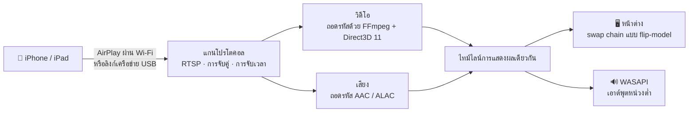

<div align="center">


# MirrorDock

**สะท้อนภาพหน้าจอ iPhone หรือ iPad ขึ้นคอมพิวเตอร์ Windows ผ่าน Wi-Fi หรือสาย USB พร้อมควบคุม iPhone ด้วยเมาส์และคีย์บอร์ด**

[](https://github.com/bestkakkoii/MirrorDock/releases/latest)
[](https://github.com/bestkakkoii/MirrorDock/releases)
[](https://github.com/bestkakkoii/MirrorDock/releases/latest)
[](README_AI.md)
[](LICENSE)
[](https://github.com/bestkakkoii/MirrorDock/stargazers)

[English](README.md) · [繁體中文](README.zh-TW.md) · [简体中文](README.zh-CN.md) · [日本語](README.ja.md) · [한국어](README.ko.md) · [Español](README.es.md) · [Deutsch](README.de.md) · [Français](README.fr.md) · [Tiếng Việt](README.vi.md) · **ไทย** · [Русский](README.ru.md)

</div>

---

MirrorDock คือตัวรับ AirPlay สำหรับ Windows เพียงเลือกโปรแกรมนี้ใน *การสะท้อนภาพหน้าจอ* บน iPhone ภาพและเสียงของโทรศัพท์ก็จะมาอยู่บนคอมพิวเตอร์ ในหน้าต่างที่ใช้งานได้เหมือนโปรแกรมเล่นสื่อ ทั้งโปรแกรมมีเพียง `mirror_dock.exe` ไฟล์เดียว ไม่มีตัวติดตั้ง ไม่ต้องใช้ GStreamer ไม่ต้องมีบริการ Bonjour และไม่มีรันไทม์ใดให้ต้องตั้งค่า

โปรแกรมนี้สร้างขึ้นบนแกนโปรโตคอล AirPlay ของ [UxPlay](https://github.com/FDH2/UxPlay) ร่วมกับเอนจินสื่อที่เขียนขึ้นสำหรับ Windows โดยเฉพาะ (Direct3D 11, FFmpeg, WASAPI) จนถึงเวอร์ชัน 1.6 โปรแกรมนี้เผยแพร่ในชื่อ *UxPlay for Windows (native)*

## ✨ จุดเด่น

| | |
|---|---|
| 📶 **สะท้อนภาพหน้าจอผ่าน Wi-Fi** | แค่โทรศัพท์กับคอมพิวเตอร์อยู่ในเครือข่ายเดียวกัน ไม่ต้องติดตั้งอะไรเพิ่มทั้งสองฝั่ง |
| 🔌 **สะท้อนภาพหน้าจอผ่านสาย USB** | เมื่อเปิด *ฮอตสปอตส่วนบุคคล* ไว้ AirPlay จะวิ่งผ่านสายชาร์จ ข้อมูลส่งถึงกันโดยตรงระหว่างสองเครื่อง เสถียร และไม่ใช้เน็ตมือถือ |
| 🎬 **ภาพคมชัดและลื่นไหล** | ถอดรหัส H.265 / H.264 ด้วย GPU ตัวที่แสดงผลออกจอภาพของคุณ (Intel, AMD หรือ NVIDIA) แสดงภาพโดยไม่ต้องคัดลอกข้อมูล และจัดจังหวะให้เข้ากับจอ เมื่อ GPU ถอดรหัสไม่ได้ ก็จะถอดรหัสด้วยซอฟต์แวร์แทน |
| 🔊 **เสียงตรงกับภาพ** | ส่งเสียงออกทาง WASAPI แบบหน่วงต่ำ บนไทม์ไลน์เดียวกับภาพ เสียงพูดจึงตรงกับปาก |
| 🎛️ **สามโหมด** | *เน้นคุณภาพ*, *สมดุล* (ค่าเริ่มต้น) และ *เน้นประสิทธิภาพ*: คุณเลือกเองได้ว่าจะเอาภาพคมชัดที่สุดหรือความหน่วงต่ำที่สุด |
| ✂️ **ครอบตัดขอบดำ** | ตัดขอบดำรอบภาพยนตร์ออกให้อัตโนมัติ หรือให้คุณใช้เมาส์ลากกรอบเลือกส่วนใดของภาพก็ได้ |
| 🖱️ **ควบคุม iPhone** | คลิก ลาก เลื่อน และพิมพ์บนภาพ แล้วโทรศัพท์ก็จะทำตาม ระหว่างนั้นภาพจะไม่รอเวลาที่ประทับมากับภาพอีกต่อไป จึงตามมือคุณได้เร็วขึ้น เป็นความสามารถที่มีมาในตัว ไม่ต้องใช้โปรแกรมเสริม ไม่ต้องเจลเบรก (ต้องใช้ iOS 27 สาย USB และโหมดนักพัฒนา) |
| 🪟 **หน้าต่างที่ใช้งานได้ดีจริง** | เปิดขึ้นมาในขนาดที่พอเหมาะ คงสัดส่วนภาพไว้ขณะปรับขนาด จำขนาดและตำแหน่งได้ เต็มหน้าจอได้ด้วยปุ่มเดียว และอยู่บนสุดเสมอได้ |
| 📸 **จับภาพหน้าจอ** | กด **F9** เพื่อบันทึกภาพที่สะท้อนมาด้วยความละเอียดเต็มของโทรศัพท์เป็นไฟล์ PNG และคัดลอกไปยังคลิปบอร์ด |
| 🌐 **สิบเอ็ดภาษา** | ภาษาของโปรแกรมเป็นไปตามภาษาที่แสดงของ Windows |
| 🩺 **รู้จักคอมพิวเตอร์ของคุณ** | หน้าต่าง “เกี่ยวกับ” จะตรวจสิ่งที่มีผลต่อการสะท้อนภาพหน้าจอ (การ์ดจอ ไดรเวอร์ เครือข่าย ไฟร์วอลล์ และซอฟต์แวร์ USB ของ Apple) ให้คะแนน บอกว่าควรแก้ไขอะไร และแก้ให้เองเท่าที่ทำได้ด้วยการกดปุ่มเดียว |
| 🔄 **อัปเดตในคลิกเดียว** | แจ้งให้คุณทราบเมื่อมีรุ่นใหม่ออกมา และติดตั้งให้เมื่อคุณสั่ง ทุกรุ่นมีลายเซ็นกำกับ และจะถูกตรวจสอบก่อนติดตั้ง |
| 🧳 **ไฟล์เดียว** | ไฟล์โปรแกรมเพียงไฟล์เดียว ขนาดประมาณ 12 MB ที่ต้องอาศัยแค่ตัว Windows เท่านั้น |

## 🚀 เริ่มต้นใช้งานอย่างรวดเร็ว

1. ดาวน์โหลด `mirror_dock_win64.zip` จาก [Releases](https://github.com/bestkakkoii/MirrorDock/releases/latest) แล้วแตกไฟล์ไว้ที่ใดก็ได้
2. เปิด `mirror_dock.exe` หากไฟร์วอลล์ Windows ถาม ให้เลือก **อนุญาต** (เครือข่ายในบ้านถือเป็นเครือข่าย *ส่วนตัว*)
3. บน iPhone: **ศูนย์ควบคุม → การสะท้อนภาพหน้าจอ → MirrorDock@ชื่อคอมพิวเตอร์ของคุณ**

โปรแกรมจะอยู่ในพื้นที่แจ้งให้ทราบ (ข้างนาฬิกา) หน้าต่างวิดีโอจะปรากฏเมื่อโทรศัพท์เชื่อมต่อเข้ามา การปิดหน้าต่างเป็นการจบการสะท้อนภาพครั้งนั้น ส่วน **ออก** ในเมนูเป็นการปิดโปรแกรม

> [!TIP]
> ความต้องการของระบบ: Windows 10 หรือ 11 (x64) และ GPU ที่รองรับ Direct3D 11 หากไม่มี โปรแกรมจะใช้ตัวเรนเดอร์แบบซอฟต์แวร์ที่มีมาในตัว

## 🔌 การสะท้อนภาพหน้าจอผ่านสาย USB

1. ติดตั้งไดรเวอร์ USB ของ Apple หนึ่งครั้ง: เปิด `install_apple_usb_support.cmd` จากไฟล์ zip หรือติดตั้ง **อุปกรณ์ Apple** จาก Microsoft Store
2. บน iPhone ให้เปิด **การตั้งค่า → ฮอตสปอตส่วนบุคคล → อนุญาตให้ผู้อื่นเข้าร่วม** แล้วจึงเสียบสาย
3. เลือก MirrorDock ใน *การสะท้อนภาพหน้าจอ* แถบควบคุมจะแสดง **USB** หรือ **Wi-Fi** ตามช่องทางที่ใช้อยู่

- **ใช้ USB เป็นหลัก / Wi-Fi เท่านั้น** ใช้สลับช่องทางโดยไม่แตะต้องอุปกรณ์ USB โทรศัพท์จึงชาร์จต่อไปได้ *Wi-Fi เท่านั้น* มีผลบังคับจริง: การเชื่อมต่อที่ยังเข้ามาทางสายจะถูกปฏิเสธ
- **เน็ตมือถือของคุณปลอดภัย** ตัวการสะท้อนภาพเป็นการส่งข้อมูลกันโดยตรงระหว่างสองเครื่อง หาก Windows เริ่มส่งการใช้อินเทอร์เน็ตของคอมพิวเตอร์เองผ่านโทรศัพท์ MirrorDock จะตรวจพบและเสนอวิธีแก้ในคลิกเดียว (**ประหยัดเน็ตมือถือ**)

## 🎛️ โหมด

| โหมด | การทำงาน | เหมาะกับ |
|---|---|---|
| **เน้นคุณภาพ** | ความละเอียดเต็ม บัฟเฟอร์เพิ่มขึ้นเล็กน้อย ไม่ข้ามเฟรมใดเลย | ภาพยนตร์ สไลด์ ข้อความ |
| **สมดุล** *(ค่าเริ่มต้น)* | ปรับตามจอภาพ, GPU และเครือข่าย | การใช้งานทั่วไป |
| **เน้นประสิทธิภาพ** | สตรีมที่เบาลง (สูงสุด 1920×1080) บัฟเฟอร์น้อยที่สุด แสดงเฟรมล่าสุดเสมอ | เกม คอมพิวเตอร์รุ่นเก่า |

เลือกโหมดได้ในเมนูหรือด้วย `-mode` การจัดจังหวะเวลาจะเปลี่ยนทันที ส่วนความละเอียดของสตรีมจะเปลี่ยนเมื่อเชื่อมต่อครั้งถัดไป

## ✂️ การครอบตัดขอบดำ

ภาพยนตร์ 16:9 บนโทรศัพท์ที่หน้าจอกว้างกว่านั้นจะถูกสะท้อนมาพร้อมขอบดำ เพราะโทรศัพท์สะท้อนภาพทั้งหน้าจอ

- **อัตโนมัติ** (ปุ่ม **C**): ขอบดำจะถูกตัดออกและหน้าต่างจะแนบพอดีกับภาพ การครอบตัดจะยังคงอยู่เมื่อเล่นภาพยนตร์เรื่องถัดไปต่อจากเรื่องเดิม แต่เมื่อมีสิ่งอื่นปรากฏในบริเวณขอบและค้างอยู่ เช่น ปุ่มควบคุมของตัวเล่นวิดีโอ ภาพทั้งหมดจะกลับมาภายในราวหนึ่งวินาที
- **กำหนดเอง** (ปุ่ม **X**): ลากกรอบรอบส่วนที่คุณต้องการดู กด **Esc** เพื่อยกเลิก

## 🖱️ การควบคุม iPhone

กด **F8** (หรือเลือก **ควบคุม iPhone ด้วยเมาส์และคีย์บอร์ด** ในเมนู) แล้วภาพจะกลายเป็นหน้าจอของโทรศัพท์: คุณทำอะไรบนภาพ iPhone ก็ทำตามนั้น

| บนคอมพิวเตอร์ | บน iPhone |
|---|---|
| ปุ่มเมาส์ซ้าย: คลิก กดค้าง ลาก | นิ้วเดียว: แตะ แตะค้างไว้ ปัด |
| ล้อเมาส์ (กด **Shift** ค้างไว้: เลื่อนไปด้านข้าง) | เลื่อนเนื้อหาใต้ตัวชี้ |
| ปุ่มกลาง | กลับไปที่หน้าจอโฮม |
| ดับเบิลคลิก | เปิด / ปิดเต็มหน้าจอตามเดิม แต่ถ้ากด **Alt** ค้างไว้: แตะสองครั้งบน iPhone |
| คีย์บอร์ด | พิมพ์บนโทรศัพท์ได้เหมือนต่อคีย์บอร์ดเข้ากับเครื่อง โดย **Ctrl** ทำหน้าที่แทน ⌘ และ **Ctrl+Space** ใช้สลับภาษาที่พิมพ์บนโทรศัพท์ |
| **Page Down** / **Page Up**, **Alt** + ปุ่มลูกศร | ตวัดนิ้วเพื่อไปยังหน้าหรือวิดีโอถัดไปหรือก่อนหน้า |
| ปุ่มเมาส์ขวา | เมนูของ MirrorDock ตามเดิม |

สิ่งที่ต้องมี:

1. **iOS 27 ขึ้นไป** และ **สาย USB** โดย iPhone ต้องเชื่อถือคอมพิวเตอร์เครื่องนี้แล้ว มีเพียงการควบคุมเท่านั้นที่ส่งผ่านสาย ส่วนภาพจะยังมาทาง Wi-Fi ต่อไปก็ได้
2. **โหมดนักพัฒนา** บน iPhone: *การตั้งค่า → ความเป็นส่วนตัวและความปลอดภัย → โหมดนักพัฒนา* สวิตช์นี้จะถูกซ่อนไว้จนกว่าจะมีเครื่องมือสำหรับนักพัฒนาร้องขอ ซึ่ง MirrorDock จะร้องขอเมื่อคุณกด F8 เป็นครั้งแรก
3. การเชื่อมต่ออินเทอร์เน็ตในครั้งแรก และครั้งแรกหลังอัปเดต iOS แต่ละครั้ง: MirrorDock จะติดตั้ง *Developer Disk Image* ซึ่งเป็นดิสก์อิมเมจสำหรับนักพัฒนาของ Apple ลงในโทรศัพท์ ขั้นตอนนี้ใช้เวลาประมาณหนึ่งนาที

> [!NOTE]
> AirPlay ส่งอินพุตไม่ได้ การควบคุมจึงต้องใช้อีกเส้นทางหนึ่ง คือบริการสำหรับนักพัฒนาของ iOS ชุดเดียวกับที่ Xcode ใช้ควบคุมเครื่องจริง ในการติดตั้งบริการเหล่านี้ MirrorDock จะดาวน์โหลดอิมเมจของ Apple จากคลังเก็บ [DeveloperDiskImage](https://github.com/doronz88/DeveloperDiskImage) แล้วขอให้บริการลงนามของ Apple (`gs.apple.com`) ลงนามรับรองอิมเมจนั้นสำหรับโทรศัพท์ของคุณ ซึ่งทำให้ Apple ทราบหมายเลขชิปของโทรศัพท์ เหมือนกับที่ Xcode ทำทุกประการ หลังจากนั้น การควบคุมจะไม่ติดต่อออกไปที่ใดอีก

ขณะเปิดการควบคุมอยู่ คำสั่งของหน้าต่างเองมาก่อนเสมอ: **F8**, **F9**, **F11**, **Alt+Enter**, **Alt+F4**, **Esc** ในโหมดเต็มหน้าจอ และการดับเบิลคลิก ยังคงเป็นของหน้าต่าง เมื่อดับเบิลคลิก คลิกแรกจะไปถึงโทรศัพท์เป็นการแตะหนึ่งครั้งไปแล้วก่อนที่คลิกที่สองจะตามมา จึงควรดับเบิลคลิกที่ขอบดำถ้ามี หรือกด **F11** แทน ส่วนแถบควบคุมจะไม่แสดงขึ้นมา เพราะจะบังส่วนล่างของหน้าจอโทรศัพท์

**หน่วงน้อยลงขณะควบคุม** iPhone ประทับเวลาให้ภาพและเสียงช้ากว่าเวลาที่ข้อมูลมาถึงจริงเล็กน้อย (สำหรับภาพผ่าน Wi-Fi ประมาณ 85 มิลลิวินาที) และตามปกติ MirrorDock จะรอจนถึงเวลานั้น เมื่อเปิดการควบคุม โปรแกรมจะเล่นทั้งสองอย่างให้เร็วที่สุดเท่าที่ข้อมูลมาถึงทัน โดยภาพกับเสียงยังตรงกันเหมือนเดิม ผลของการแตะจึงปรากฏเร็วขึ้น การเปลี่ยนจะค่อย ๆ เกิดขึ้นภายในไม่กี่วินาที เสียงจะไม่กระตุก

## ⌨️ คีย์บอร์ดและเมาส์

| การทำงาน | ปุ่ม |
|---|---|
| เปิด / ปิดเต็มหน้าจอ | **F**, **F11**, **Alt+Enter** หรือดับเบิลคลิก; **Esc** เพื่อออก |
| ครอบตัดขอบดำอัตโนมัติ | **C** |
| ลากกรอบเลือกพื้นที่ที่จะแสดง | **X** |
| อยู่บนสุดเสมอ | **T** |
| ปิดเสียง (เฉพาะฝั่งคอมพิวเตอร์) | **M** |
| จับภาพหน้าจอ (ไฟล์ PNG และคลิปบอร์ด) | **F9** |
| เปิด / ปิดการควบคุม iPhone | **F8** |
| แถบควบคุม | เลื่อนเมาส์ไปบนภาพ |
| เมนู | คลิกขวาที่ใดก็ได้บนภาพ |

ขณะควบคุม iPhone อยู่ ปุ่มตัวอักษรจะพิมพ์ลงบนโทรศัพท์ กด **F8** เพื่อคืนปุ่มเหล่านี้ให้หน้าต่าง ภาพหน้าจอจะถูกบันทึกไว้ในโฟลเดอร์ *MirrorDock* ภายในโฟลเดอร์ *รูปภาพ* ของคุณ ตั้งชื่อตามวันที่และเวลา ด้วยขนาดที่โทรศัพท์ส่งมา ไม่ใช่ขนาดของหน้าต่าง

## 🔄 การอัปเดต

**ตรวจหาการอัปเดต…** ในเมนูจะถาม GitHub ว่ารุ่นล่าสุดคือรุ่นใด แล้วแสดงคำตอบในหน้าต่าง “เกี่ยวกับ” เมื่อมีรุ่นที่ใหม่กว่า **อัปเดตตอนนี้** จะดาวน์โหลดรุ่นนั้น ตรวจสอบ แล้วนำไปแทนที่โปรแกรมที่กำลังทำงานอยู่ จากนั้นโปรแกรมจะเริ่มใหม่เอง หากกำลังสะท้อนภาพหน้าจออยู่ การเริ่มใหม่จะรอจนการสะท้อนภาพสิ้นสุด หรือจนกว่าคุณจะเลือก **เริ่มใหม่ตอนนี้** ส่วน **ดาวน์โหลด** ยังคงเปิดไฟล์ zip ในเบราว์เซอร์ของคุณเผื่อคุณอยากแตกไฟล์เอง และ **มีอะไรใหม่** จะเปิดบันทึกประจำรุ่น จะไม่มีการติดตั้งอะไรเว้นแต่คุณสั่ง

- **ตรวจหาอัตโนมัติ** วันละครั้ง และแจ้งเตือนเมื่อมีรุ่นใหม่ออกมา ปิดได้ด้วยสวิตช์ตัวเดียวในหน้าต่าง “เกี่ยวกับ”
- **ข้อมูลที่ส่งออกไป** มีเพียงคำขอหนึ่งรายการไปยัง `api.github.com` โดย GitHub จะเห็นที่อยู่ IP ของคุณและชื่อไคลเอนต์ `MirrorDock/<version>` แต่ไม่เห็นข้อมูลใดเกี่ยวกับคุณหรือคอมพิวเตอร์ของคุณ
- **ไม่ใช้เน็ตมือถือของคุณ** โปรแกรมจะไม่ตรวจหาเองเมื่อใช้การเชื่อมต่อที่ Windows ระบุว่าเป็นแบบคิดค่าบริการตามปริมาณข้อมูล หรือขณะที่คอมพิวเตอร์ออกอินเทอร์เน็ตผ่าน iPhone
- **ติดตั้งเฉพาะรุ่นของแท้** ทุกรุ่นถูกลงลายเซ็นด้วยกุญแจที่ไม่ได้เก็บไว้บนอินเทอร์เน็ต และ MirrorDock มีกุญแจสาธารณะคู่กันติดมาด้วย แพ็กเกจที่ลายเซ็นไม่ตรงจะไม่ถูกติดตั้ง ไม่ว่าจะมาจากที่ใด

## 🩺 “เกี่ยวกับ” และ “คอมพิวเตอร์เครื่องนี้”

**เกี่ยวกับ…** ในเมนูจะเปิดหน้าต่างแยกของตัวเอง ซึ่งมีสามหน้า:

| หน้า | สิ่งที่แสดง |
|---|---|
| **เกี่ยวกับ** | เวอร์ชันและวันที่เผยแพร่ การตรวจหาการอัปเดต และลิงก์ไปยังโครงการ คู่มือการใช้งาน และข้อความสัญญาอนุญาต |
| **คอมพิวเตอร์เครื่องนี้** | สิ่งที่มีผลต่อ MirrorDock บนคอมพิวเตอร์ของคุณ แสดงทีละแถว: Windows, จอภาพ, พลังงาน, เครือข่าย, ไฟร์วอลล์, โปรเซสเซอร์, หน่วยความจำ, การ์ดจอและการถอดรหัสวิดีโอของการ์ดจอ, เสียง, ไดรเวอร์การ์ดจอ, ซอฟต์แวร์ USB ของ Apple และ iPhone ที่เสียบสายอยู่ |
| **ส่วนประกอบ** | ไลบรารีและเครื่องมือทุกตัวที่ใช้สร้าง MirrorDock พร้อมเวอร์ชัน วันที่ และสัญญาอนุญาต รวมถึงวันที่เผยแพร่ของ MirrorDock แต่ละเวอร์ชัน |

ทุกแถวของ *คอมพิวเตอร์เครื่องนี้* จะถูกจัดระดับเป็น “ดี” “ควรตรวจสอบ” หรือ “มีปัญหา” แถวที่ไม่ได้อยู่ในระดับดีจะบอกว่าควรทำอย่างไร และมีปุ่มให้เมื่อ MirrorDock ทำแทนคุณได้ เช่น อนุญาตโปรแกรมผ่านไฟร์วอลล์ Windows เริ่มบริการของ Apple ติดตั้งซอฟต์แวร์ USB ของ Apple หรือเปิดหน้าการตั้งค่าของ Windows ที่ใช้จัดการเรื่องนั้น สิ่งที่ต้องใช้สิทธิ์ผู้ดูแลระบบจะทำโดยเครื่องมือของ Windows เอง หลังหน้าต่างขอความยินยอมตามปกติ คะแนนคือสัดส่วนของแถวที่เรียบร้อยดีจากแถวทั้งหมดที่มีการจัดระดับ โดยถ่วงน้ำหนักตามความสำคัญของแต่ละแถวต่อการสะท้อนภาพหน้าจอ (การถอดรหัสวิดีโอด้วยฮาร์ดแวร์มีน้ำหนักมากที่สุด) คะแนนนี้บอกว่าคอมพิวเตอร์ถูกตั้งค่าไว้พร้อมเพียงใด ไม่ใช่การทดสอบเบนช์มาร์ก **คัดลอกรายงาน** จะคัดลอกหน้านี้ไปยังคลิปบอร์ดเป็นข้อความธรรมดา สำหรับใช้เมื่อรายงานปัญหา ไม่มีข้อมูลใดในหน้านี้ออกไปจากคอมพิวเตอร์ของคุณ และโปรแกรมจะไม่แสดงหรือเก็บหมายเลขประจำเครื่องหรือชื่ออุปกรณ์ใด ๆ ไว้

## ⚙️ ตัวเลือก

เพิ่มตัวเลือกในทางลัดของ `mirror_dock.exe` หรือเขียนลงใน `%USERPROFILE%\.uxplayrc` บรรทัดละหนึ่งตัวเลือก (ไม่ต้องใส่ `-` นำหน้า) คำสั่ง `mirror_dock.exe -h` จะแสดงตัวเลือกทั้งหมด

| ตัวเลือก | ผล |
|---|---|
| `-n name` | ชื่อที่แสดงบน iPhone |
| `-fs` | เริ่มในโหมดเต็มหน้าจอ |
| `-mode quality\|balanced\|performance` | สิ่งที่ต้องการให้เน้น |
| `-crop auto\|off` | ตัดขอบดำออก / แสดงภาพทั้งหมด |
| `-gpu auto\|integrated\|discrete\|software` | GPU ที่ใช้ถอดรหัสและแสดงผล |
| `-h264` / `-h265` | เสนอเฉพาะ H.264 / เสนอ H.265 เสมอ |
| `-ui language` | ภาษาของโปรแกรม (ดูด้านล่าง) |
| `-vsync ms` | เลื่อนจังหวะเสียงเทียบกับภาพ |
| `-pin`, `-pw` | กำหนดให้ต้องใช้ PIN หรือรหัสผ่าน |

## 🌐 ภาษา

ภาษาของโปรแกรมเป็นไปตามภาษาที่แสดงของ Windows ได้แก่ English, 繁體中文, 简体中文, 日本語, 한국어, Español, Deutsch, Français, Tiếng Việt, ไทย และ Русский ภาษาอื่นนอกจากนี้จะแสดงเป็นภาษาอังกฤษ หากต้องการกำหนดภาษาเอง ให้ใช้ `-ui en|zh-TW|zh-CN|ja|ko|es|de|fr|vi|th|ru`

คู่มือการใช้งานทั้งสิบเอ็ดภาษาอยู่ในไฟล์ zip (โฟลเดอร์ `user_guide`)

## 🧩 หลักการทำงาน



ภาพและเสียงถูกจัดจังหวะบนไทม์ไลน์เดียวกัน โดยมีความหน่วงที่ปรับตามเครือข่ายและความเร็วในการถอดรหัสของคอมพิวเตอร์ ให้สั้นที่สุดเท่าที่ภาพจะไม่กระตุก

การควบคุมใช้อีกเส้นทางหนึ่งที่แยกต่างหาก MirrorDock จะเปิดอุโมงค์สำหรับนักพัฒนาของโทรศัพท์ผ่านสาย USB (ด้วย IPv6 และ TCP ขนาดเล็กที่เขียนขึ้นเอง จึงไม่ต้องใช้อะแดปเตอร์เครือข่ายและไม่ต้องใช้สิทธิ์ผู้ดูแลระบบ) แล้วส่งรายงานการสัมผัสและคีย์บอร์ดไปยังบริการรับอินพุตของโทรศัพท์

## 📊 ผลการวัด

แล็ปท็อปปี 2016 หนึ่งเครื่อง (Intel Core i7-6700HQ, Intel HD Graphics 530) สตรีมทดสอบ H.265 ขนาด 2872×1320 ที่ 60 fps ในโหมด *สมดุล* เวอร์ชัน 1.6:

| | |
|---|---|
| เฟรมของสตรีมทดสอบที่แสดงได้ | 480 จาก 480 |
| ความเหลื่อมระหว่างเสียงกับภาพเมื่อทำงานคงที่ | ประมาณ 18 ms |
| หน่วยความจำขณะไม่ได้ใช้งาน | 46 MB |
| การออกจากโปรแกรม | 0.04 วินาที |

การสะท้อนภาพหน้าจอผ่าน Wi-Fi และผ่าน USB ได้รับการตรวจสอบกับ iPhone 16 Pro Max (iOS 26) มาจนถึงเวอร์ชัน 1.5 และเวอร์ชัน 1.7 ก็ได้ทำงานกับโทรศัพท์เครื่องนั้นผ่าน Wi-Fi แล้ว โดยสตรีมขนาด 3200×1536 ของโทรศัพท์ใช้หน่วยความจำประมาณ 310 MB และหน่วยความจำ GPU 200 MB ส่วน [CHANGELOG.md](CHANGELOG.md) ระบุไว้สำหรับแต่ละรุ่นว่าส่วนใดผ่านการทดสอบกับโทรศัพท์ และส่วนใดเพียงคอมไพล์เท่านั้น

## ❓ คำถามที่พบบ่อย

**iPhone ไม่แสดงคอมพิวเตอร์ของฉันในรายการ**
ทั้งสองเครื่องต้องอยู่ในเครือข่ายเดียวกัน และไฟร์วอลล์ Windows ต้องอนุญาต `mirror_dock.exe` หน้า *คอมพิวเตอร์เครื่องนี้* ของหน้าต่าง “เกี่ยวกับ” จะบอกว่าไฟร์วอลล์หรือเครือข่ายที่ตั้งเป็น *สาธารณะ* เป็นตัวขวางอยู่หรือไม่ และปุ่มในหน้านั้นจะอนุญาต MirrorDock ผ่านไฟร์วอลล์ให้ การปิดแล้วเปิด Wi-Fi ของ iPhone ใหม่จะช่วยรีเฟรชรายการ

**เสียบสายแล้ว แต่การสะท้อนภาพยังใช้ Wi-Fi อยู่**
ต้องเปิดฮอตสปอตส่วนบุคคลไว้ และต้องเลือกช่องทางเป็น *ใช้ USB เป็นหลัก* บรรทัดที่สองของเมนูจะแสดงสถานะของลิงก์ USB

**ไม่มีเสียง**
ตรวจดูปุ่มลำโพงในแถบควบคุม แล้วจึงดูตัวปรับแต่งระดับเสียงของ Windows

**เสียงไม่ตรงกับปาก**
ปรับละเอียดด้วย `-vsync` ตามด้วยจำนวนมิลลิวินาที (ค่าบวกทำให้เสียงช้าลง)

**กด F8 แล้วขึ้นว่าควบคุม iPhone ไม่ได้**
ข้อความจะบอกสาเหตุ: ยังไม่ได้เสียบสายหรือ iPhone ยังไม่เชื่อถือคอมพิวเตอร์เครื่องนี้ โหมดนักพัฒนาปิดอยู่ iPhone ใช้ iOS ที่เก่ากว่า 27 หรือติดตั้ง Developer Disk Image ไม่สำเร็จ (ขั้นตอนนี้ต้องใช้อินเทอร์เน็ต) หลังจากเปิดโหมดนักพัฒนาแล้ว iPhone จะรีสตาร์ทและขอให้ยืนยันอีกครั้ง

**เปิดโหมดนักพัฒนาทิ้งไว้ปลอดภัยหรือไม่?**
โหมดนี้เป็นสวิตช์ของ Apple เองสำหรับผู้ที่สร้างแอป ช่วยให้คอมพิวเตอร์ที่เชื่อถือแล้วติดตั้งและดีบักแอปได้ รวมทั้งเข้าถึงบริการสำหรับนักพัฒนา แต่ไม่ได้เป็นการเจลเบรกโทรศัพท์ และคุณปิดกลับได้ที่ตำแหน่งเดิม

**MirrorDock ใช้อินเทอร์เน็ตหรือไม่?**
ตัวการสะท้อนภาพเป็นการส่งข้อมูลกันโดยตรงระหว่างสองเครื่อง MirrorDock ออกอินเทอร์เน็ตเพียงสองกรณีเท่านั้น คือการอัปเดต (ตรวจหาบน GitHub วันละครั้งซึ่งคุณปิดได้ และดาวน์โหลดรุ่นใหม่เมื่อคุณสั่ง) และเมื่อคุณควบคุม iPhone เป็นครั้งแรก เพื่อรับ Developer Disk Image ของ Apple พร้อมลายเซ็นของ Apple สำหรับอิมเมจนั้น

**ไฟล์บันทึกอยู่ที่ไหน?**
`%LOCALAPPDATA%\MirrorDock\mirror_dock.log` หรือเลือก **เปิดไฟล์บันทึก** ในเมนู

## 🛠️ การบิลด์จากซอร์สโค้ด

ใช้ MSYS2 CLANG64 (clang 23, libc++ พร้อมโมดูลไลบรารีมาตรฐาน C++26, CMake 4.4, Ninja) และคอมไพเลอร์เชดเดอร์ของ Windows SDK ส่วน FFmpeg, OpenSSL และ libplist จะถูกบิลด์เป็นไลบรารีแบบสแตติกจากคอมมิตที่ตรึงไว้ โดยรายการคอมมิตที่ตรึงไว้อยู่ใน `win_native/build_scripts/build_inputs.tsv` ซึ่งเป็นรายการเดียวกับที่หน้าต่าง “เกี่ยวกับ” แสดง โปรแกรมที่คุณบิลด์เองและต้องการให้อัปเดตจากรุ่นที่คุณเผยแพร่เอง ต้องใช้กุญแจลงลายเซ็นของคุณเอง ดูที่ `win_native/build_scripts/sign_release.ps1`

```sh
bash win_native/build_scripts/fetch_deps.sh <src_root>
MSYSTEM=CLANG64 bash -lc 'bash win_native/build_scripts/build_deps.sh <src_root> <prefix> libplist openssl ffmpeg'
MSYSTEM=CLANG64 bash -lc 'bash win_native/build_scripts/build_uxplay_native.sh <this_repo> <build_dir> <prefix> Release'
```

[README_AI.md](README_AI.md) อธิบายสถาปัตยกรรม เงื่อนไขที่ต้องคงไว้เสมอ อินพุตที่ตรึงเวอร์ชันไว้ และสิ่งที่ได้รับการตรวจสอบแล้ว ส่วน [CHANGELOG.md](CHANGELOG.md) รวบรวมรายการรุ่นที่เผยแพร่

## 📜 สัญญาอนุญาต

MirrorDock เผยแพร่ภายใต้ **GNU General Public License v3** ([LICENSE](LICENSE)) เนื่องจากสร้างขึ้นบนโค้ด GPL-3.0 ของ UxPlay ส่วนเอนจินสื่อสำหรับ Windows ใน [`win_native/`](win_native) เป็นงานต้นฉบับภายใต้ **สัญญาอนุญาต MIT** ([win_native/LICENSE](win_native/LICENSE)) และส่วนควบคุม iPhone ใน [`phone_control/`](phone_control) เป็นงานต้นฉบับภายใต้ **GPL-3.0-or-later** ไฟล์ zip ของรุ่นที่เผยแพร่มีข้อความสัญญาอนุญาตของไลบรารีทุกตัวที่รวมมาด้วย และซอร์สโค้ดที่ตรงกันฉบับสมบูรณ์

## 🙏 ขอขอบคุณ

- [UxPlay](https://github.com/FDH2/UxPlay) โดย F. Duncanh และผู้ร่วมพัฒนา — เซิร์ฟเวอร์ AirPlay ที่ MirrorDock สร้างขึ้นบนนั้น
- [RPiPlay](https://github.com/FD-/RPiPlay) โดย Florian Draschbacher และ [shairplay](https://github.com/juhovh/shairplay) โดย Juho Vähä-Herttua — ต้นทางของแกนโปรโตคอลดังกล่าว
- [pymobiledevice3](https://github.com/doronz88/pymobiledevice3) โดย doronz88 และผู้ร่วมพัฒนา — แหล่งความรู้เกี่ยวกับบริการสำหรับนักพัฒนาของ iOS ที่ใช้เป็นพื้นฐานในการเขียนส่วนควบคุม iPhone
- playfair, llhttp, csrp, FFmpeg, OpenSSL และ libplist

AirPlay, iPhone และ iPad เป็นเครื่องหมายการค้าของ Apple Inc. MirrorDock เป็นโครงการโอเพนซอร์สอิสระ และไม่มีส่วนเกี่ยวข้องกับ Apple
