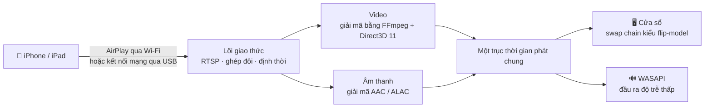

<div align="center">


# MirrorDock

**Phản chiếu iPhone hoặc iPad lên máy tính Windows — qua Wi-Fi hoặc cáp USB — và điều khiển iPhone bằng chuột và bàn phím.**

[](https://github.com/bestkakkoii/MirrorDock/releases/latest)
[](https://github.com/bestkakkoii/MirrorDock/releases)
[](https://github.com/bestkakkoii/MirrorDock/releases/latest)
[](README_AI.md)
[](LICENSE)
[](https://github.com/bestkakkoii/MirrorDock/stargazers)

[English](README.md) · [繁體中文](README.zh-TW.md) · [简体中文](README.zh-CN.md) · [日本語](README.ja.md) · [한국어](README.ko.md) · [Español](README.es.md) · [Deutsch](README.de.md) · [Français](README.fr.md) · **Tiếng Việt** · [ไทย](README.th.md)

</div>

---

MirrorDock là một bộ thu AirPlay dành cho Windows. Chỉ cần chọn nó trong mục *Phản chiếu màn hình* trên iPhone là hình ảnh và âm thanh của điện thoại xuất hiện trên máy tính, trong một cửa sổ hoạt động như một trình phát đa phương tiện. Cả chương trình chỉ là một tệp `mirror_dock.exe` duy nhất: không trình cài đặt, không GStreamer, không dịch vụ Bonjour, không có môi trường chạy nào phải thiết lập.

Chương trình được xây dựng trên lõi giao thức AirPlay của [UxPlay](https://github.com/FDH2/UxPlay), kết hợp với một bộ máy xử lý đa phương tiện viết riêng cho Windows (Direct3D 11, FFmpeg, WASAPI). Cho đến phiên bản 1.6, nó được phát hành dưới tên *UxPlay for Windows (native)*.

## ✨ Điểm nổi bật

| | |
|---|---|
| 📶 **Phản chiếu qua Wi-Fi** | Điện thoại và máy tính ở cùng một mạng, không phải cài thêm gì ở cả hai phía. |
| 🔌 **Phản chiếu qua cáp USB** | Khi bật *Điểm truy cập cá nhân*, AirPlay chạy ngay trên cáp sạc: cục bộ, ổn định và không tốn dữ liệu di động. |
| 🎬 **Hình ảnh sắc nét, mượt mà** | H.265 / H.264 được giải mã trên chính GPU đang xuất hình ra màn hình của bạn (Intel, AMD hoặc NVIDIA), hiển thị mà không cần sao chép và theo đúng nhịp của màn hình. Khi GPU không làm được, bộ giải mã phần mềm sẽ đảm nhận. |
| 🔊 **Âm thanh khớp hình** | Đầu ra WASAPI độ trễ thấp chạy trên cùng một trục thời gian với hình ảnh, nên khẩu hình và lời nói khớp nhau. |
| 🎛️ **Ba chế độ** | *Chất lượng*, *Cân bằng* (mặc định) và *Hiệu năng*: bạn chọn giữa hình ảnh sắc nét nhất và độ trễ thấp nhất. |
| ✂️ **Cắt viền đen** | Tự động cắt bỏ viền đen quanh bộ phim, hoặc để bạn dùng chuột khoanh bất kỳ phần nào của hình ảnh. |
| 🖱️ **Điều khiển iPhone** | Bấm, kéo, cuộn và gõ phím ngay trên hình ảnh, điện thoại sẽ làm theo. Tích hợp sẵn: không cần chương trình hỗ trợ, không cần jailbreak (cần iOS 27, cáp USB và Chế độ nhà phát triển). |
| 🪟 **Một cửa sổ đúng nghĩa** | Mở ra với kích thước hợp lý, giữ nguyên tỉ lệ khung hình khi bạn đổi kích thước, ghi nhớ kích thước và vị trí, vào toàn màn hình bằng một phím, luôn ở trên cùng. |
| 🌐 **Mười ngôn ngữ** | Giao diện đi theo ngôn ngữ hiển thị Windows của bạn. |
| 🧳 **Một tệp duy nhất** | Chỉ một tệp thực thi khoảng 12 MB, không cần gì ngoài chính Windows. |

## 🚀 Bắt đầu nhanh

1. Tải `mirror_dock_win64.zip` từ trang [Releases](https://github.com/bestkakkoii/MirrorDock/releases/latest) rồi giải nén vào bất kỳ đâu.
2. Chạy `mirror_dock.exe`. Nếu Tường lửa Windows hỏi, hãy chọn **Cho phép** (mạng gia đình là mạng *riêng*).
3. Trên iPhone: **Trung tâm điều khiển → Phản chiếu màn hình → MirrorDock@tên-máy-tính**.

Chương trình nằm ở khu vực thông báo (cạnh đồng hồ). Cửa sổ video xuất hiện khi điện thoại kết nối; đóng cửa sổ là kết thúc phiên đó, còn **Thoát** trong menu sẽ tắt hẳn chương trình.

> [!TIP]
> Yêu cầu: Windows 10 hoặc 11 (x64) và một GPU hỗ trợ Direct3D 11. Nếu không có, trình kết xuất phần mềm tích hợp sẵn sẽ được dùng.

## 🔌 Phản chiếu qua cáp USB

1. Cài trình điều khiển USB của Apple một lần: chạy `install_apple_usb_support.cmd` trong tệp zip, hoặc cài **Thiết bị Apple** từ Microsoft Store.
2. Trên iPhone, bật **Cài đặt → Điểm truy cập cá nhân → Cho phép người khác kết nối**, rồi cắm cáp.
3. Chọn MirrorDock trong *Phản chiếu màn hình*. Thanh điều khiển hiện **USB** hoặc **Wi-Fi**, tùy theo kết nối đang được dùng.

- **Ưu tiên USB / Chỉ Wi-Fi** đổi đường kết nối mà không đụng đến thiết bị USB, nên điện thoại vẫn tiếp tục sạc. *Chỉ Wi-Fi* được thực thi nghiêm ngặt: kết nối nào vẫn đến qua cáp sẽ bị từ chối.
- **Dữ liệu di động của bạn vẫn an toàn.** Bản thân việc phản chiếu chỉ diễn ra cục bộ. Nếu Windows bắt đầu chuyển lưu lượng Internet của chính máy tính qua điện thoại, MirrorDock sẽ nhận ra và đề nghị khắc phục chỉ bằng một cú bấm (**Tiết kiệm dữ liệu di động**).

## 🎛️ Các chế độ

| Chế độ | Tác dụng | Phù hợp với |
|---|---|---|
| **Chất lượng** | Độ phân giải đầy đủ, bộ đệm nhiều hơn một chút, không bỏ khung hình nào. | Phim, trang trình chiếu, văn bản |
| **Cân bằng** *(mặc định)* | Tự điều chỉnh theo màn hình, GPU và mạng. | Sử dụng hằng ngày |
| **Hiệu năng** | Luồng nhẹ hơn (tối đa 1920×1080), bộ đệm tối thiểu, luôn hiện khung hình mới nhất. | Trò chơi, máy tính đời cũ |

Chọn chế độ trong menu hoặc bằng `-mode`. Phần định thời thay đổi ngay; độ phân giải luồng thay đổi từ lần kết nối tiếp theo.

## ✂️ Cắt viền đen

Một bộ phim 16:9 phát trên điện thoại có màn hình rộng hơn sẽ được phản chiếu kèm viền đen, vì điện thoại phản chiếu toàn bộ màn hình của nó.

- **Tự động** (phím **C**): viền đen được cắt bỏ và cửa sổ ôm sát hình ảnh. Vùng cắt vẫn được giữ khi phim này nối tiếp phim khác; còn khi có nội dung khác xuất hiện trong viền và ở lại đó, chẳng hạn các nút điều khiển của trình phát, toàn bộ hình ảnh sẽ trở lại trong vòng khoảng một giây.
- **Thủ công** (phím **X**): kéo một khung quanh phần bạn muốn xem. **Esc** để hủy.

## 🖱️ Điều khiển iPhone

Nhấn **F8** (hoặc chọn **Điều khiển iPhone bằng chuột và bàn phím** trong menu) là hình ảnh trở thành màn hình của điện thoại: bạn làm gì trên đó, iPhone làm đúng như vậy.

| Trên máy tính | Trên iPhone |
|---|---|
| Nút chuột trái: bấm, giữ, kéo | Một ngón tay: chạm, nhấn giữ, vuốt |
| Con lăn chuột (giữ **Shift**: cuộn ngang) | Cuộn nội dung nằm dưới con trỏ |
| Nút chuột giữa | Về Màn hình chính |
| Bàn phím | Gõ chữ trên điện thoại như thể có bàn phím cắm vào máy; **Ctrl** tương ứng với ⌘, **Ctrl+Phím cách** chuyển ngôn ngữ nhập của điện thoại |
| **Page Down** / **Page Up**, **Alt** + phím mũi tên | Vuốt nhanh sang trang hoặc video tiếp theo hay trước đó |
| Nút chuột phải | Vẫn là menu của MirrorDock như mọi khi |

Điều kiện cần có:

1. **iOS 27 trở lên** và **cáp USB**, đồng thời iPhone đã tin cậy máy tính này. Chỉ riêng việc điều khiển đi qua cáp; hình ảnh vẫn có thể tiếp tục truyền qua Wi-Fi.
2. **Chế độ nhà phát triển** trên iPhone: *Cài đặt → Quyền riêng tư & Bảo mật → Chế độ nhà phát triển*. Công tắc này bị ẩn cho đến khi có một công cụ phát triển yêu cầu, và MirrorDock làm việc đó ở lần đầu tiên bạn nhấn F8.
3. Kết nối Internet ở lần đầu tiên, và ở lần đầu tiên sau mỗi lần cập nhật iOS: MirrorDock cài lên điện thoại *Developer Disk Image* của Apple, tức ảnh đĩa chứa các dịch vụ dành cho nhà phát triển. Việc này mất khoảng một phút.

> [!NOTE]
> AirPlay không truyền được thao tác nhập, nên việc điều khiển đi theo một đường khác: qua các dịch vụ dành cho nhà phát triển của iOS, chính là những dịch vụ Xcode dùng để điều khiển thiết bị thật. Để cài các dịch vụ này, MirrorDock tải ảnh đĩa của Apple từ kho [DeveloperDiskImage](https://github.com/doronz88/DeveloperDiskImage) rồi yêu cầu dịch vụ ký của Apple (`gs.apple.com`) ký ảnh đĩa đó cho điện thoại của bạn; việc này cho Apple biết các mã số chip của điện thoại, hệt như Xcode vẫn làm. Sau đó, việc điều khiển không liên lạc với bất kỳ ai nữa.

Trong lúc đang điều khiển iPhone, **F8**, **F11**, **Alt+Enter** và **Alt+F4** vẫn thuộc về cửa sổ, còn thanh điều khiển thì không hiện ra, vì nó sẽ che mất phần dưới cùng của màn hình điện thoại.

## ⌨️ Bàn phím và chuột

| Thao tác | Phím |
|---|---|
| Bật / tắt toàn màn hình | **F**, **F11**, **Alt+Enter** hoặc bấm đúp; **Esc** để thoát |
| Tự động cắt viền đen | **C** |
| Khoanh vùng cần hiển thị | **X** |
| Luôn ở trên cùng | **T** |
| Tắt tiếng (chỉ phía máy tính) | **M** |
| Bật / tắt điều khiển iPhone | **F8** |
| Thanh điều khiển | Di chuột lên hình ảnh |
| Menu | Bấm chuột phải vào bất kỳ đâu trên hình ảnh |

Trong lúc đang điều khiển iPhone, các phím chữ cái được gõ vào điện thoại; **F8** trả chúng lại cho cửa sổ.

## ⚙️ Tùy chọn

Thêm tùy chọn vào một lối tắt của `mirror_dock.exe`, hoặc ghi mỗi tùy chọn một dòng (bỏ dấu `-` ở đầu) vào `%USERPROFILE%\.uxplayrc`. `mirror_dock.exe -h` liệt kê toàn bộ tùy chọn.

| Tùy chọn | Tác dụng |
|---|---|
| `-n name` | Tên hiển thị trên iPhone |
| `-fs` | Khởi động ở chế độ toàn màn hình |
| `-mode quality\|balanced\|performance` | Mục tiêu cần tối ưu |
| `-crop auto\|off` | Cắt bỏ viền đen / hiện toàn bộ hình ảnh |
| `-gpu auto\|integrated\|discrete\|software` | GPU dùng để giải mã và hiển thị |
| `-h264` / `-h265` | Chỉ đề xuất H.264 / luôn đề xuất H.265 |
| `-ui language` | Ngôn ngữ giao diện (xem bên dưới) |
| `-vsync ms` | Dịch âm thanh so với hình ảnh |
| `-pin`, `-pw` | Yêu cầu mã PIN hoặc mật khẩu |

## 🌐 Ngôn ngữ

Giao diện đi theo ngôn ngữ hiển thị của Windows: English, 繁體中文, 简体中文, 日本語, 한국어, Español, Deutsch, Français, Tiếng Việt và ไทย. Mọi ngôn ngữ khác sẽ dùng tiếng Anh. Để chỉ định một ngôn ngữ, hãy dùng `-ui en|zh-TW|zh-CN|ja|ko|es|de|fr|vi|th`.

Hướng dẫn sử dụng bằng cả mười ngôn ngữ có sẵn trong tệp zip (thư mục `user_guide`).

## 🧩 Cách hoạt động



Hình ảnh và âm thanh được lên lịch trên cùng một trục thời gian, với độ trễ tự điều chỉnh theo mạng và theo tốc độ giải mã của máy tính: ngắn nhất có thể mà không bị giật.

Việc điều khiển là một đường truyền thứ hai, tách biệt. Qua cáp USB, MirrorDock mở đường hầm dành cho nhà phát triển của điện thoại (bằng phần triển khai IPv6 và TCP nhỏ gọn của riêng nó, nên không cần bộ điều hợp mạng, cũng không cần quyền quản trị viên) rồi gửi các báo cáo cảm ứng và bàn phím đến dịch vụ nhập liệu của điện thoại.

## 📊 Số liệu đo được

Một laptop đời 2016 (Intel Core i7-6700HQ, Intel HD Graphics 530), luồng thử nghiệm H.265 2872×1320 60 fps, chế độ *Cân bằng*, phiên bản 1.6:

| | |
|---|---|
| Số khung hình của luồng thử nghiệm được hiển thị | 480 trên 480 |
| Độ trễ giữa âm thanh và hình ảnh khi ổn định | khoảng 18 ms |
| Bộ nhớ khi nhàn rỗi | 46 MB |
| Thoát | 0,04 s |

Việc phản chiếu qua Wi-Fi và qua USB đã được kiểm chứng với iPhone 16 Pro Max (iOS 26) cho đến phiên bản 1.5, và phiên bản 1.7 đã chạy với chiếc điện thoại đó qua Wi-Fi: luồng 3200×1536 của nó dùng khoảng 310 MB bộ nhớ và 200 MB bộ nhớ GPU. [CHANGELOG.md](CHANGELOG.md) ghi rõ với từng bản phát hành những gì đã được kiểm thử với điện thoại và những gì mới chỉ được biên dịch.

## ❓ Câu hỏi thường gặp

**iPhone không liệt kê máy tính của tôi.**
Cả hai phải ở trên cùng một mạng, và Tường lửa Windows phải cho phép `mirror_dock.exe`. Tắt rồi bật lại Wi-Fi trên iPhone sẽ làm mới danh sách.

**Đã cắm cáp nhưng việc phản chiếu vẫn dùng Wi-Fi.**
Điểm truy cập cá nhân phải đang bật, và kiểu kết nối được chọn phải là *Ưu tiên USB*. Dòng thứ hai của menu cho biết trạng thái của kết nối USB.

**Không có âm thanh.**
Hãy kiểm tra nút loa trên thanh điều khiển, sau đó kiểm tra bộ trộn âm lượng của Windows.

**Khẩu hình và lời nói không khớp.**
Tinh chỉnh bằng `-vsync` kèm theo số mili giây (giá trị dương làm âm thanh trễ hơn).

**Nhấn F8 thì báo không điều khiển được iPhone.**
Thông báo có nêu lý do: chưa cắm cáp hoặc iPhone chưa tin cậy máy tính này, Chế độ nhà phát triển đang tắt, iPhone chạy iOS cũ hơn 27, hoặc không cài được Developer Disk Image (bước này cần Internet). Sau khi bật Chế độ nhà phát triển, iPhone khởi động lại và hỏi xác nhận thêm một lần nữa.

**Cứ để Chế độ nhà phát triển bật thì có an toàn không?**
Đây là công tắc do chính Apple làm ra cho những người phát triển ứng dụng. Nó cho phép một máy tính đã được tin cậy cài đặt và gỡ lỗi ứng dụng, đồng thời truy cập các dịch vụ dành cho nhà phát triển; nó không jailbreak điện thoại, và bạn có thể tắt nó đi ở chính chỗ đó.

**Nhật ký nằm ở đâu?**
`%LOCALAPPDATA%\MirrorDock\mirror_dock.log`, hoặc chọn **Mở tệp nhật ký** trong menu.

## 🛠️ Biên dịch từ mã nguồn

MSYS2 CLANG64 (clang 23, libc++ kèm mô-đun thư viện chuẩn C++26, CMake 4.4, Ninja) và trình biên dịch shader của Windows SDK. FFmpeg, OpenSSL và libplist được biên dịch từ các commit đã ghim thành thư viện tĩnh.

```sh
bash win_native/build_scripts/fetch_deps.sh <src_root>
MSYSTEM=CLANG64 bash -lc 'bash win_native/build_scripts/build_deps.sh <src_root> <prefix> libplist openssl ffmpeg'
MSYSTEM=CLANG64 bash -lc 'bash win_native/build_scripts/build_uxplay_native.sh <this_repo> <build_dir> <prefix> Release'
```

[README_AI.md](README_AI.md) mô tả kiến trúc, các bất biến, các đầu vào đã ghim và những gì đã được kiểm chứng. [CHANGELOG.md](CHANGELOG.md) liệt kê các bản phát hành.

## 📜 Giấy phép

MirrorDock được phân phối theo **GNU General Public License v3** ([LICENSE](LICENSE)), vì nó được xây dựng trên mã GPL-3.0 của UxPlay. Bộ máy xử lý đa phương tiện cho Windows trong [`win_native/`](win_native) là tác phẩm gốc theo **giấy phép MIT** ([win_native/LICENSE](win_native/LICENSE)); phần điều khiển từ xa trong [`phone_control/`](phone_control) là tác phẩm gốc theo **GPL-3.0-or-later**. Tệp zip phát hành chứa văn bản giấy phép của mọi thư viện đi kèm và toàn bộ mã nguồn tương ứng.

## 🙏 Lời cảm ơn

- [UxPlay](https://github.com/FDH2/UxPlay) của F. Duncanh và các cộng tác viên — máy chủ AirPlay làm nền tảng cho MirrorDock.
- [RPiPlay](https://github.com/FD-/RPiPlay) của Florian Draschbacher và [shairplay](https://github.com/juhovh/shairplay) của Juho Vähä-Herttua — nơi khởi nguồn của lõi giao thức ấy.
- [pymobiledevice3](https://github.com/doronz88/pymobiledevice3) của doronz88 và các cộng tác viên — nguồn hiểu biết về các dịch vụ dành cho nhà phát triển của iOS mà phần điều khiển từ xa dựa vào.
- playfair, llhttp, csrp, FFmpeg, OpenSSL và libplist.

AirPlay, iPhone và iPad là nhãn hiệu của Apple Inc. MirrorDock là một dự án mã nguồn mở độc lập và không liên kết với Apple.
