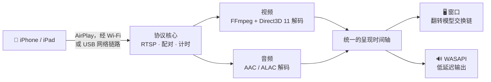

<div align="center">


# MirrorDock

**把 iPhone 或 iPad 的屏幕镜像到 Windows 电脑——走 Wi-Fi 或 USB 数据线都可以——还能用鼠标和键盘操作 iPhone。**

[](https://github.com/bestkakkoii/MirrorDock/releases/latest)
[](https://github.com/bestkakkoii/MirrorDock/releases)
[](https://github.com/bestkakkoii/MirrorDock/releases/latest)
[](README_AI.md)
[](LICENSE)
[](https://github.com/bestkakkoii/MirrorDock/stargazers)

[English](README.md) · [繁體中文](README.zh-TW.md) · **简体中文** · [日本語](README.ja.md) · [한국어](README.ko.md) · [Español](README.es.md) · [Deutsch](README.de.md) · [Français](README.fr.md) · [Tiếng Việt](README.vi.md) · [ไทย](README.th.md) · [Русский](README.ru.md)

</div>

---

MirrorDock 是一款运行在 Windows 上的 AirPlay 接收端。在 iPhone 的 *屏幕镜像* 里选中它，手机的画面和声音就会出现在电脑上，所在的窗口用起来和媒体播放器一样。整个软件只有一个 `mirror_dock.exe`：没有安装程序，不需要 GStreamer，不需要 Bonjour 服务，也没有运行时要配置。

它以 [UxPlay](https://github.com/FDH2/UxPlay) 的 AirPlay 协议核心为基础，搭配专为 Windows 编写的媒体引擎（Direct3D 11、FFmpeg、WASAPI）。1.6 及更早的版本曾以 *UxPlay for Windows (native)* 的名称发布。

## ✨ 亮点

| | |
|---|---|
| 📶 **Wi-Fi 镜像** | 手机和电脑连在同一个网络即可，两边都不用安装任何东西。 |
| 🔌 **USB 数据线镜像** | 打开 *个人热点* 后，AirPlay 直接走充电线：数据只在本地传输，连接稳定，也不消耗手机流量。 |
| 🎬 **清晰流畅的画面** | H.265 / H.264 由驱动显示器的那块 GPU（Intel、AMD 或 NVIDIA）解码，画面无需拷贝即可呈现，并按显示器的节奏输出。GPU 解不了的时候，自动改用软件解码。 |
| 🔊 **音画同步** | 低延迟的 WASAPI 输出与画面共用同一条时间轴，口型和声音对得上。 |
| 🎛️ **三种模式** | *画质优先*、*均衡*（默认）和 *性能优先*：要最清晰的画面还是最低的延迟，由你决定。 |
| ✂️ **裁剪黑边** | 自动裁掉影片四周的黑边，也可以用鼠标框选画面中的任意区域。 |
| 🖱️ **操作 iPhone** | 在画面上点击、拖动、滚动、打字，手机就照着做；操作期间画面不再等它的时间戳，会更快跟上你的手。功能内置：不用另装辅助程序，也不用越狱（需要 iOS 27、USB 数据线和开发者模式）。 |
| 🪟 **像样的窗口** | 以合适的大小打开，调整大小时保持画面比例，记住大小和位置，一键全屏，还能窗口置顶。 |
| 📸 **截图** | 按 **F9**，就把镜像画面以手机的完整分辨率保存为 PNG 文件，同时复制到剪贴板。 |
| 🌐 **十一种语言** | 界面语言跟随 Windows 的显示语言。 |
| 🩺 **了解你的电脑** | “关于”窗口会检查镜像要用到的各项（显卡、驱动、网络、防火墙、Apple 的 USB 支持），为它们评分，告诉你该修什么，能代劳的点一下按钮就修好。 |
| 🔄 **一键更新** | 有新版本时会提醒你，你同意就替你装上。每个版本都有签名，安装前会先验证。 |
| 🧳 **单文件** | 只有一个约 12 MB 的可执行文件，除了 Windows 本身什么都不依赖。 |

## 🚀 快速上手

1. 从 [Releases](https://github.com/bestkakkoii/MirrorDock/releases/latest) 下载 `mirror_dock_win64.zip`，解压到任意位置。
2. 运行 `mirror_dock.exe`。如果 Windows 防火墙弹出询问，请选择 **允许**（家庭网络属于 *专用* 网络）。
3. 在 iPhone 上：**控制中心 → 屏幕镜像 → MirrorDock@你的电脑名**。

软件常驻在通知区域（时钟旁边）。手机连接后才会出现视频窗口；关闭窗口只结束这一次镜像，在菜单里选择 **退出** 才会关闭软件。

> [!TIP]
> 系统要求：Windows 10 或 11（x64），以及支持 Direct3D 11 的 GPU。没有这样的 GPU 时，会使用内置的软件渲染器。

## 🔌 通过 USB 数据线镜像

1. 安装一次 Apple 的 USB 驱动：运行压缩包里的 `install_apple_usb_support.cmd`，或者从 Microsoft Store 安装 **Apple 设备**。
2. 在 iPhone 上打开 **设置 → 个人热点 → 允许其他人加入**，然后插上数据线。
3. 在 *屏幕镜像* 里选择 MirrorDock。控制栏会显示 **USB** 或 **Wi-Fi**，即当前实际使用的链路。

- **USB 优先 / 仅 Wi-Fi** 用来切换链路，不会去动 USB 设备，所以手机可以一直充着电。*仅 Wi-Fi* 是强制生效的：仍然从数据线进来的连接会被拒绝。
- **你的手机流量是安全的。** 镜像本身只在本地传输。如果 Windows 开始让电脑自己的上网流量走手机，MirrorDock 会察觉并提供一键修复（**节省手机流量**）。

## 🎛️ 模式

| 模式 | 作用 | 适用场景 |
|---|---|---|
| **画质优先** | 完整分辨率，缓冲稍多一些，不跳过任何一帧。 | 电影、幻灯片、文字 |
| **均衡** *（默认）* | 根据显示器、GPU 和网络状况自动调整。 | 日常使用 |
| **性能优先** | 更轻量的视频流（最高 1920×1080），缓冲最少，始终显示最新的一帧。 | 游戏、老旧电脑 |

可以在菜单里选择，也可以用 `-mode` 指定。时序方面的变化立即生效；视频流的分辨率则从下一次连接开始改变。

## ✂️ 裁剪黑边

在屏幕更宽的手机上播放 16:9 的影片，镜像过来的画面会带着黑边，因为手机镜像的是整个屏幕。

- **自动**（按 **C** 键）：裁掉黑边，窗口紧贴画面。一部影片接着另一部播放时，裁剪保持不变；如果黑边里出现了别的内容并且停留在那里（例如播放器的控制按钮），完整画面会在大约一秒内恢复。
- **手动**（按 **X** 键）：拖出一个框，圈住想看的部分。按 **Esc** 取消。

## 🖱️ 操作 iPhone

按 **F8**（或在菜单里选择 **用鼠标和键盘操作 iPhone**），画面就成了手机的屏幕：你在上面做什么，iPhone 就做什么。

| 在电脑上 | 在 iPhone 上 |
|---|---|
| 鼠标左键：单击、按住、拖动 | 一根手指：轻点、长按、轻扫 |
| 鼠标滚轮（按住 **Shift**：横向滚动） | 滚动指针下方的内容 |
| 鼠标中键 | 回到主屏幕 |
| 双击 | 照旧是进入 / 退出全屏；按住 **Alt** 再双击：在 iPhone 上轻点两下 |
| 键盘 | 在手机上打字，就像给手机接了一把键盘；**Ctrl** 相当于 ⌘，**Ctrl+空格** 切换手机的输入语言 |
| **Page Down** / **Page Up**、**Alt** + 方向键 | 快速滑动到下一页或上一页、下一个或上一个视频 |
| 鼠标右键 | 照旧是 MirrorDock 的菜单 |

需要满足的条件：

1. **iOS 27 或更高版本**，插着 **USB 数据线**，并且 iPhone 已经信任这台电脑。只有操作走数据线；画面仍然可以走 Wi-Fi。
2. 在 iPhone 上打开 **开发者模式**：*设置 → 隐私与安全性 → 开发者模式*。这个开关平时是隐藏的，要有开发工具提出请求才会出现；你第一次按 F8 时，MirrorDock 就会提出请求。
3. 第一次使用，以及每次 iOS 更新后的第一次，需要互联网连接：MirrorDock 会给手机装上 Apple 的 *开发者磁盘映像*，大约需要一分钟。

> [!NOTE]
> AirPlay 无法传递输入，所以操作走的是另一条路：iOS 的开发者服务，也就是 Xcode 用来操作真机的那一套。为了装上这些服务，MirrorDock 会从 [DeveloperDiskImage](https://github.com/doronz88/DeveloperDiskImage) 仓库下载 Apple 的映像，并请 Apple 的签名服务（`gs.apple.com`）针对你的手机为映像签名；这个过程会把手机的芯片编号告诉 Apple，和 Xcode 的做法完全一样。装好之后，操作不会再连接任何地方。

操作开启期间，窗口自己的命令优先：**F8**、**F9**、**F11**、**Alt+Enter**、**Alt+F4**、全屏时的 **Esc** 以及双击，仍然归窗口所有。双击的时候，第一下在第二下到来之前就已经作为一次轻点发到手机上了，所以有黑边时请双击黑边，或者改按 **F11**。控制栏不会出现，因为它会挡住手机屏幕的底部。

**操作时延迟更短。** iPhone 给画面和声音标上的时间，比它们实际送达的时刻晚一点（走 Wi-Fi 时，画面大约晚 85 毫秒），MirrorDock 平时会等到那个时间才播放。操作开启期间，两者只要来得及就尽早播放，彼此仍然同步，所以点下去之后的反应会更早出现在画面上。切换时会用几秒钟平滑地过渡，声音不会跳一下。

## ⌨️ 键盘和鼠标

| 操作 | 按键 |
|---|---|
| 进入 / 退出全屏 | **F**、**F11**、**Alt+Enter** 或双击；按 **Esc** 退出 |
| 自动裁剪黑边 | **C** |
| 框选要显示的区域 | **X** |
| 窗口置顶 | **T** |
| 静音（仅电脑端） | **M** |
| 截图（PNG 文件和剪贴板） | **F9** |
| 开启 / 关闭 iPhone 操作 | **F8** |
| 控制栏 | 把鼠标移到画面上 |
| 菜单 | 在画面任意位置单击右键 |

操作 iPhone 期间，字母键会输入到手机上；按 **F8** 就把它们还给窗口。截图保存在你的 *图片* 文件夹里的 *MirrorDock* 文件夹中，以日期和时间命名；大小是手机发来的分辨率，不是窗口的大小。

## 🔄 更新

菜单里的 **检查更新…** 会向 GitHub 询问最新版本，并把结果显示在“关于”窗口里。有新版本时，**立即更新** 会把它下载下来、验证，再替换正在运行的程序，然后程序自动重新启动；如果正在镜像，会等镜像结束才重新启动，或者等你点 **立即重新启动**。想自己解压的话，**下载** 照样会在浏览器中打开它的 zip 压缩包，**更新内容** 会打开它的发行说明。你没有要求，就不会安装任何东西。

- **自动检查。** 每天一次，有新版本时会弹出通知。在“关于”窗口里拨一下开关就能关掉。
- **发送了什么。** 只有一个发往 `api.github.com` 的请求。GitHub 能看到你的 IP 地址和客户端名称 `MirrorDock/<version>`，除此之外没有任何关于你或你的电脑的信息。
- **不走你的手机流量。** 在 Windows 标记为按流量计费的连接上，或者电脑正通过 iPhone 上网时，都不会自动检查。
- **只装真正的版本。** 每个版本都用一把不放在网上的密钥签名，MirrorDock 内置它的公钥。签名对不上的更新包，不管从哪里来，都不会安装。

## 🩺 “关于”与这台电脑

菜单里的 **关于…** 会打开一个独立的窗口，共有三页：

| 页面 | 显示的内容 |
|---|---|
| **关于** | 版本和发布日期、检查更新，以及项目主页、使用说明、许可证全文的链接 |
| **这台电脑** | 你的电脑上与 MirrorDock 有关的各项，一项一行：Windows、显示器、电源、网络、防火墙、处理器、内存、显卡及其视频解码、音频、显卡驱动、Apple 的 USB 支持、插着数据线的 iPhone |
| **组件** | 构建 MirrorDock 所用的每一个库和工具，附版本、日期和许可证，以及 MirrorDock 各个版本的发布日期 |

*这台电脑* 的每一行都会评为良好、需要注意或有问题。不是良好的那一行，会写明该怎么处理；MirrorDock 能代劳的，旁边还有按钮：让程序通过 Windows 防火墙、启动 Apple 的服务、安装 Apple 的 USB 支持，或者打开 Windows“设置”里处理那件事的页面。需要管理员权限的部分，由 Windows 自己的工具在平时那个确认提示之后完成。评分是“参与评级的各行里，没有问题的占多少”，并按各项对镜像的重要程度加权（视频硬件解码的权重最大）。它反映的是这台电脑准备得好不好，不是跑分。**复制报告** 会把这一页以纯文本的形式放到剪贴板，方便反馈问题。这一页的内容不会离开你的电脑，也不会显示或保存任何序列号或设备名称。

## ⚙️ 选项

把选项加到 `mirror_dock.exe` 的快捷方式里，或者写进 `%USERPROFILE%\.uxplayrc`，每行一个（不带开头的 `-`）。运行 `mirror_dock.exe -h` 可以列出全部选项。

| 选项 | 作用 |
|---|---|
| `-n name` | 在 iPhone 上显示的名称 |
| `-fs` | 启动后直接全屏 |
| `-mode quality\|balanced\|performance` | 优化的侧重点 |
| `-crop auto\|off` | 裁掉黑边 / 显示完整画面 |
| `-gpu auto\|integrated\|discrete\|software` | 用于解码和显示的 GPU |
| `-h264` / `-h265` | 只提供 H.264 / 始终提供 H.265 |
| `-ui language` | 界面语言（见下文） |
| `-vsync ms` | 让声音相对画面提前或延后 |
| `-pin`, `-pw` | 要求输入 PIN 或密码 |

## 🌐 语言

界面语言跟随 Windows 的显示语言：English、繁體中文、简体中文、日本語、한국어、Español、Deutsch、Français、Tiếng Việt、ไทย 和 Русский。其他语言一律显示英文。也可以用 `-ui en|zh-TW|zh-CN|ja|ko|es|de|fr|vi|th|ru` 强制指定。

压缩包里附有全部十一种语言的使用说明（`user_guide` 文件夹）。

## 🧩 工作原理



画面和声音在同一条时间轴上调度，延迟会随网络状况和电脑的解码速度自动调整：在不卡顿的前提下尽可能短。

操作则是另一条独立的通路。MirrorDock 通过 USB 数据线打开手机的开发者隧道（自带一套精简的 IPv6 和 TCP 实现，所以不需要网卡，也不需要管理员权限），再把触控和键盘报告发送到手机的输入服务。

## 📊 实测数据

一台 2016 年的笔记本电脑（Intel Core i7-6700HQ，Intel HD Graphics 530），2872×1320、60 fps 的 H.265 测试流，*均衡* 模式，1.6 版：

| | |
|---|---|
| 测试流中实际显示的帧数 | 480 帧（共 480 帧） |
| 稳定状态下的音画延迟 | 约 18 ms |
| 空闲时的内存占用 | 46 MB |
| 退出耗时 | 0.04 秒 |

Wi-Fi 镜像和 USB 镜像已用 iPhone 16 Pro Max（iOS 26）验证，覆盖到 1.5 版为止；1.7 版也已经用这部手机通过 Wi-Fi 实际运行过：它的 3200×1536 视频流占用了约 310 MB 内存和 200 MB 显存。每个版本中哪些内容用手机测试过、哪些只是通过了编译，都记在 [CHANGELOG.md](CHANGELOG.md) 里。

## ❓ 常见问题

**iPhone 的列表里没有我的电脑。**
两台设备必须在同一个网络中，并且 Windows 防火墙要放行 `mirror_dock.exe`。“关于”窗口的 *这台电脑* 页会告诉你，是不是防火墙或者被设成 *公用* 的网络挡了路，那一页的按钮可以直接让 MirrorDock 通过防火墙。把 iPhone 的 Wi-Fi 关掉再打开，可以刷新列表。

**数据线已经插上，镜像却还在走 Wi-Fi。**
必须打开个人热点，并且链路要选 *USB 优先*。菜单的第二行会显示 USB 链路的状态。

**没有声音。**
先看控制栏上的扬声器按钮，再检查 Windows 的音量合成器。

**口型和声音对不上。**
用 `-vsync` 加一个毫秒数来微调（正值让声音延后）。

**按了 F8，却提示无法操作 iPhone。**
提示信息会说明原因：没插数据线或还没有信任这台电脑、开发者模式没有打开、iPhone 的 iOS 版本低于 27，或者开发者磁盘映像没能装上（这一步需要联网）。打开开发者模式后，iPhone 会重新启动，并再次请你确认。

**开发者模式一直开着安全吗？**
这是 Apple 自己为开发 App 的人准备的开关。它允许受信任的电脑安装和调试 App，并访问开发者服务；它不会让手机越狱，想关的时候回到同一个地方关掉就行。

**MirrorDock 会联网吗？**
镜像本身只在本地传输。MirrorDock 只在两件事上需要联网：更新（每天向 GitHub 检查一次，可以关掉；以及在你要求时下载新版本），以及第一次操作 iPhone 时，下载 Apple 的开发者磁盘映像并获取 Apple 为它出具的签名。

**日志在哪里？**
`%LOCALAPPDATA%\MirrorDock\mirror_dock.log`，或者在菜单里选择 **打开日志**。

## 🛠️ 从源码构建

需要 MSYS2 CLANG64（clang 23、带 C++26 标准库模块的 libc++、CMake 4.4、Ninja）和 Windows SDK 的着色器编译器。FFmpeg、OpenSSL 和 libplist 会从锁定的提交构建为静态库；这些锁定的提交记录在 `win_native/build_scripts/build_inputs.tsv` 中，也就是“关于”窗口显示的那份清单。如果你自己构建的程序要从你自己的发布更新，就需要你自己的签名密钥：见 `win_native/build_scripts/sign_release.ps1`。

```sh
bash win_native/build_scripts/fetch_deps.sh <src_root>
MSYSTEM=CLANG64 bash -lc 'bash win_native/build_scripts/build_deps.sh <src_root> <prefix> libplist openssl ffmpeg'
MSYSTEM=CLANG64 bash -lc 'bash win_native/build_scripts/build_uxplay_native.sh <this_repo> <build_dir> <prefix> Release'
```

[README_AI.md](README_AI.md) 记录了架构、不变量、锁定的输入以及已经验证过的内容。[CHANGELOG.md](CHANGELOG.md) 列出了各个发布版本。

## 📜 许可证

MirrorDock 以 **GNU General Public License v3**（[LICENSE](LICENSE)）发布，因为它构建在 UxPlay 的 GPL-3.0 代码之上。[`win_native/`](win_native) 中的 Windows 媒体引擎是原创作品，采用 **MIT 许可证**（[win_native/LICENSE](win_native/LICENSE)）；[`phone_control/`](phone_control) 中的操作功能同样是原创作品，采用 **GPL-3.0-or-later**。发布的压缩包里包含所有捆绑库的许可证文本，以及完整的对应源代码。

## 🙏 致谢

- [UxPlay](https://github.com/FDH2/UxPlay)，作者 F. Duncanh 及各位贡献者——MirrorDock 所基于的 AirPlay 服务器。
- [RPiPlay](https://github.com/FD-/RPiPlay)（作者 Florian Draschbacher）和 [shairplay](https://github.com/juhovh/shairplay)（作者 Juho Vähä-Herttua）——这套协议核心的来源。
- [pymobiledevice3](https://github.com/doronz88/pymobiledevice3)，作者 doronz88 及各位贡献者——操作功能所依据的 iOS 开发者服务知识，就来自这个项目。
- playfair、llhttp、csrp、FFmpeg、OpenSSL 和 libplist。

AirPlay、iPhone 和 iPad 是 Apple Inc. 的商标。MirrorDock 是独立的开源项目，与 Apple 没有任何关联。
