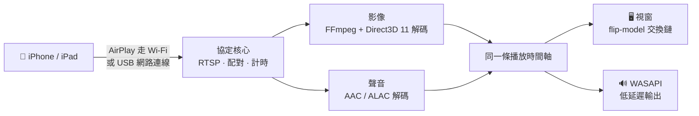

<div align="center">


# MirrorDock

**把 iPhone 或 iPad 的畫面投到 Windows 電腦 —— 走 Wi-Fi，或直接走 USB 線 —— 還能用滑鼠和鍵盤操作 iPhone。**

[](https://github.com/bestkakkoii/MirrorDock/releases/latest)
[](https://github.com/bestkakkoii/MirrorDock/releases)
[](https://github.com/bestkakkoii/MirrorDock/releases/latest)
[](README_AI.md)
[](LICENSE)
[](https://github.com/bestkakkoii/MirrorDock/stargazers)

[English](README.md) · **繁體中文** · [简体中文](README.zh-CN.md) · [日本語](README.ja.md) · [한국어](README.ko.md) · [Español](README.es.md) · [Deutsch](README.de.md) · [Français](README.fr.md) · [Tiếng Việt](README.vi.md) · [ไทย](README.th.md) · [Русский](README.ru.md)

</div>

---

MirrorDock 是 Windows 上的 AirPlay 接收器。在 iPhone 的「螢幕鏡像輸出」選它，手機的畫面和聲音就會出現在電腦上，視窗用起來就像一般的影片播放器。整個程式只有一個 `mirror_dock.exe`：不用安裝，不需要 GStreamer、Bonjour 服務，也沒有任何執行環境要先裝好。

它以 [UxPlay](https://github.com/FDH2/UxPlay) 的 AirPlay 協定核心為基礎，搭配專為 Windows 寫的媒體引擎（Direct3D 11、FFmpeg、WASAPI）。1.6 版以前，它以「UxPlay for Windows (native)」的名稱發布。

## ✨ 特色

| | |
|---|---|
| 📶 **Wi-Fi 鏡像** | 手機和電腦連上同一個網路就能用，兩邊都不必安裝任何東西。 |
| 🔌 **USB 線鏡像** | 打開「個人熱點」後，AirPlay 直接走充電線：本地傳輸、穩定，而且不耗行動數據。 |
| 🎬 **畫面清晰流暢** | H.265／H.264 由驅動螢幕的那張顯示卡解碼（Intel、AMD、NVIDIA 都可以），不經複製直接顯示，並配合螢幕的更新節奏。顯示卡無法解碼時自動改用軟體解碼。 |
| 🔊 **聲音對得上嘴型** | WASAPI 低延遲輸出，和畫面共用同一條時間軸，音畫同步。 |
| 🎛️ **三種模式** | 「畫質優先」、「平衡」（預設）與「效能全開」：要最細緻的畫面還是最低的延遲，由你決定。 |
| ✂️ **裁切黑邊** | 自動切掉影片四周的黑邊，也可以用滑鼠框出想看的範圍。 |
| 🖱️ **操作 iPhone** | 在畫面上點擊、拖曳、捲動、打字，手機就照著做；操作期間畫面不再等它的時間戳，會更快跟上你的手。功能內建：不必另裝輔助程式，也不用越獄（需要 iOS 27、USB 線與開發者模式）。 |
| 🪟 **像樣的視窗** | 開啟時大小適中，縮放時維持比例，會記住大小與位置，一鍵全螢幕，可設為最上層顯示。 |
| 📸 **截圖** | 按 **F9**，就把鏡像畫面以手機的完整解析度存成 PNG 檔，同時複製到剪貼簿。 |
| 🌐 **十一種語言** | 介面跟著 Windows 的顯示語言走。 |
| 🩺 **了解你的電腦** | 「關於」視窗會檢查鏡像用得到的東西（顯示卡、驅動程式、網路、防火牆、Apple 的 USB 支援），替它們評分，告訴你該修什麼，能代勞的按一下按鈕就修好。 |
| 🔄 **一鍵更新** | 有新版本時會通知你，你說好就替你裝上。每個版本都有簽章，安裝前會先驗證。 |
| 🧳 **單一檔案** | 約 12 MB 的執行檔，只需要 Windows 本身。 |

## 🚀 快速上手

1. 從 [Releases](https://github.com/bestkakkoii/MirrorDock/releases/latest) 下載 `mirror_dock_win64.zip`，解壓縮到任何位置。
2. 執行 `mirror_dock.exe`。Windows 防火牆若跳出詢問，請選**允許**（家用網路屬於「私人」網路）。
3. 在 iPhone 上：**控制中心 → 螢幕鏡像輸出 → MirrorDock@你的電腦名稱**。

程式常駐在通知區域（時鐘旁邊）。手機連上後才會出現畫面視窗；關掉視窗只會結束這次鏡像，要結束程式請選選單裡的**結束**。

> [!TIP]
> 系統需求：Windows 10 或 11（x64），以及支援 Direct3D 11 的顯示卡。沒有的話會改用內建的軟體繪圖。

## 🔌 用 USB 線鏡像

1. 安裝 Apple 的 USB 驅動程式（只需一次）：執行壓縮檔裡的 `install_apple_usb_support.cmd`，或從 Microsoft Store 安裝 **Apple 裝置**。
2. 在 iPhone 打開**設定 → 個人熱點 → 允許其他人加入**，再接上傳輸線。
3. 在「螢幕鏡像輸出」選 MirrorDock。控制列會顯示目前走的是 **USB** 還是 **Wi-Fi**。

- **USB 優先／僅 Wi-Fi** 切換的只是走哪條路，不會動到 USB 裝置，所以手機照樣充電。「僅 Wi-Fi」是說到做到：仍然從傳輸線連進來的連線會被拒絕。
- **不必擔心行動數據。** 鏡像本身是本地傳輸。萬一 Windows 開始讓電腦自己的上網流量走手機，MirrorDock 會發現並提供一鍵修正（**省行動數據**）。

## 🎛️ 模式

| 模式 | 作用 | 適合 |
|---|---|---|
| **畫質優先** | 完整解析度，多保留一點緩衝，不跳過任何畫面。 | 影片、簡報、文字 |
| **平衡**（預設） | 依螢幕、顯示卡與網路狀況自動調整。 | 日常使用 |
| **效能全開** | 較輕的串流（最高 1920×1080），緩衝減到最少，永遠顯示最新的畫面。 | 遊戲、較舊的電腦 |

在選單裡選，或用 `-mode` 指定。延遲的部分立即生效；串流解析度則從下一次連線開始改變。

## ✂️ 裁切黑邊

在螢幕比較寬的手機上播 16:9 的影片，鏡像過來的畫面會帶著黑邊，因為手機鏡像的是它的整個螢幕。

- **自動**（按 **C**）：切掉黑邊，視窗剛好貼齊畫面。換到下一部影片時裁切會保持；黑邊裡出現別的內容而且沒有馬上消失（例如播放器的控制列），大約一秒內就恢復完整畫面。
- **手動**（按 **X**）：用滑鼠框出你想看的範圍。按 **Esc** 取消。

## 🖱️ 操作 iPhone

按 **F8**（或在選單選**用滑鼠和鍵盤操作 iPhone**），畫面就成了手機的螢幕：你在上面做什麼，iPhone 就做什麼。

| 在電腦上 | 在 iPhone 上 |
|---|---|
| 滑鼠左鍵：點一下、按住、拖曳 | 一根手指：點一下、長按、滑動 |
| 滑鼠滾輪（按住 **Shift**：左右） | 捲動游標底下的內容 |
| 滑鼠中鍵 | 回主畫面 |
| 按兩下 | 照舊是進入／離開全螢幕；按住 **Alt** 再按兩下：在 iPhone 上點兩下 |
| 鍵盤 | 在手機上打字，就像接了一把鍵盤；**Ctrl** 等於 ⌘，**Ctrl+空白鍵** 切換手機的輸入語言 |
| **Page Down**／**Page Up**、**Alt** + 方向鍵 | 輕滑到下一頁或上一頁、下一部或上一部影片 |
| 滑鼠右鍵 | 照舊是 MirrorDock 的選單 |

需要的條件：

1. **iOS 27 以上**，接著 **USB 線**，並且已經信任這台電腦。只有操作走這條線；畫面照樣可以走 Wi-Fi。
2. iPhone 打開**開發者模式**：*設定 → 隱私權與安全性 → 開發者模式*。這個開關平常是藏起來的，要有開發工具提出要求才會出現；你第一次按 F8 時，MirrorDock 就會提出。
3. 第一次使用，以及每次 iOS 更新後的第一次，電腦需要連上網際網路：MirrorDock 會替手機裝上 Apple 的「開發者磁碟映像檔」，大約一分鐘。

> [!NOTE]
> AirPlay 沒辦法傳送輸入，所以操作走的是另一條路：iOS 的開發者服務，也就是 Xcode 用來操作實機的那一套。為了裝上這套服務，MirrorDock 會從 [DeveloperDiskImage](https://github.com/doronz88/DeveloperDiskImage) 儲存庫下載 Apple 的映像檔，並請 Apple 的簽署服務（`gs.apple.com`）為你的手機簽署，過程中會把手機的晶片編號告訴 Apple，和 Xcode 的做法完全一樣。裝好之後，操作不會再連到任何地方。

操作開啟時，視窗自己的指令優先：**F8**、**F9**、**F11**、**Alt+Enter**、**Alt+F4**、全螢幕時的 **Esc**，以及按兩下，都仍然歸視窗所有。按兩下的時候，第一下在第二下到來之前就已經當成點一下送到手機了，所以有黑邊時請按在黑邊上，或改按 **F11**。控制列不會出現，因為它會擋住手機螢幕的底部。

**操作時延遲更短。**iPhone 替畫面和聲音標上的時間，比它們實際送達的時刻晚一點（走 Wi-Fi 時，畫面大約晚 85 毫秒），MirrorDock 平常會等到那個時間才播放。操作開啟時，兩者只要來得及就盡早播放，彼此仍然同步，所以點下去之後的反應會更早出現在畫面上。切換時會用幾秒鐘平順地滑過去，聲音不會跳一下。

## ⌨️ 鍵盤與滑鼠

| 動作 | 按鍵 |
|---|---|
| 進入／離開全螢幕 | **F**、**F11**、**Alt+Enter** 或按兩下；**Esc** 離開 |
| 自動裁切黑邊 | **C** |
| 框選要顯示的範圍 | **X** |
| 最上層顯示 | **T** |
| 靜音（只影響電腦這一端） | **M** |
| 截圖（PNG 檔與剪貼簿） | **F9** |
| 開啟／關閉操作 iPhone | **F8** |
| 控制列 | 把滑鼠移到畫面上 |
| 選單 | 在畫面上任意處按右鍵 |

操作 iPhone 的時候，字母鍵會打到手機上；按 **F8** 就把它們還給視窗。截圖存在你的*圖片*資料夾裡的 *MirrorDock* 資料夾，以日期和時間命名；大小是手機送來的解析度，不是視窗的大小。

## 🔄 更新

選單裡的**檢查更新…**會向 GitHub 詢問最新版本，結果顯示在「關於」視窗。有新版本時，**立即更新**會把它抓下來、驗證，再換掉正在執行的程式，然後程式自己重新啟動；如果正在鏡像，會等鏡像結束才重新啟動，或等你按**立即重新啟動**。想自己解壓縮的話，**下載**照樣會用瀏覽器開啟它的 zip 檔，**更新內容**則開啟它的版本說明。你沒有要求，就不會安裝任何東西。

- **自動檢查。**每天一次，有新版本時會跳出通知。在「關於」視窗撥一個開關就能關掉。
- **送出了什麼。**只有一個送往 `api.github.com` 的要求。GitHub 看得到你的 IP 位址和用戶端名稱 `MirrorDock/<version>`，除此之外沒有任何關於你或這台電腦的資料。
- **不走你的行動數據。**Windows 標示為計量付費的連線，或電腦正經由 iPhone 上網時，都不會自動檢查。
- **只裝真正的版本。**每個版本都用一把不放在網路上的金鑰簽章，MirrorDock 內建它的公開金鑰。簽章對不上的更新檔，不管從哪裡來，都不會安裝。

## 🩺 「關於」與這台電腦

選單裡的**關於…**會開啟一個獨立的視窗，共有三頁：

| 分頁 | 內容 |
|---|---|
| **關於** | 版本與發布日期、檢查更新，以及專案、使用說明、授權條款全文的連結 |
| **這台電腦** | 你的電腦上和 MirrorDock 有關的每一項，一項一列：Windows、顯示器、電源、網路、防火牆、處理器、記憶體、顯示卡與它的影片解碼、音訊、顯示卡驅動程式、Apple 的 USB 支援、接在線上的 iPhone |
| **元件** | MirrorDock 用到的每一個程式庫與工具，附版本、日期與授權，以及 MirrorDock 各版本的發布日期 |

「這台電腦」的每一列都會標成良好、需要注意或有問題。不是良好的那一列，會寫出該怎麼處理；MirrorDock 能代勞的，旁邊還有按鈕：讓程式通過 Windows 防火牆、啟動 Apple 的服務、安裝 Apple 的 USB 支援，或開啟 Windows「設定」裡處理那件事的頁面。需要系統管理員權限的部分，由 Windows 自己的工具在平常那個確認提示之後完成。評分是「有評等的各列當中，沒問題的占多少」，並依各項對鏡像的重要程度加權（影片硬體解碼占最重）。它說的是這台電腦準備得好不好，不是跑分。**複製報告**會把這一頁以純文字放到剪貼簿，方便回報問題。這一頁的內容不會離開你的電腦，也不會顯示或儲存任何序號或裝置名稱。

## ⚙️ 選項

把選項加在 `mirror_dock.exe` 的捷徑後面，或一行一個（不加開頭的 `-`）寫進 `%USERPROFILE%\.uxplayrc`。執行 `mirror_dock.exe -h` 可以列出全部選項。

| 選項 | 作用 |
|---|---|
| `-n name` | iPhone 上顯示的名稱 |
| `-fs` | 啟動後直接全螢幕 |
| `-mode quality\|balanced\|performance` | 以什麼為優先 |
| `-crop auto\|off` | 切掉黑邊／顯示完整畫面 |
| `-gpu auto\|integrated\|discrete\|software` | 解碼與顯示用的顯示卡 |
| `-h264` / `-h265` | 只提供 H.264／一律提供 H.265 |
| `-ui language` | 介面語言（見下方） |
| `-vsync ms` | 讓聲音相對畫面提前或延後 |
| `-pin`、`-pw` | 需要 PIN 碼或密碼才能連線 |

## 🌐 語言

介面跟著 Windows 的顯示語言走：English、繁體中文、简体中文、日本語、한국어、Español、Deutsch、Français、Tiếng Việt、ไทย 與 Русский。其他語言一律顯示英文。想固定某一種，用 `-ui en|zh-TW|zh-CN|ja|ko|es|de|fr|vi|th|ru`。

壓縮檔裡附有這十一種語言的使用說明（`user_guide` 資料夾）。

## 🧩 運作方式



畫面和聲音排在同一條時間軸上，延遲會隨著網路狀況和電腦的解碼速度自動調整：在不卡頓的前提下盡可能短。

操作則是另一條獨立的路。MirrorDock 透過 USB 線開啟手機的開發者通道（自帶一套精簡的 IPv6 與 TCP 實作，所以不需要網路介面卡，也不需要系統管理員權限），再把觸控與鍵盤報告送到手機的輸入服務。

## 📊 實測數據

一台 2016 年的筆電（Intel Core i7-6700HQ、Intel HD Graphics 530），2872×1320、60 fps 的 H.265 測試串流，「平衡」模式，1.6 版：

| | |
|---|---|
| 測試串流顯示的畫面數 | 480 張中的 480 張 |
| 平時的音畫延遲 | 約 18 毫秒 |
| 閒置時的記憶體 | 46 MB |
| 結束程式 | 0.04 秒 |

Wi-Fi 與 USB 鏡像在 1.5 版以前已用 iPhone 16 Pro Max（iOS 26）實機驗證，1.7 版也已用同一支手機透過 Wi-Fi 實際運作：它的 3200×1536 串流約占用 310 MB 記憶體與 200 MB 顯示記憶體。每個版本哪些部分做過實機測試、哪些只通過編譯，都寫在 [CHANGELOG.md](CHANGELOG.md)。

## ❓ 常見問題

**iPhone 的清單裡找不到我的電腦。**
兩者必須在同一個網路上，而且 Windows 防火牆要允許 `mirror_dock.exe`。「關於」視窗的*這台電腦*分頁會告訴你，是不是防火牆或被設成*公用*的網路擋住了，那一頁的按鈕可以直接讓 MirrorDock 通過防火牆。把 iPhone 的 Wi-Fi 關掉再打開，可以重新整理清單。

**線已經接上了，鏡像卻還是走 Wi-Fi。**
個人熱點必須打開，而且連線方式要選「USB 優先」。選單的第二行會顯示 USB 連線的狀態。

**沒有聲音。**
先看控制列上的喇叭按鈕，再看 Windows 的音量混音程式。

**聲音和嘴型對不上。**
用 `-vsync` 加上毫秒數微調（正數會讓聲音延後）。

**按了 F8，卻說無法操作 iPhone。**
訊息會說明原因：沒接線或還沒信任這台電腦、開發者模式沒開、iPhone 的 iOS 比 27 舊，或是開發者磁碟映像檔裝不上去（這一步需要網路）。打開開發者模式之後，iPhone 會重新開機，並再請你確認一次。

**開發者模式一直開著安全嗎？**
這是 Apple 自己為開發 App 的人準備的開關。它讓你信任的電腦可以安裝、偵錯 App，並使用開發者服務；它不是越獄，想關掉時回到同一個地方關掉就行。

**MirrorDock 會連上網際網路嗎？**
鏡像本身只在你的區域網路或 USB 線上進行。MirrorDock 只有兩件事會上網：更新（每天向 GitHub 檢查一次，可以關掉；以及在你要求時下載新版本），以及第一次操作 iPhone 時，下載 Apple 的開發者磁碟映像檔並取得 Apple 的簽署。

**記錄檔在哪裡？**
在 `%LOCALAPPDATA%\MirrorDock\mirror_dock.log`，或從選單選**開啟記錄檔**。

## 🛠️ 從原始碼建置

需要 MSYS2 CLANG64（clang 23、附 C++26 標準程式庫模組的 libc++、CMake 4.4、Ninja）與 Windows SDK 的著色器編譯器。FFmpeg、OpenSSL 與 libplist 會從固定的提交版本建置成靜態程式庫；這些固定版本記在 `win_native/build_scripts/build_inputs.tsv`，也就是「關於」視窗顯示的那份清單。如果你自己建置的程式要從你自己的發布更新，就需要你自己的簽章金鑰：見 `win_native/build_scripts/sign_release.ps1`。

```sh
bash win_native/build_scripts/fetch_deps.sh <src_root>
MSYSTEM=CLANG64 bash -lc 'bash win_native/build_scripts/build_deps.sh <src_root> <prefix> libplist openssl ffmpeg'
MSYSTEM=CLANG64 bash -lc 'bash win_native/build_scripts/build_uxplay_native.sh <this_repo> <build_dir> <prefix> Release'
```

[README_AI.md](README_AI.md) 記錄了架構、設計上的不變條件、固定的相依版本，以及哪些部分驗證過。[CHANGELOG.md](CHANGELOG.md) 列出各個版本。

## 📜 授權

MirrorDock 以 **GNU General Public License v3**（[LICENSE](LICENSE)）發布，因為它建立在 UxPlay 的 GPL-3.0 程式碼之上。[`win_native/`](win_native) 裡的 Windows 媒體引擎是原創作品，採用 **MIT 授權**（[win_native/LICENSE](win_native/LICENSE)）；[`phone_control/`](phone_control) 裡的操作功能也是原創作品，採用 **GPL-3.0-or-later**。發布的壓縮檔內含所有隨附程式庫的授權條文，以及完整的對應原始碼。

## 🙏 致謝

- [UxPlay](https://github.com/FDH2/UxPlay)，作者 F. Duncanh 與各位貢獻者 —— MirrorDock 所依據的 AirPlay 伺服器。
- [RPiPlay](https://github.com/FD-/RPiPlay)（Florian Draschbacher）與 [shairplay](https://github.com/juhovh/shairplay)（Juho Vähä-Herttua）—— 這套協定核心的源頭。
- [pymobiledevice3](https://github.com/doronz88/pymobiledevice3)，作者 doronz88 與各位貢獻者 —— 操作功能所依據的 iOS 開發者服務知識，都來自這個專案。
- playfair、llhttp、csrp、FFmpeg、OpenSSL 與 libplist。

AirPlay、iPhone 與 iPad 是 Apple Inc. 的商標。MirrorDock 是獨立的開源專案，與 Apple 沒有任何關係。
